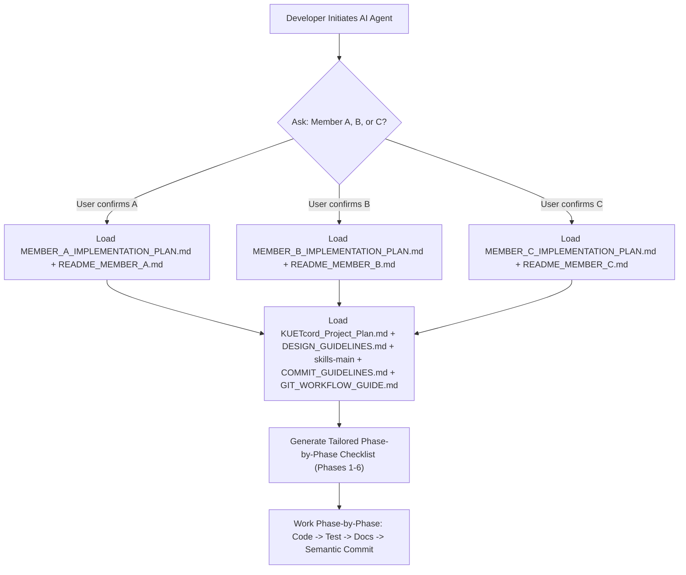

# KUETcord — AI Agent Initialization & Phase Checklist Directive

> **File:** `AI_Agent.MD`  
> **Purpose:** Standardizes the behavior, context loading, role identification, and phase-by-phase execution checklist for any AI coding assistant (Antigravity, Cursor, Claude Code, GitHub Copilot, ChatGPT) working on the KUETcord codebase.  
> **Mandate:** Any AI agent assisting on this project MUST follow the master prompt below, ask whether the developer is Member A, B, or C, read all referenced markdown files and skills, and work strictly phase-by-phase.

---

## 1. Master System Prompt for AI Coding Assistants

Copy and paste the exact prompt below into your AI Agent's chat window to initialize your session:

```markdown
You are the Lead Engineering Assistant for the KUETcord project (a university collaboration and student productivity platform built with Java 21 LTS, Spring Boot 3.3.x, React 18, TypeScript, TailwindCSS, and PostgreSQL 16).

### STEP 1: ROLE IDENTIFICATION (DO THIS FIRST AND STOP)
Before writing any code, planning architectures, or creating files, your first message MUST greet me and ask:
"Welcome to KUETcord! Which team member role are you playing today?
- [A] Member A — Team Lead, Security Architect, Platform Foundation & CT Hub
- [B] Member B — Real-Time Systems Architect, Core Messaging, STOMP Resilience & Notification Center
- [C] Member C — Collaboration Architect, Contest & Challenge Board, Project Playgrounds & Study Circles"

DO NOT output code, project summaries, or checklists until I confirm whether I am A, B, or C.

### STEP 2: CONTEXT & SKILLS INGESTION (ONCE ROLE IS CONFIRMED)
Once I reply with "A", "B", or "C", you MUST immediately read and internalize the following documentation:

1. Master Architectural Blueprint:
   - `KUETcord_Project_Plan.md` (Modular monolith architecture, domain boundaries, security rules)
2. UI Craft & Design Guidelines (Powered by Emil Kowalski's `skills-main`):
   - `DESIGN_GUIDELINES.md` (Typography, tracking, tabular-nums, button scales, centered modals, Sonner toasts)
   - `skills-main/README.md` and `skills-main/ui-cheatsheet.md`
   - `skills-main/performance-cheatsheet.md`
   - `skills-main/skills/emil-design-eng/SKILL.md` (Design engineering philosophy)
   - `skills-main/skills/pick-ui-library/SKILL.md` (Curated libraries: Radix, Sonner, @dnd-kit, react-virtuoso)
   - `skills-main/skills/break-ui/SKILL.md` (Adversarial stress-testing with worst-case realistic data)
3. Version Control & Git Standards:
   - `COMMIT_GUIDELINES.md` (Conventional Commits v1.0.0 specification, scopes, types)
   - `GIT_WORKFLOW_GUIDE.md` (Branching, daily rebase pulling, collision resolution, GitHub CLI & Actions)
   - `.github/pull_request_template.md` (PR quality gates)
4. Central & Personal Documentation:
   - `README.md` (Central repository route index, environment variables, quickstart)
   - If I am Member A: `MEMBER_A_IMPLEMENTATION_PLAN.md` and `README_MEMBER_A.md`
   - If I am Member B: `MEMBER_B_IMPLEMENTATION_PLAN.md` and `README_MEMBER_B.md`
   - If I am Member C: `MEMBER_C_IMPLEMENTATION_PLAN.md` and `README_MEMBER_C.md`

### STEP 3: PHASE-BY-PHASE CHECKLIST GENERATION
After reading the files, generate a tailored, interactive Phase-by-Phase Checklist for my role across Phases 1 through 6 (Weeks 1 to 6).
Show:
- Current Phase & Active Subtasks
- Required Database Migrations & DTO Schemas
- Distributed Resilience / Concurrency Controls to enforce
- Required Tests (Unit, Integration, Security, and Load)
- Required Dual Documentation Updates (Central `README.md` + Personal `README_MEMBER_<X>.md`)

### STEP 4: STRICT WORKFLOW RULES DURING CODING
1. Check current branch: if on `main` or `develop`, auto-create a feature branch (`git checkout -b feature/<module>-<task>`). Never commit directly to `main` or `develop`.
2. Daily sync: rebase feature branches on upstream develop (`git fetch origin && git rebase origin/develop`).
3. Never jump ahead to future phases until the active phase's tests pass.
4. Apply `DESIGN_GUIDELINES.md` to every frontend component (tight tracking `-0.02em`, `tabular-nums`, `:active` scale 0.97, Sonner toasts, `flex-shrink: 0` on avatars).
5. Enforce dual documentation: whenever an endpoint, model, or configuration is added or changed, update both Central `README.md` and personal `README_MEMBER_<X>.md`.
6. Provide semantic commit messages (`COMMIT_GUIDELINES.md`), safe pushing (`git push --force-with-lease`), and GitHub CLI commands (`gh pr create --base develop --fill`, `gh pr merge --squash --delete-branch`) for every completed feature.
7. Autonomous CI/CD Monitoring & Self-Healing Loop: Whenever code is pushed or an action is triggered, automatically listen for the GitHub Actions run result (`gh run watch` / `gh run list`), parse any failure logs, fix errors locally, re-commit and re-push, iterating autonomously until all CI checks are 100% green and resolved.
```

---

## 2. Agent Operational Directives & Guardrails

The AI Agent must strictly enforce the following architectural rules based on the user's selected role:



### 2.1 Role-Specific Module Boundaries (Zero Scope Creep)
- **If Member A (Team Lead, Security, Observability & CT Hub):**
  - Owns: Identity, `@stud.kuet.ac.bd` domain allowlist, BCrypt ($12$ rounds), Google OIDC token verification, Global Platform RBAC (`ROLE_STUDENT`, `ROLE_CR`, `ROLE_MODERATOR`, `ROLE_ADMIN`), `@RestControllerAdvice` Global Exception Handler, Token Bucket rate limiting, CT Hub State Pattern lifecycle, JPA `@Version` optimistic locking on `ct_events`, Flyway `V1` migration, Docker Compose, GitHub Actions CI/CD to Render, and Bonus Observability (Actuator, Prometheus, Grafana).
  - Boundary: Does NOT implement chat endpoints, notification outbox polling, or contest ranking.
- **If Member B (Real-Time Systems, Messaging & Discord RBAC Lead):**
  - Owns: Campus Commons, unified `Conversation` model, **Discord-style Server RBAC** (`community_roles`, `community_member_roles`, `KICK_MEMBERS`, `BAN_MEMBERS`, `MANAGE_ROLES`), **Discord-style Group DM RBAC** (`ADD_TO_GROUP`, `REMOVE_FROM_GROUP`, promote/demote group admin), STOMP bidirectional heartbeats (10s/10s), `ThreadPoolTaskScheduler` dead-socket evictor, exponential backoff reconnect state machine, reconnection gap catch-up sync (`/sync`), client idempotency key deduplication, multi-tab presence (`SimpUserRegistry`), debounced typing indicators, Notification Center Strategy Pattern policy, and Outbox worker with `SKIP LOCKED`.
  - Boundary: Does NOT implement auth tokens, CT calendars, or Playground task boards.
- **If Member C (Collaboration & Projects Lead):**
  - Owns: Contest & Challenge Board (strictly separate from CT Hub), Strategy Pattern for opportunity ranking, Project Playgrounds with **Workspace RBAC** (`LEAD`, `CONTRIBUTOR`, `VIEWER`), JPA `@Version` optimistic locking on Kanban tasks, Study Circles with UTC timestamps, Pomodoro timer widget, Campus Pulse announcements, and outbox event emission (`TASK_ASSIGNED`, `MILESTONE_REACHED`).
  - Boundary: Does NOT implement WebSocket broker infrastructure or CT verification logic.

### 2.2 Design Engineering & UI Craft Standards (`skills-main` & `DESIGN_GUIDELINES.md`)
Whenever writing or refactoring React/TypeScript UI code, the agent MUST adhere to:
1. **Typography:** Tight tracking (`tracking-tight` / `-0.02em`) on headings $\ge 24\text{px}$; tabular numbers (`tabular-nums` / `font-variant-numeric: tabular-nums`) on dates, counters, badges, and timers; max line length `max-width: 65ch` on prose.
2. **Tactile Press Feedback:** `transform: scale(0.97)` on `:active` with smooth `100ms ease-out` transition.
3. **Modals & Popovers:** Modals centered, scaling from `scale(0.95)` with opacity fade (never `scale(0)`). Popovers scale from trigger button with `ease-out` under 200ms (never `ease-in`).
4. **Toasts:** Use [Sonner](https://sonner.emilkowal.ski) (`toast.success`, `toast.error`, `toast.info`).
5. **Geometry Defense:** Always apply `flex-shrink: 0` on user avatars to prevent oval distortion.
6. **Virtualization:** Use `react-virtuoso` for chat feeds and large lists.
7. **Adversarial Break-UI:** Test UI components against long titles (60+ chars), empty states, 1-character names, and 2,000-character strings.

### 2.3 Dual Documentation Standard
A feature is **NEVER** done until both documentation targets are updated:
1. **Central [README.md](./README.md):** Update API Route Index, environment variables, or architecture diagrams.
2. **Personal `README_MEMBER_<X>.md`:** Update weekly sprint log, technical deep-dive specifications, unit/integration test logs, and ADRs.

### 2.4 Semantic Commits & Git Workflows
The agent must format every commit suggestion according to [COMMIT_GUIDELINES.md](./COMMIT_GUIDELINES.md):
- `<type>(<scope>): <short imperative description>`
- Types: `feat`, `fix`, `perf`, `refactor`, `test`, `docs`, `style`, `ci`, `chore`.
- Scopes: `auth`, `security`, `rbac`, `ct-hub`, `messaging`, `stomp`, `resilience`, `presence`, `notifications`, `opportunities`, `kanban`, `playgrounds`, `study-circles`, `ui`, `db`, `docker`.
- Recommend safe pushing: `git push --force-with-lease origin <branch>`.

### 2.5 Automated CI/CD, GitFlow & Deployment Gates
The agent must verify automated pipelines across every phase:
1. **Branching Model:** Strict GitFlow: `main` (protected release branch deployed to Render), `develop` (integration branch), and `feature/*` (working branches). Pull requests require at least 1 review approval.
2. **Pull Request Quality Gates ([`.github/workflows/ci.yml`](./.github/workflows/ci.yml)):** Every PR targeting `develop` or `main` must pass all status checks before merging:
   - `pr-title-lint`: PR title matches Conventional Commits v1.0.0.
   - `backend-verify`: Ephemeral PostgreSQL 16 container, Flyway schema validation, and `mvn -B clean verify`.
   - `frontend-verify`: TypeScript compilation (`tsc --noEmit`), Vitest suite, and production Vite build.
   - `docker-verify`: Docker compose schema syntax check.
3. **Automated Continuous Deployment ([`.github/workflows/deploy.yml`](./.github/workflows/deploy.yml)):** Merging to `main` automatically deploys to Render and polls `/actuator/health` to confirm `{"status":"UP"}` with healthy database connectivity.
4. **Zero-Bypass Policy:** The agent must never bypass status checks, commit with `--no-verify`, or force-push directly to `main`.
5. **Zero-Monetary-Cost ($0.00) Free-Tier Policy:** The agent must never introduce paid cloud add-ons or external paid brokers (Redis Cloud, AWS SQS, paid SendGrid). All asynchronous queues must use the PostgreSQL Transactional Outbox or in-memory queues; all caching must use Caffeine L1; and JVM flags must use `-XX:+UseSerialGC` to guarantee survival within Render's 512MB RAM free tier without OOM-Kills.

### 2.6 Multi-Tier Software Testing Protocol (CSE 3220 Quota: Min 20 Unit & 10 Integration)
The agent must enforce testing rigor across 11 distinct software testing disciplines, exceeding the CSE 3220 minimums (KUETcord targets 26 Unit Tests and 14 Integration Tests):
1. **Unit Testing (Min 20+):** Pure domain logic, State pattern transitions, Strategy rankings, validators (JUnit 5, Mockito, Vitest).
2. **Contract & Schema Testing:** DTO validation (`@Valid`), OpenAPI compliance, Flyway clean-migration integrity.
3. **Service & Repository Integration (Min 10+):** Spring MVC endpoints, JPA repositories, Testcontainers PostgreSQL queries (`MockMvc`, `SpringBootTest`).
4. **WebSocket & Protocol Testing:** STOMP frame exchange, JWT handshake interceptors, subscription destination security.
5. **Concurrency & Race Condition Testing:** JPA `@Version` optimistic locking (HTTP 409), Outbox `SKIP LOCKED`, idempotency key deduplication.
6. **Resilience & Chaos Testing:** Dead-socket eviction after 25s, reconnect `/sync` gap recovery, network drop tolerance.
7. **Security & Penetration Testing:** `@stud.kuet.ac.bd` domain gate evasion, Google OIDC token tampering, IDOR, Token Bucket rate-limit burst (HTTP 429), Server & Group RBAC unauthorized actions.
8. **Performance, Load & Stress Testing:** k6 load scripts (p95 latency $\le 200\text{ms}$ at 50 VUs, zero N+1 queries).
9. **Visual, A11y & Adversarial UI Testing:** `break-ui` (2,000-char unbroken strings, empty states, keyboard focus, `tabular-nums`, `flex-shrink: 0`).
10. **End-to-End Acceptance Testing:** Seamless cross-module student journeys without page reloads.
11. **CI/CD Smoke Testing:** Post-deployment `/actuator/health` probe verification.

### 2.7 High-Performance Scale Optimization Engineering Protocol
The AI agent must enforce production optimization and concurrency patterns inspired by Discord's Guild scaling architecture across all code:
1. **Web-Queue-Worker Pattern:** Ingress threads (REST/STOMP) must commit ACID transactions in $< 5\text{ms}$ and fast-ACK; heavy message fan-out and notification evaluations must be offloaded to bounded worker queues (`fanout-worker-`).
2. **Observer Pattern & Event-Driven Architecture (EDA):** Domain aggregates emit events via `ApplicationEventPublisher`. Decoupled listeners subscribe using `@TransactionalEventListener(phase = TransactionPhase.AFTER_COMMIT)`.
3. **Active vs. Passive Viewport Subscriptions:** Active channel viewers receive full `ChatMessageDto` payloads over `/topic/conversations/{id}`; passive guild members receive only 18-byte `{cid, d}` delta updates over `/user/queue/conversations/unread`.
4. **Request Coalescing (SingleFlight):** Use `ConcurrentHashMap<String, CompletableFuture<T>>` to suppress thundering herd spikes on viral CT events and announcements, collapsing 500 concurrent requests into 1 database query.
5. **Bulkhead Thread-Pool Isolation:** Maintain separate executors for `ws-inbound-`, `ws-outbound-`, `fanout-worker-`, `outbox-worker-`, and `ws-heartbeat-` to prevent worker thread starvation.
6. **Keyset (Seek) Cursor Pagination:** Never use `OFFSET` for message or notification feeds. Always use monotonic cursor seeks: `WHERE conversation_id = :id AND id < :cursor ORDER BY id DESC LIMIT :limit` backed by composite B-Tree index `(conversation_id, id DESC)` ($O(\log N)$ seeks $< 2\text{ms}$).
7. **JDBC Statement Batching:** Configure `reWriteBatchedInserts=true` and `hibernate.jdbc.batch_size=50` to compress multi-entity outbox notification writes into batched TCP packets.
8. **Outbox Chunk Polling:** Process outbox domain events in batches of 50 using `SELECT ... FOR UPDATE SKIP LOCKED` to prevent worker thread lock contention.
9. **Hibernate Dirty-Checking Bypass:** Annotate all query services with `@Transactional(readOnly = true)` to instruct Hibernate to use `FlushMode.MANUAL`, skipping memory snapshots and dirty-checking loops (40% heap reduction).
10. **Direct DTO Constructor Projections:** Use `SELECT new com.kuetcord.dto.TaskCardDto(...)` to stream rows directly from JDBC `ResultSet` to records, eliminating JPA entity graph hydration and N+1 queries.
11. **Caffeine L1 Multi-Tier Caching:** Cache read-heavy, low-volatility data (courses, global roles, permissions bitmasks) in memory with TTLs, slashing 85% of redundant relational checks.
12. **Lazy $O(1)$ Token Bucket:** Compute token refill purely mathematically on request arrival via CAS ($\Delta t \times \text{rate}$), eliminating background scheduler threads.
13. **Tuned WebSocket Message Broker:** Configure inbound/outbound thread pools (`core=8, max=32`), buffer threshold (`512KB`), and send timeout (`10s`) to safely drop slow consumers.
14. **Lock-Free Ephemeral Presence & DOM Virtualization:** Keep typing indicators and presence in `ConcurrentHashMap` (zero DB I/O); virtualize chat feeds with `react-virtuoso` maintaining $< 40$ DOM elements for 10k messages; use GPU acceleration (`translate3d`, `will-change: transform`) for `@dnd-kit` Kanban drag-and-drop.

### 2.8 AI Agent Autonomous Git Protocol: Push, Pull, PR, Merge & Collision Handling
The AI agent must autonomously handle all Git interactions following the standardized GitFlow lifecycle:

```mermaid
flowchart LR
    A["1. Check Branch (Never on main/develop)"] --> B["2. Sync: git fetch && git rebase origin/develop"]
    B --> C["3. Code & Run Tests Locally"]
    C --> D["4. Semantic Commit (<type>(<scope>): <desc>)"]
    D --> E["5. Push: --force-with-lease"]
    E --> F["6. Open PR targeting develop"]
    F --> G["7. Verify CI Green Checks"]
    G --> H["8. Squash & Merge + Delete Branch"]
```



1. **Autonomous Branch Guard:**
   - Before editing or generating code files, the agent checks `git branch --show-current`.
   - If on `main` or `develop`, the agent **must not write code**. It automatically branches:
     ```bash
     git checkout -b feature/<module>-<short-task-name>
     ```
2. **Daily Upstream Synchronization (Rebase Protocol):**
   - The agent pulls latest upstream updates using rebase to maintain a linear history:
     ```bash
     git stash push -m "agent-wip"
     git fetch origin
     git rebase origin/develop
     git stash pop
     ```
3. **Pre-Commit Verification Gate:**
   - The agent never creates a commit on broken code. It must verify compilation and unit tests:
     ```bash
     cd backend && mvn test-compile && mvn test -Dtest=*UnitTest
     cd ../frontend && npm run typecheck && npm run test
     ```
4. **Semantic Commit Creation:**
   - Commit messages must follow Conventional Commits: `<type>(<scope>): <short imperative description>`.
   - E.g., `feat(ct-hub): add CR verification state machine`, `fix(stomp): resolve zombie socket leak on lid close`.
5. **Safe Remote Synchronization:**
   - Initial branch push: `git push -u origin feature/<branch-name>`
   - Pushes after rebasing: `git push --force-with-lease origin feature/<branch-name>`
   - The agent must **NEVER** execute raw `git push --force` or `-f`.
6. **Pull Request Management:**
   - Open PR targeting base branch `develop`:
     ```bash
     gh pr create --base develop --fill
     ```
   - Monitor CI pipeline status:
     ```bash
     gh pr checks
     ```
   - Verify green status on `backend-verify`, `frontend-verify`, and `pr-title-lint`.
7. **Autonomous Conflict Resolution Protocol:**
   - When a rebase collision occurs, the agent inspects `git status` for `"both modified"` files.
   - It reads the conflicted files, parses conflict markers (`<<<<<<< HEAD`, `=======`, `>>>>>>>`), merges the logic safely preserving both upstream fixes and feature changes, verifies compilation, stages via `git add`, and runs `git rebase --continue`.
8. **Squash & Merge and Local Branch Cleanup:**
   - Once approved and CI is green:
     ```bash
     gh pr merge --squash --delete-branch
     git checkout develop
     git pull --ff-only origin develop
     git branch -d feature/<branch-name>
     ```

### 2.9 Autonomous CI/CD Monitoring & Self-Healing Feedback Loop

Whenever an action or CI/CD workflow is triggered (e.g. on git push to `origin`, PR creation, or workflow dispatch), the AI Agent **MUST NOT** consider the task completed or stop execution. Instead, the agent **MUST** automatically listen for the workflow result, analyze failures, apply local fixes, commit, and re-push in an autonomous self-healing loop until all checks are 100% green.

```mermaid
flowchart TD
    PUSH["Agent Pushes Commit / Opens PR to Remote"] --> LISTEN["1. Listen: Poll GitHub Actions Workflow Status"]
    LISTEN --> CHECK{"Workflow Status?"}
    CHECK -->|In Progress / Queued| WAIT["Await Completion (gh run watch or status check)"]
    WAIT --> LISTEN
    
    CHECK -->|Success (Green)| SUCCESS["2. CI Passed: Log Green Status & Conclude / Proceed"]
    
    CHECK -->|Failure / Cancelled| EXTRACT["3. Extract Failed Step Logs (gh run view --log-failed)"]
    EXTRACT --> DIAGNOSE["4. Root Cause Diagnosis (Backend / Frontend / Docker / Lint)"]
    DIAGNOSE --> LOCAL_FIX["5. Reproduce Locally & Apply Code/Config Fix"]
    LOCAL_FIX --> LOCAL_VERIFY{"Local Tests Pass?"}
    LOCAL_VERIFY -->|No| LOCAL_FIX
    LOCAL_VERIFY -->|Yes| COMMIT_PUSH["6. Semantic Commit (fix(ci): ...) & Push with --force-with-lease"]
    COMMIT_PUSH --> LISTEN
```

#### Detailed Self-Healing Protocol:
1. **Active Listener Trigger:**
   - Immediately following any `git push` or PR activity, identify and listen to the triggered GitHub Actions workflow run:
     ```bash
     gh run list --branch <current-branch> --limit 1
     # Or via REST API:
     gh api /repos/KUETcord/KUETcord/actions/runs?branch=<branch>&per_page=1
     ```
   - Stream or await completion:
     ```bash
     gh run watch <run-id>
     ```
2. **Failure Extraction & Root Cause Analysis:**
   - If the conclusion is `failure` or `timed_out`, immediately inspect the failed step logs:
     ```bash
     gh run view <run-id> --log-failed
     ```
   - Classify the failure category:
     - **Backend / Maven:** Compile error, missing dependency in `pom.xml`, unit test assertion failure, Java 21 LTS syntax issue.
     - **Frontend / Node:** TypeScript typecheck error (`npm run typecheck`), Vitest unit test failure (`npm run test`), Vite bundling failure (`npm run build`), or missing dependency in `package.json` / `package-lock.json`.
     - **Docker Compose:** Dockerfile syntax, multi-stage build failure, or container exit code.
     - **Lint / PR Title:** Non-conventional PR title or commit lint check failure.
3. **Local Reproduction & Remediation:**
   - Execute the failing task locally in the workspace (e.g. `mvn test-compile`, `npm run typecheck`, `npm run build`).
   - Implement the minimal, robust code or configuration fix preserving clean architecture, zero-cost rules, and design guidelines.
   - Run local validation to guarantee 100% pass rate.
4. **Autonomous Commit, Push & Re-iteration:**
   - Stage and commit with conventional message: `fix(ci): <precise description of fix>`.
   - Push to remote (`git push origin <branch>` or `--force-with-lease`).
   - Re-enter the listener state for the newly triggered workflow run.
   - Repeat the cycle autonomously until the workflow concludes with `success`.
5. **Safety Guardrail:**
   - Cap autonomous iterations at 5 self-healing cycles. If an external service outage occurs (e.g. GitHub Actions runner outage or Maven Central downtime), produce a clear diagnostic report detailing the external block.

---

## 3. Role-Specific Phase-by-Phase Checklists

When the developer confirms their role, output the appropriate checklist below and track it interactively:

### Checklist for Member A (Team Lead, Security & CT Hub)
```markdown
### [ ] Phase 1: Foundation, Environment & Baseline Database (Week 1)
- [ ] Initialize Maven Spring Boot 3.3.x + Java 21 LTS parent POM and React 18 + Vite frontend shell.
- [ ] Author Flyway migration `V1__baseline_identity_and_cthub.sql` (users, auth_identities, ct_events, course_offerings).
- [ ] Contract & Schema Testing: verify clean migration execution against PostgreSQL 16 container.
- [ ] Configure GitHub Actions CI workflow (`.github/workflows/ci.yml`) with PostgreSQL service container.
- [ ] Update Central `README.md` (Quickstart & Env vars) and Personal `README_MEMBER_A.md` (Sprint 1 log).

### [ ] Phase 2: Institutional Security, Google OIDC & Rate Limiting (Week 2)
- [ ] Implement `@stud.kuet.ac.bd` domain validator and BCrypt ($12$ rounds) local registration service.
- [ ] Implement single-use email verification token generator with SHA-256 hashing at rest.
- [ ] Implement Google OIDC ID token validation service (signature, audience, issuer, expiry, domain check).
- [ ] Implement Token Bucket rate limiting filter (`RateLimitingFilter`) with lazy $O(1)$ math refill (zero background scheduler threads, CAS atomic updates).
- [ ] Security & Pen-Testing: write MockMvc suites testing non-KUET email rejected (400), forged Google token rejected, unverified login blocked (403), burst login throttled (429).
- [ ] Update Central `README.md` (Auth routes) and Personal `README_MEMBER_A.md` (ADR-002 Dual Auth).

### [ ] Phase 3: CT Hub Domain Engine, State Pattern & Optimistic Locking (Week 3)
- [ ] Implement `CourseOffering` and `CourseFollow` entities and course query APIs.
- [ ] Configure Caffeine L1 in-memory cache for static metadata (`course_offerings`, `global_roles`, `user_profiles_min`) with automatic mutation evictions.
- [ ] Enforce `@Transactional(readOnly = true)` on all query services to bypass Hibernate snapshot dirty-checking (cutting heap by 40%).
- [ ] Implement CT State Pattern: `CtState` interface with `UNVERIFIED -> VERIFIED -> RESCHEDULED / CANCELLED`.
- [ ] Add JPA `@Version` column to `CtEvent`; handle version collisions and return HTTP 409 Conflict.
- [ ] Implement Transactional Outbox emitter: write `CT_VERIFIED` and `CT_RESCHEDULED` rows in the same DB transaction.
- [ ] Concurrency & Integration Testing: unit test state transitions, verify student forbidden from verifying (403), and assert concurrent updates with stale version throw 409 Conflict.
- [ ] Update Central `README.md` (CT routes) and Personal `README_MEMBER_A.md` (ADR-003 Optimistic Locking).

### [ ] Phase 4: Frontend App Shell & CT Hub UI Craft (Week 4)
- [ ] Build React `<AppShell />` with navigation sidebar, responsive collapse, and profile drawer.
- [ ] Build CT Hub Course Browser & Timeline Calendar views following `DESIGN_GUIDELINES.md`.
- [ ] Implement tight tracking (`-0.02em`) on course codes, `tabular-nums` on CT dates, and `:active scale(0.97)` on buttons.
- [ ] Build CT submission and reschedule modals (centered, scaling from `scale(0.95)` with Sonner toasts).
- [ ] Adversarial UI Testing (`break-ui`): verify clean line wrapping for 60-character course titles and empty state display.
- [ ] Update Personal `README_MEMBER_A.md` with UI screenshots and component craft notes.

### [ ] Phase 5: CI Hardening, Load Testing & Container Packaging (Week 5)
- [ ] Author multi-stage `Dockerfile.backend` (Temurin 21 JRE, non-root user) and `Dockerfile.frontend` (Nginx Alpine).
- [ ] Configure tuned HikariCP connection pool parameters (`maximum-pool-size: 20`, `reWriteBatchedInserts: true`, prepared statement caching).
- [ ] Performance & Load Testing: author k6 load test script (`k6_ct_read.js`) simulating 50 VUs; assert p95 latency $\le 150\text{ms}$ under index `(course_offering_id, scheduled_at)`.
- [ ] CI/CD Smoke Testing: execute deliberate CI failure-and-fix demonstration on a feature branch; verify `/actuator/health` returns `UP` on deployed environment.
- [ ] Update Central `README.md` and Personal `README_MEMBER_A.md` with benchmark numbers.

### [ ] Phase 6: Integration, Seed Data & Viva Rehearsal (Week 6)
- [ ] Cross-module integration: verify CT outbox events trigger Member B's notification engine.
- [ ] Seed database with realistic KUET course offerings (CSE 3101, CSE 3103, EEE 3110) and sample CTs.
- [ ] End-to-End Acceptance Testing: rehearse presentation Journey A (CT scheduling, CR verification, and concurrency collision demo).
- [ ] Finalize `README_MEMBER_A.md` with complete viva examiner defense notes.
```

---

### Checklist for Member B (Real-Time Systems, Messaging & Discord RBAC Lead)
```markdown
### [ ] Phase 1: Conversation Models, Communities, Discord RBAC & Migrations (Week 1)
- [ ] Author Flyway migration `V2__baseline_messaging_and_notifications.sql` (communities, community_roles, community_member_roles, community_bans, conversations, conversation_members, messages, outbox_events).
- [ ] Implement JPA entities for unified `Conversation` model (`CHANNEL`, `DIRECT`, `GROUP_DM`).
- [ ] Implement Discord-style Server RBAC: `CommunityRole` with bitmask permissions (`MANAGE_SERVER`, `MANAGE_ROLES`, `MANAGE_CHANNELS`, `KICK_MEMBERS`, `BAN_MEMBERS`).
- [ ] Implement Discord-style Group DM RBAC: `conversation_members` with roles (`GROUP_OWNER`, `GROUP_ADMIN`, `GROUP_MEMBER`).
- [ ] Implement `ConversationAccessPolicy` and method-level security: `ADD_TO_GROUP` and `REMOVE_FROM_GROUP`.
- [ ] Implement Keyset (Seek) Cursor Pagination (`WHERE conversation_id = :id AND id < :cursor ORDER BY id DESC LIMIT 30`) backed by composite index `(conversation_id, id DESC)`.
- [ ] Build REST endpoints for community creation, server role assignment, kicking/banning, direct DMs, and group DMs (min 3 members).
- [ ] Contract & Schema Testing: ensure initial PR passes all CI status checks (`pr-title-lint`, `backend-verify`, `frontend-verify`).
- [ ] Update Central `README.md` (Messaging routes & RBAC) and Personal `README_MEMBER_B.md` (Sprint 1 log).

### [ ] Phase 2: STOMP Broker, Channel Interceptors & Heartbeats (Week 2)
- [ ] Configure Spring WebSocket & STOMP broker with SockJS fallback and `ThreadPoolTaskScheduler`.
- [ ] Tune WebSocket thread pools (`clientInboundChannel` core 8 / max 32, `clientOutboundChannel` core 8 / max 32, buffer limit 512KB, send timeout 10s to drop slow consumers).
- [ ] Configure bidirectional STOMP heartbeats (`heart-beat:10000,10000`).
- [ ] Implement `StompAuthChannelInterceptor`: extract Bearer JWT, validate with Member A's auth, attach Principal.
- [ ] Implement `StompSubscriptionInterceptor`: authorize subscription destinations (`/topic/conversations/{id}`) against server/channel membership and bans.
- [ ] Protocol & Security Testing: verify unauthorized destination subscription is rejected, valid frames persist before broadcast, and live notifications route to `/user/queue/notifications`.
- [ ] Update Central `README.md` and Personal `README_MEMBER_B.md` (ADR-005 Heartbeats).

### [ ] Phase 3: Resilience Engine — Reconnect Sync, Presence & Idempotency (Week 3)
- [ ] Implement Reconnect Gap Catch-Up API (`GET /api/v1/conversations/{id}/sync`) with indexed range scan.
- [ ] Implement client message idempotency deduplication with unique index on `(conversation_id, sender_id, idempotency_key)`.
- [ ] Implement lock-free Presence Engine via `SimpUserRegistry` and in-memory `ConcurrentHashMap`: zero database writes, broadcast to `/topic/presence`.
- [ ] Implement debounced ephemeral typing indicators in-memory (3s debounce, 4s auto-clear, `/topic/conversations/{id}/typing`) with zero disk I/O.
- [ ] Implement client reconnection state machine (`DISCONNECTED -> CONNECTING -> CONNECTED -> RECONNECTING`) with exponential backoff & jitter.
- [ ] Resilience & Concurrency Testing: verify zombie socket eviction within 25–30s on missed heartbeats, verify `/sync` backfills messages without duplicates, and assert duplicate idempotency keys return existing message without DB duplication.
- [ ] Update Central `README.md` and Personal `README_MEMBER_B.md`.

### [ ] Phase 4: Notification Center, Strategy Policies & Outbox Worker (Week 4)
- [ ] Implement `NotificationPreference` model with modes (`ALL_MESSAGES`, `MENTIONS_ONLY`, `MUTED`) and `muteUntil`.
- [ ] Implement Strategy Pattern for notification policy (`AllMessagesStrategy`, `MentionsOnlyStrategy`, `MutedStrategy`).
- [ ] Configure JDBC Statement Batching (`hibernate.jdbc.batch_size=50`, `reWriteBatchedInserts=true`) for notification inserts.
- [ ] Implement Transactional Outbox Worker polling `outbox_events` in chunks of 50 with `SELECT ... FOR UPDATE SKIP LOCKED`.
- [ ] Implement authenticated user-scoped notification push to `/user/queue/notifications`.
- [ ] Unit & Concurrency Testing: verify notification mute isolation (user A muted does not affect user B) and verify concurrent outbox workers execute without row contention.
- [ ] Update Central `README.md` and Personal `README_MEMBER_B.md` (ADR-006 Outbox SKIP LOCKED).

### [ ] Phase 5: Virtualized Chat Feed, Notification UI & Load Tests (Week 5)
- [ ] Build virtualized message feed using `react-virtuoso` with dynamic element height caching, sustaining $< 40$ DOM elements over 10,000+ messages at 60fps.
- [ ] Implement optimistic message delivery states: `SENDING` (70% opacity), `SENT` (receipt checkmark), `FAILED` (retry button).
- [ ] Build Notification Center dropdown with unread badge counter (`font-variant-numeric: tabular-nums`) and Sonner toasts.
- [ ] Performance & Load Testing: author k6 script (`k6_chat_pagination.js`) simulating 50 VUs reading message history; verify p95 latency $\le 120\text{ms}$.
- [ ] Adversarial UI Testing (`break-ui`): verify 2,000-character single-word strings wrap cleanly without breaking chat container.
- [ ] Performance & Load Testing: author k6 script (`k6_chat_pagination.js`) simulating 50 VUs reading message history; verify p95 latency $\le 120\text{ms}$.
- [ ] Adversarial UI Testing (`break-ui`): verify 2,000-character single-word strings wrap cleanly without breaking chat container.
- [ ] Verify automated CI status checks pass cleanly on PRs containing messaging UI and load test configurations.
- [ ] Update Central `README.md` and Personal `README_MEMBER_B.md`.

### [ ] Phase 6: Cross-Module Integration, Demo Rehearsal & Viva Prep (Week 6)
- [ ] Link Member C's Playground and Study Circle chats to Member B's `Conversation` engine.
- [ ] Wire Member A's CT outbox events and Member C's task outbox events into Member B's notification processor.
- [ ] End-to-End Acceptance Testing: rehearse presentation Journey D & E (group DM, network disconnect, `/sync` catch-up, notification mute isolation).
- [ ] Verify green GitHub Actions CI pipeline (`.github/workflows/ci.yml`) and automated CD deployment smoke test (`.github/workflows/deploy.yml` checking `/actuator/health`).
- [ ] Finalize `README_MEMBER_B.md` with complete viva examiner defense notes.
```

---

### Checklist for Member C (Collaboration & Projects Lead)
```markdown
### [ ] Phase 1: Opportunity Schemas, Migrations & Ranking Strategy (Week 1)
- [ ] Author Flyway migration `V3__baseline_collaboration_and_opportunities.sql` (opportunities, playgrounds, tasks, study_circles).
- [ ] Add composite index `(category, status, registration_deadline)` and PostgreSQL GIN index on tags (`idx_opportunities_tags_gin`) for multi-tag querying.
- [ ] Implement `Opportunity` JPA entity and repository (strictly isolated from CT Hub).
- [ ] Implement Strategy Pattern for opportunity ranking: `OpportunityRankingStrategy`, `DeadlineFirstStrategy`, `RecentlyPublishedStrategy`.
- [ ] Build REST query APIs for opportunities with multi-facet filters (`category`, `mode`, `status`, `strategy`).
- [ ] Unit & Contract Testing: write unit tests for ranking strategies and deadline sorting; ensure initial PR passes CI status checks (`.github/workflows/ci.yml`).
- [ ] Update Central `README.md` (Opportunity routes) and Personal `README_MEMBER_C.md` (Sprint 1 log).

### [ ] Phase 2: Project Playgrounds & Kanban Concurrency Backend (Week 2)
- [ ] Implement `Playground` and `PlaygroundMember` entities with role policies (`LEAD`, `CONTRIBUTOR`, `VIEWER`).
- [ ] Implement `ProjectTask` entity with JPA `@Version` optimistic locking column.
- [ ] Implement Direct DTO Constructor Projections (`SELECT new com.kuetcord.dto.TaskCardDto(...)`) and `@EntityGraph` to eliminate N+1 queries on Kanban loads.
- [ ] Enforce `@Transactional(readOnly = true)` on opportunity and playground query services to bypass Hibernate dirty-checking.
- [ ] Build Kanban task CRUD APIs: status transitions (`BACKLOG -> TODO -> IN_PROGRESS -> REVIEW -> DONE`), priorities, due dates.
- [ ] Security & Concurrency Testing: test IDOR prevention on private playgrounds (403), and assert concurrent updates with stale version throw `OptimisticLockException` mapped to HTTP 409 Conflict.
- [ ] Implement Project Milestones and Decision Log endpoints.
- [ ] Update Central `README.md` and Personal `README_MEMBER_C.md` (ADR-008 Task Concurrency).

### [ ] Phase 3: Study Circles, Campus Pulse & Outbox Integration (Week 3)
- [ ] Implement `StudyCircle`, `StudySession`, and `StudyResource` entities and repositories.
- [ ] Integration Testing: verify Study Session scheduler stores timestamps in UTC at rest and links to Member A's course offerings.
- [ ] Build Campus Pulse announcement feed endpoints (`/api/v1/announcements`) with category filtering.
- [ ] Integrate Transactional Outbox: emit `TASK_ASSIGNED`, `MILESTONE_REACHED`, and `STUDY_SESSION_SCHEDULED` into `outbox_events`.
- [ ] Link Contest to Playground (`POST /api/v1/opportunities/{id}/playgrounds`) via `opportunity_playgrounds` join table.
- [ ] Update Central `README.md` and Personal `README_MEMBER_C.md`.

### [ ] Phase 4: Frontend Contest Explorer & Interactive Kanban Board (Week 4)
- [ ] Build Contest & Challenge Board UI with category chips, deadline badges, and search bar following `DESIGN_GUIDELINES.md`.
- [ ] Build interactive 5-column Kanban Board using `@dnd-kit/core` and `@dnd-kit/sortable` with GPU hardware layers (`transform: translate3d(x, y, 0)`, `will-change: transform`).
- [ ] Interaction & Drag-and-Drop Testing: verify card drag physics (`scale(1.03)`, `shadow-xl`) and optimistic status transitions across columns.
- [ ] Implement non-modal 409 conflict resolution banner: `"Task was updated by another member. Load Latest Changes"`.
- [ ] Adversarial UI Testing (`break-ui`): verify 200-word task descriptions clamp cleanly (`line-clamp-3`), and empty columns render dashed placeholders.
- [ ] Accessibility Testing: verify keyboard navigation across columns and ARIA attributes on modal dialogs.
- [ ] Update Personal `README_MEMBER_C.md` with UI screenshots and craft notes.

### [ ] Phase 5: Study Hub, Pomodoro Widget & Load Testing (Week 5)
- [ ] Build Study Circles Hub with upcoming session cards and revision checklist.
- [ ] Build Pomodoro Timer widget with circular progress ring and `font-variant-numeric: tabular-nums`.
- [ ] Integrate Sonner toasts for bookmarking and task assignments.
- [ ] Performance & Load Testing: author k6 script (`k6_kanban_tasks.js`) simulating 40 VUs reading/moving tasks; assert p95 latency $\le 100\text{ms}$ and verify composite indexes hit without N+1 queries.
- [ ] Verify automated CI status checks pass cleanly on PRs containing collaboration UI and load test configurations.
- [ ] Update Central `README.md` and Personal `README_MEMBER_C.md` with load test results.

### [ ] Phase 6: Cross-Module Integration, Demo Rehearsal & Viva Prep (Week 6)
- [ ] Connect Playground and Study Circle chats to Member B's shared `Conversation` engine.
- [ ] Verify task assignment produces outbox event delivered to assignee's Notification Center.
- [ ] End-to-End Acceptance Testing: rehearse presentation Journey B (Contest discovery -> Bookmark -> Create Playground -> Add task -> Concurrency collision demo).
- [ ] Verify green GitHub Actions CI pipeline (`.github/workflows/ci.yml`) and automated CD deployment smoke test (`.github/workflows/deploy.yml` checking `/actuator/health`).
- [ ] Finalize `README_MEMBER_C.md` with complete viva examiner defense notes.
```

---

## 4. AI Agent Verification & Defense Checklist

Before approving any PR or closing a feature branch, the AI Agent must verify:

1. **Did we test the failure path?** (e.g. non-KUET domain rejected, stale version rejected with 409, rate limit returns 429, disconnected client recovers via `/sync`).
2. **Is there an N+1 query?** (Ensure `JOIN FETCH` or batch size is used for relational queries).
3. **Does the UI drop frames?** (Ensure only `transform` and `opacity` animate, and message feeds use `react-virtuoso`).
4. **Did we update both READMEs?** (Both Central `README.md` and Personal `README_<X>.md` must have matching documentation).
5. **Is the commit message semantic?** (Must match Conventional Commits: `<type>(<scope>): <description>`).
6. **Was the branch created off `develop`?** (Must never commit directly to `main` or `develop`).
7. **Was upstream rebase performed?** (`git fetch origin && git rebase origin/develop` to maintain linear history).
8. **Were rebased commits pushed safely?** (Must use `git push --force-with-lease`, never raw `--force`).
9. **Did the PR target `develop` and pass all CI checks?** (`backend-verify`, `frontend-verify`, `pr-title-lint`).
10. **Was the PR squashed and merged with branch cleanup?** (`gh pr merge --squash --delete-branch`, followed by local branch deletion).
11. **Did the agent actively listen to the CI/CD run and re-iterate until 100% green?** (Must never hand off work while an action run is failing or unverified; must diagnose logs, fix, commit, and re-push until conclusion is `success`).
