# KUETcord — Production Deployment Guide (Zero-Cost Free Tier)

> **Mandate:** 100% Free Forever ($0.00 total monetary expenditure, zero credit card required)  
> **Course:** CSE 3220 Software Engineering Lab Project  
> **Target Platforms:**  
> 1. **Primary Deployment (Mandatory):** [Render](https://render.com) (512MB Web Service + Managed PostgreSQL + Static Site CDN)  
> 2. **Secondary Deployment (10 Bonus Marks):** [Vercel](https://vercel.com) (Frontend) + [Neon.tech](https://neon.tech) (PostgreSQL) + [Koyeb](https://koyeb.com) (Backend)  
> 3. **Observability Stack (10 Bonus Marks):** Spring Boot Actuator (`/actuator/prometheus`) + Prometheus (`:9090`) + Grafana (`:3000`)

---

## 1. Zero-Cost Cloud Architecture Topology

```mermaid
flowchart TD
    subgraph Primary_Render["Primary Deployment: Render ($0.00 / Month - Mandatory)"]
        RENDER_FE["Render Static Site: React 18 + Vite (Free Forever)"]
        RENDER_BE["Render Web Service: Spring Boot 3.3 (512MB Free Tier)"]
        RENDER_DB["Render Managed PostgreSQL (1GB Free Tier, 50 Conn)"]
        RENDER_FE -->|HTTPS REST / WSS| RENDER_BE
        RENDER_BE -->|JDBC / SSL| RENDER_DB
    end

    subgraph Secondary_Deploy["Secondary Deployment: Vercel + Neon ($0.00 / Month - 10 Bonus Marks)"]
        VERCEL_FE["Vercel Edge CDN: React 18 (Free Hobby Tier, No CC)"]
        KOYEB_BE["Koyeb / Railway Free Instance: 512MB Eco Container"]
        NEON_DB["Neon Serverless PostgreSQL (0.5GB Free Forever, No CC)"]
        VERCEL_FE -->|HTTPS REST / WSS| KOYEB_BE
        KOYEB_BE -->|JDBC / SSL| NEON_DB
    end

    subgraph Bonus_Observability["Observability Stack ($0.00 - 10 Bonus Marks)"]
        ACTUATOR["Spring Boot Actuator (/actuator/prometheus on Render)"]
        LOCAL_PROM["Prometheus Scraper (Docker Compose :9090 on Laptop)"]
        LOCAL_GRAF["Grafana Dashboards (Docker Compose :3000 on Laptop)"]
        ACTUATOR -->|HTTPS Scrape| LOCAL_PROM
        LOCAL_PROM --> LOCAL_GRAF
    end
```



---

## 2. Phase 1: Render Primary Deployment ($0.00 / Month)

Render provides a completely free tier with no credit card required. Follow these steps in order:

### Step 1.1: Sign up & Connect GitHub
1. Navigate to [https://render.com](https://render.com) and click **"Get Started for Free"**.
2. Select **"Sign in with GitHub"** and authorize the `KUETcord` organization.

---

### Step 1.2: Create Free PostgreSQL Database on Render
1. In the Render Dashboard, click **"New +"** $\rightarrow$ **"PostgreSQL"**.
2. Fill in the database details:
   - **Name:** `kuetcord-postgres`
   - **Database:** `kuetcord_db`
   - **User:** `kuetcord_admin`
   - **Region:** `Singapore` (or region closest to Bangladesh for minimal latency)
   - **PostgreSQL Version:** `16`
   - **Instance Type:** Select **"Free"** (1 GB storage, 50 connections max, $0/month)
3. Click **"Create Database"**.
4. Once provisioned (approx 1 minute), scroll down to **"Connections"**:
   - Copy the **Internal Database URL** (used by backend on Render):  
     `postgres://kuetcord_admin:<password>@dpg-xxxxxx-a:5432/kuetcord_db`
   - Copy the **External Database URL** (used for local DBeaver/psql inspection if needed).

---

### Step 1.3: Deploy Backend Web Service on Render
1. In Render Dashboard, click **"New +"** $\rightarrow$ **"Web Service"**.
2. Select **"Build and deploy from a Git repository"** and choose **`KUETcord/KUETcord`**.
3. Configure the service:
   - **Name:** `kuetcord-backend`
   - **Region:** `Singapore` (Must match your PostgreSQL region!)
   - **Branch:** `main` (Render automatically deploys merges to `main`)
   - **Root Directory:** Leave empty (root `.`)
   - **Runtime:** Select **`Docker`**
   - **Dockerfile Path:** `backend/Dockerfile`
   - **Instance Type:** Select **"Free"** (512 MB RAM, 0.1 vCPU, $0/month)
4. Scroll down to **"Environment Variables"** and click **"Add Environment Variable"** for each:

| Key | Value | Description |
|---|---|---|
| `SPRING_PROFILES_ACTIVE` | `prod,render` | Activates production and Render profiles |
| `SPRING_DATASOURCE_URL` | `jdbc:postgresql://dpg-xxxxxx-a:5432/kuetcord_db?sslmode=require` | Use JDBC format with internal host from Step 1.2 |
| `SPRING_DATASOURCE_USERNAME` | `kuetcord_admin` | Database username from Step 1.2 |
| `SPRING_DATASOURCE_PASSWORD` | `<your-db-password>` | Database password from Step 1.2 |
| `JWT_SECRET` | `c2VjdXJlX2p3dF90ZXN0X3NlY3JldF9mb3JfZ2l0aHViX2FjdGlvbnNfMTIzNDU2Nzg5MA==` | 64-char Base64 secret |
| `ALLOWED_ORIGINS` | `https://kuetcord.onrender.com,https://kuetcord.vercel.app` | CORS origins for Render and Vercel frontends |
| `MANAGEMENT_ENDPOINTS_WEB_EXPOSURE_INCLUDE` | `health,info,prometheus` | Exposes Actuator endpoints for Bonus Marks |

5. Scroll down to **"Advanced"**:
   - **Health Check Path:** `/actuator/health`
   - **Auto-Deploy:** Select **"Yes"** (Deploy on push/merge to `main`).
6. Click **"Create Web Service"**.
7. Render will build the Docker container and start the service.
8. Once healthy, your backend URL will be live at:  
   👉 `https://kuetcord-backend.onrender.com`  
   Test health: `curl -f https://kuetcord-backend.onrender.com/actuator/health` $\rightarrow$ `{"status":"UP"}`

> [!IMPORTANT]
> **512MB RAM OOM-Kill Protection:**  
> The backend Dockerfile is pre-configured with `-XX:+UseSerialGC -XX:MaxRAMPercentage=75.0 -XX:MaxMetaspaceSize=128m -Xss512k`. This caps JVM memory usage at ~300MB, leaving 200MB headroom and completely preventing Linux OOM 137 crashes on Render!

---

### Step 1.4: Deploy Frontend Static Site on Render
1. In Render Dashboard, click **"New +"** $\rightarrow$ **"Static Site"**.
2. Select **`KUETcord/KUETcord`**.
3. Configure the static site:
   - **Name:** `kuetcord`
   - **Branch:** `main`
   - **Root Directory:** `frontend`
   - **Build Command:** `npm install && npm run build`
   - **Publish Directory:** `dist`
4. Add Environment Variables:
   - `VITE_API_BASE_URL`: `https://kuetcord-backend.onrender.com/api/v1`
   - `VITE_WS_BASE_URL`: `wss://kuetcord-backend.onrender.com/ws`
5. Configure **Redirects & Rewrites** (Mandatory for React Router single-page navigation):
   - Click **"Redirects/Rewrites"** tab $\rightarrow$ **"Add Rule"**:
     - **Type:** `Rewrite`
     - **Source:** `/*`
     - **Destination:** `/index.html`
6. Click **"Create Static Site"**.
7. Your frontend will be live on Render's global CDN:  
   👉 `https://kuetcord.onrender.com`

---

### Step 1.5: Setup Automated GitHub Actions CD Hook
1. Go to your Render backend web service (`kuetcord-backend`).
2. Navigate to **Settings** $\rightarrow$ scroll to **"Deploy Hook"** $\rightarrow$ copy the webhook URL:  
   `https://api.render.com/deploy/srv-xxxxxx?key=yyyyyy`
3. In your GitHub repository:
   - Go to: **Settings** $\rightarrow$ **Secrets and variables** $\rightarrow$ **Actions** $\rightarrow$ **"New repository secret"**.
   - **Name:** `RENDER_DEPLOY_HOOK_URL`
   - **Secret:** Paste the Render Deploy Hook URL.
4. Click **"Add secret"**.
5. Now, whenever a Pull Request merges into `main`, GitHub Actions [`.github/workflows/deploy.yml`](./.github/workflows/deploy.yml) triggers automatic deployment to Render and asserts `/actuator/health` is `UP`!

---

### Step 1.6: Free Tier Spindown & Cold-Start Keep-Warm Strategy
Render free tier instances sleep after 15 minutes of inactivity. When a request arrives, it takes ~30–45s to spin up.
* **Viva Presentation Day Keep-Warm:**  
  Set up a free monitor on [UptimeRobot](https://uptimerobot.com) (100% free, 5-minute interval) pointing to:  
  `https://kuetcord-backend.onrender.com/actuator/health`  
  This prevents the backend from sleeping during your 15-minute presentation demo with $0 cost!

---

## 3. Phase 2: Secondary Cloud Deployment (10 Bonus Marks)

The CSE 3220 rubric awards **10 Bonus Marks** for deploying on a platform other than Render:
- Application deployed on another platform: **5 marks**
- Deployment documentation explained in README: **5 marks**

We achieve this with **100% Zero Monetary Cost ($0.00)** using **Vercel** + **Neon Serverless PostgreSQL**:

### Step 2.1: Create Free Database on Neon.tech (No Credit Card)
1. Go to [https://neon.tech](https://neon.tech) and sign up with GitHub.
2. Click **"Create Project"**:
   - **Project Name:** `kuetcord-bonus-db`
   - **Postgres Version:** `16`
   - **Region:** `Asia Pacific (Singapore)`
3. Copy the JDBC Connection string:  
   `jdbc:postgresql://ep-xxxx.ap-southeast-1.aws.neon.tech/neondb?sslmode=require`

### Step 2.2: Deploy Secondary Frontend on Vercel
1. Go to [https://vercel.com](https://vercel.com) and sign up with GitHub.
2. Click **"Add New..."** $\rightarrow$ **"Project"** $\rightarrow$ import **`KUETcord/KUETcord`**.
3. Configure Project:
   - **Framework Preset:** `Vite`
   - **Root Directory:** Edit $\rightarrow$ select `frontend`
   - **Build Command:** `npm run build`
   - **Output Directory:** `dist`
4. Add Environment Variables:
   - `VITE_API_BASE_URL`: `https://kuetcord-backend.onrender.com/api/v1`
   - `VITE_WS_BASE_URL`: `wss://kuetcord-backend.onrender.com/ws`
5. Click **"Deploy"**.
6. Live URL: 👉 `https://kuetcord.vercel.app` (100% free global edge deployment).

---

## 4. Phase 3: Observability & Monitoring Setup (10 Bonus Marks)

The rubric awards **10 Bonus Marks** for Actuator (2m), Prometheus (4m), and Grafana (4m):

### Step 4.1: Verify Live Actuator Endpoints
Open your browser and verify the live endpoints on Render:
1. Health probe: `https://kuetcord-backend.onrender.com/actuator/health` $\rightarrow$ `{"status":"UP"}`
2. Prometheus metrics stream: `https://kuetcord-backend.onrender.com/actuator/prometheus`

### Step 4.2: Scrape Live Metrics with Local Prometheus
In `monitoring/prometheus/prometheus.yml`, Prometheus is pre-configured to scrape the endpoint.
Start the observability stack locally via Docker Compose:
```bash
docker compose up -d prometheus grafana
```
1. Open Prometheus UI: `http://localhost:9090`
2. Check Targets: `http://localhost:9090/targets` (Verify `kuetcord-backend` state is `UP`).
3. Query metric: `http_server_requests_seconds_count` or `jvm_memory_used_bytes`.

### Step 4.3: Open Pre-Configured Grafana Dashboard
1. Open Grafana: `http://localhost:3000`
2. Login with credentials: `admin` / `admin`.
3. Open the **"KUETcord Spring Boot Observability Dashboard"** to view live:
   - HTTP Request Rates (RPS) and Status Codes (2xx, 4xx, 5xx).
   - p95 and p99 REST API Latency histograms.
   - JVM Heap Memory and Garbage Collection pause times.
   - Active WebSocket sessions and STOMP message rates.

---

## 5. Troubleshooting & Deployment FAQs

### Q1: The backend fails on Render with `Exit Code 137` (OOM-Killed)?
* **Cause:** Default JVM memory sizing exceeded Render's 512MB RAM cap.
* **Fix:** Verify `backend/Dockerfile` contains the high-efficiency flags:
  `-XX:+UseContainerSupport -XX:MaxRAMPercentage=75.0 -XX:+UseSerialGC -XX:MaxMetaspaceSize=128m -XX:ReservedCodeCacheSize=48m -Xss512k`.

### Q2: Frontend gets `CORS error` when making requests to the backend?
* **Cause:** The Render frontend domain is not listed in `ALLOWED_ORIGINS`.
* **Fix:** In Render backend Web Service settings, update `ALLOWED_ORIGINS` to include your exact frontend URL: `https://kuetcord.onrender.com,https://kuetcord.vercel.app`.

### Q3: Frontend shows blank page when reloading routes like `/ct` or `/chat`?
* **Cause:** Single-Page Application (SPA) routing is not rewriting requests to `/index.html`.
* **Fix:** In Render Static Site settings $\rightarrow$ Redirects/Rewrites $\rightarrow$ add a rule: Source `/*` $\rightarrow$ Destination `/index.html` $\rightarrow$ Action `Rewrite`.

### Q4: Database connection fails on startup with SSL error?
* **Cause:** Render and Neon PostgreSQL require SSL connections.
* **Fix:** Ensure the database URL includes `?sslmode=require` at the end:
  `jdbc:postgresql://<host>:5432/kuetcord_db?sslmode=require`.

