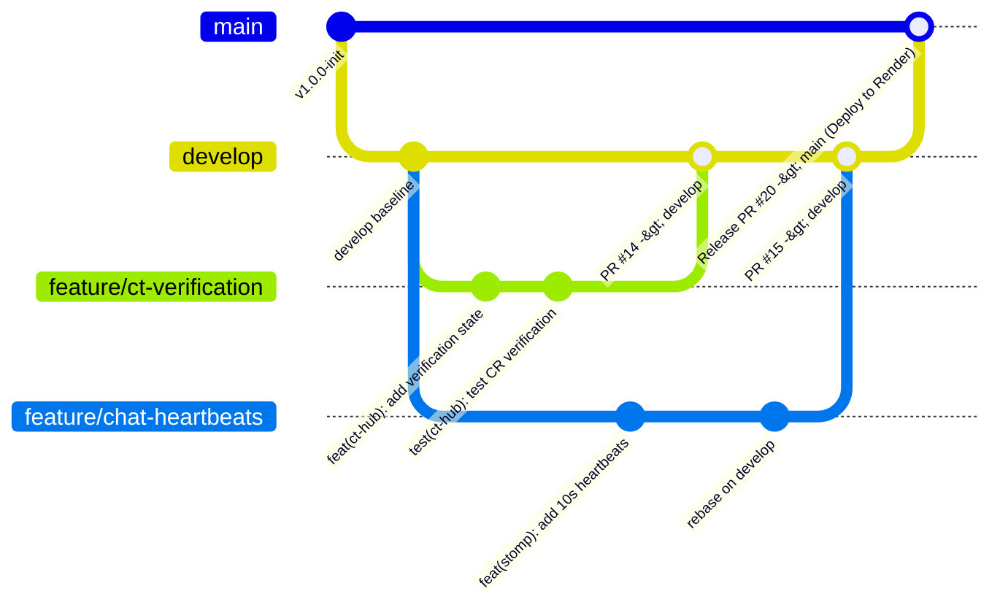
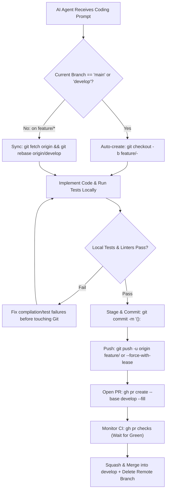
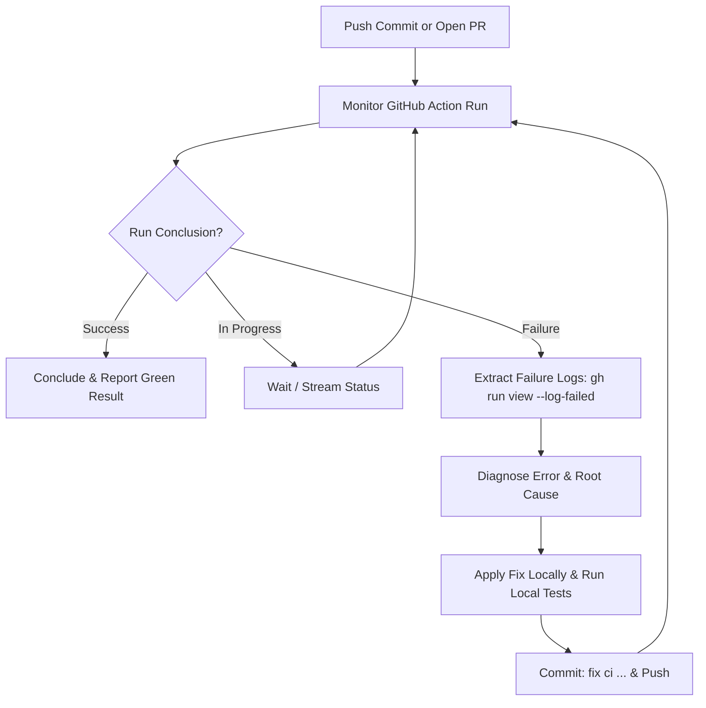

# KUETcord — Git Branching, Pulling & Collision Resolution Guide

> **Target Audience:** All 3 Engineering Team Members & AI Coding Assistants  
> **Mandate:** All repository interactions, branch lifecycles, upstream synchronization, and merge/rebase collision resolutions must strictly adhere to this guide.

---

## 1. Branching Strategy (`main`, `develop`, and `feature/*`)

In strict accordance with the **CSE 3220 Lab Project Requirements**, the team operates a 3-tier branch lifecycle:
1. **`main` (Production & Render Deployment):** The canonical, production-ready release branch. **Direct pushes to `main` are strictly forbidden.** Every commit on `main` is deployed automatically to Render via GitHub Actions CD.
2. **`develop` (Integration Branch):** The day-to-day shared integration branch. All active feature PRs merge into `develop` once reviewed and CI passes.
3. **`feature/*` (Working Branches):** Developers create feature branches off `develop`. Daily rebasing and PRs target `develop`.



### 1.1 Standardized Branch Naming Conventions

Every feature branch must follow the semantic prefix structure:

```text
<prefix>/<module>-<short-description>
```

| Prefix | Use Case | Example |
|---|---|---|
| `feature/` | New functionality or user stories | `feature/auth-google-oidc` |
| `feature/` | Core module components | `feature/messaging-heartbeats` |
| `feature/` | Kanban / Workspace additions | `feature/kanban-dnd-kit` |
| `fix/` | Bug fixes and defect corrections | `fix/stomp-zombie-eviction` |
| `fix/` | Validation or constraint corrections | `fix/ct-date-timezone-offset` |
| `perf/` | Performance optimizations | `perf/chat-cursor-indexing` |
| `test/` | Adding test suites or load tests | `test/outbox-skip-locked` |
| `docs/` | Documentation, READMEs, ADRs | `docs/viva-demo-script` |
| `refactor/`| Structural code cleanup | `refactor/notification-strategy` |

**Rules:**
- Use lowercase alphanumeric characters and hyphens (`-`). Never use spaces, underscores, or uppercase letters.
- Keep branch names concise (under 40 characters).
- Delete feature branches on GitHub immediately after merging.

---

## 2. Daily Pulling & Synchronization Protocol

To prevent massive divergence and painful merge conflicts, team members must synchronize with `develop` **at the start of each work session** and **before opening a PR**.

### 2.1 Starting a New Feature Branch
```bash
# 1. Switch to develop and pull latest upstream commits
git checkout develop
git pull --ff-only origin develop

# 2. Create and switch to your feature branch
git checkout -b feature/ct-reschedule-concurrency
```

### 2.2 Synchronizing an In-Progress Branch (The Rebase Workflow)
KUETcord uses **`git rebase`** rather than `git merge` to pull updates from `develop` into a feature branch. This keeps the commit history linear and readable without noisy "Merge branch 'develop' into..." commits.

```bash
# 1. Save any uncommitted work safely
git stash push -m "wip: halfway through task updates"

# 2. Fetch the latest changes from the remote repository
git fetch origin

# 3. Rebase your feature branch on top of origin/develop
git rebase origin/develop

# 4. Restore your uncommitted changes
git stash pop
```

> **Why `--rebase`?**  
> `git rebase origin/develop` rewinds your local commits, fast-forwards your branch to the latest commit on `develop`, and then replays your commits one by one on top. If a conflict occurs, you resolve it cleanly at the exact commit that caused it, preserving a clean, linear git history.

---

## 3. Collision & Conflict Resolution Guide

In a team of three building an integrated modular monolith, collisions naturally occur in three primary areas:
1. **Code Collisions:** Two members modifying the same Java class or React component.
2. **Database Migration Collisions:** Two members creating Flyway migration files with the same version number.
3. **Documentation Collisions:** Two members simultaneously updating the Central `README.md` API Route Index.

---

### 3.1 Resolving Code & Git Conflicts

When `git rebase origin/main` encounters conflicting lines, Git pauses and outputs:
```text
CONFLICT (content): Merge conflict in backend/src/main/java/.../CtService.java
error: could not apply a1b2c3d... feat(ct-hub): add reschedule method
Resolve all conflicts manually, mark them with "git add <paths>",
and run "git rebase --continue".
```

#### Step-by-Step Resolution Workflow:

1. **Check Conflicted Files:**
   ```bash
   git status
   # Look for files labeled "both modified"
   ```

2. **Open Conflicted Files:**  
   Locate Git's conflict markers inside the code:
   ```java
   <<<<<<< HEAD (Current state on main)
   public CtEvent verifyCt(Long ctId, User verifier) {
       CtEvent event = ctRepository.findById(ctId)...;
   =======
   public CtEvent verifyCt(Long ctId, User verifier, String verificationNote) {
       CtEvent event = ctRepository.findByIdWithLock(ctId)...;
   >>>>>>> a1b2c3d (Your commit: feat(ct-hub): add verification note)
   ```

3. **Manually Reconcile the Code:**
   - Understand what changes `main` introduced and what your commit needs.
   - Delete the markers (`<<<<<<<`, `=======`, `>>>>>>>`).
   - Keep the unified, correct logic (combining both changes if appropriate).

4. **Verify the Fix (CRITICAL):**
   Never mark a conflict resolved without compiling and running tests!
   ```bash
   # Backend check
   cd backend && mvn test-compile && mvn test

   # Frontend check
   cd frontend && npm run typecheck && npm run test
   ```

5. **Stage and Continue Rebase:**
   ```bash
   git add backend/src/main/java/.../CtService.java
   git rebase --continue
   ```
   *Repeat if Git pauses on subsequent commits until you see `Successfully rebased and updated refs/heads/...`.*

6. **Safety Abort (If You Get Lost or Made a Mistake):**
   If a rebase becomes confusing or messy, you can return to the exact state before you started:
   ```bash
   git rebase --abort
   ```
   *No files or commits will be damaged.*

---

### 3.2 Database Migration Collisions (Flyway Protocol)

#### The Problem:
Member A creates `V4__add_ct_reminder_indices.sql`. Simultaneously, Member C creates `V4__add_opportunity_tags.sql`. When merged, Flyway will crash on startup due to duplicate version numbers (`V4`).

#### Prevention & Resolution Rules:
1. **Version Reservation Matrix:**
   - Member A owns: `V1__*` (Baseline), `V4__*`, `V7__*`...
   - Member B owns: `V2__*` (Baseline), `V5__*`, `V8__*`...
   - Member C owns: `V3__*` (Baseline), `V6__*`, `V9__*`...
2. **Collision Resolution:**
   If a version collision occurs upon rebasing on `main`:
   ```bash
   # Rename your migration to the next unused integer
   git mv backend/src/main/resources/db/migration/V4__add_opportunity_tags.sql \
          backend/src/main/resources/db/migration/V5__add_opportunity_tags.sql
   
   # Re-test migration locally
   cd backend && mvn clean test
   ```

---

### 3.3 Central `README.md` Merge Collisions

When two members add new endpoints to the Central API Route Index in [README.md](./README.md):
- **Rule:** Do not overwrite the other member's endpoints.
- Reconcile the markdown table by keeping **both sets of routes**, organized under their respective module headers (Member A: Auth/CT; Member B: Messaging/Notifications; Member C: Contests/Playgrounds).

---

### 3.4 Pushing Rebased Commits (`--force-with-lease`)

Once your local branch has been rebased on `origin/main`, Git will reject a standard `git push` because the commit SHAs have changed.

> **DANGER:** Never use `git push --force` or `git push -f`. This can overwrite and destroy a teammate's commits on the remote branch!

**The Safe Standard:**
```bash
git push --force-with-lease origin feature/<branch-name>
```

> **Why `--force-with-lease`?**  
> `--force-with-lease` checks if anyone else has pushed commits to the remote branch since you last fetched. If someone has, it refuses to push, protecting their work from being overwritten.

---

## 4. Pull Request (PR) & Code Review Protocol

### 4.1 Two-Tier Pull Request Hierarchy

In strict alignment with GitFlow and CSE 3220 requirements:

1. **Feature PRs (Day-to-Day Integration):**
   - **Base Branch:** `develop`
   - **Head Branch:** `feature/<module>-<short-description>` or `fix/<scope>-<description>`
   - **Purpose:** Merges reviewed, tested feature increments into the shared integration branch.
   - **Merge Strategy:** **Squash and Merge** with semantic commit message.
2. **Release PRs (Deployments to Render):**
   - **Base Branch:** `main` (Protected, triggers `.github/workflows/deploy.yml` on Render)
   - **Head Branch:** `develop`
   - **Purpose:** Deploys a stable milestone or release version to public Render staging/production.
   - **Merge Strategy:** **Merge Commit** (or fast-forward) to preserve development history.

### 4.2 Pull Request Creation Standard
1. The PR title MUST strictly adhere to Conventional Commits v1.0.0 (enforced by `pr-title-lint` in CI):
   ```text
   feat(ct-hub): add CR verification state machine and optimistic locking
   ```
2. Fill out the PR template completely (`.github/pull_request_template.md`):
   - Linked Issue (e.g., `Closes #14`).
   - Summary of Changes (bulleted list).
   - Design Guidelines Checklist (`DESIGN_GUIDELINES.md` compliance).
   - Dual Documentation Checklist (Central `README.md` + Personal `README_<X>.md` updated).
   - Test Evidence (unit/integration test CLI output or screenshots).

### 4.3 Review & Approval Protocol
- At least **1 peer review approval** is required before merge.
- **Member A (Team Lead):** Mandatory review for security (`/auth/*`), database migrations (`V*`), and CI/CD workflows.
- **Member B & Member C:** Cross-review real-time messaging interfaces, Kanban interactions, and design engineering craft.
- **Review Etiquette:** If changes are requested, address them by adding commits on the feature branch; do NOT open a new PR.

### 4.4 The Complete 10-Step Feature Lifecycle (Standard Sequence)

Every team member and AI coding assistant must follow this exact 10-step sequence for every task:

```bash
# -------------------------------------------------------------
# STEP 1: Sync local develop with remote upstream
# -------------------------------------------------------------
git checkout develop
git pull --ff-only origin develop

# -------------------------------------------------------------
# STEP 2: Create a dedicated feature branch off develop
# -------------------------------------------------------------
git checkout -b feature/ct-reschedule-concurrency

# -------------------------------------------------------------
# STEP 3: Implement feature, adhere to DESIGN_GUIDELINES.md,
#         and update dual documentation (README.md & README_MEMBER_X.md)
# -------------------------------------------------------------

# -------------------------------------------------------------
# STEP 4: Run local verification before committing
# -------------------------------------------------------------
cd backend && mvn test-compile && mvn test
cd ../frontend && npm run typecheck && npm run test
cd ..

# -------------------------------------------------------------
# STEP 5: Stage and commit using semantic commit messages
# -------------------------------------------------------------
git add .
git commit -m "feat(ct-hub): implement reschedule with optimistic version check"

# -------------------------------------------------------------
# STEP 6: Pre-PR rebase on latest upstream develop
# -------------------------------------------------------------
git fetch origin
git rebase origin/develop

# -------------------------------------------------------------
# STEP 7: Push to remote feature branch safely
# -------------------------------------------------------------
# For initial push:
git push -u origin feature/ct-reschedule-concurrency
# For subsequent pushes after rebasing:
git push --force-with-lease origin feature/ct-reschedule-concurrency

# -------------------------------------------------------------
# STEP 8: Open Pull Request targeting develop
# -------------------------------------------------------------
# Via GitHub Web UI:
# Visit: https://github.com/KUETcord/KUETcord/compare/develop...feature/ct-reschedule-concurrency
# Or via GitHub CLI (if installed):
gh pr create --base develop --fill

# -------------------------------------------------------------
# STEP 9: Verify automated CI checks pass & obtain peer approval
# -------------------------------------------------------------
# Via GitHub Web UI: Check Actions tab at https://github.com/KUETcord/KUETcord/actions
# Or via GitHub CLI: gh pr checks
# Wait for green checks: backend-verify, frontend-verify, pr-title-lint

# -------------------------------------------------------------
# STEP 10: Squash and Merge into develop, then delete remote branch
# -------------------------------------------------------------
# Via GitHub Web UI: Click "Squash and merge", then "Delete branch"
# Or via GitHub CLI: gh pr merge --squash --delete-branch

# Switch back to develop and clean up local branch
git checkout develop
git pull --ff-only origin develop
git branch -d feature/ct-reschedule-concurrency
```

---

## 5. GitHub-Specific Tooling, Branch Protection & Project Management

### 5.1 GitHub Branch Protection Rules (Repository Admin Setup)

Member A (Team Lead / Repo Admin) must configure branch protection on the `main` branch via **Settings $\rightarrow$ Branches $\rightarrow$ Add branch ruleset / protection rule**:

1. **Branch Name Pattern:** `main`
2. **Protect Matching Branches:**
   - [x] **Require a pull request before merging:**
     - Required approvals: `1`
     - Dismiss stale pull request approvals when new commits are pushed: `Checked`
     - Require review from Code Owners: `Optional`
   - [x] **Require status checks to pass before merging:**
     - Require branches to be up to date before merging: `Checked`
     - Status checks required:
       - `Backend Test & Build` (`backend-verify`)
       - `Frontend Lint, Typecheck & Build` (`frontend-verify`)
       - `Validate Semantic PR Title` (`pr-title-lint`)
   - [x] **Require linear history:** `Checked` (Prevents noisy merge bubbles).
   - [x] **Do not allow bypassing the above settings:** `Checked` (Applies to administrators as well).
   - [x] **Do not allow force pushes:** `Checked` (Blocks `git push -f` on `main`).
   - [x] **Do not allow deletions:** `Checked`.

### 5.2 GitHub Actions CI Pipeline (`.github/workflows/ci.yml`)

The repository runs automated quality gates on every Pull Request targeting `main` and on push to `main`:
1. **Backend Service Container (`backend-verify`):** Spawns an ephemeral PostgreSQL 16 service container, applies Flyway migrations (`V1`, `V2`, `V3`), compiles Java 21, and executes:
   - **Unit & Contract Tests:** Domain entities, State pattern transitions, Strategy rankings, and DTO validations.
   - **Security & Pen-Tests:** Domain gate evasion (`@stud.kuet.ac.bd`), Google OIDC verification, and Token Bucket rate limiting.
   - **Integration & Protocol Tests:** Spring Data JPA repositories, Testcontainers queries, and WebSocket STOMP frame routing.
   - **Concurrency Tests:** JPA `@Version` optimistic locking (HTTP 409) and Transactional Outbox `SKIP LOCKED` throughput.
2. **Frontend Quality Check (`frontend-verify`):** Runs `npm ci`, enforces strict TypeScript compilation (`npm run typecheck`), executes Vitest component, accessibility (A11y), and adversarial `break-ui` test suites (`npm run test`), and verifies the production Vite bundle builds cleanly (`npm run build`).
3. **Semantic PR Title Check (`pr-title-lint`):** Validates the PR title against Conventional Commits v1.0.0 (`amannn/action-semantic-pull-request@v5`).
4. **Docker Compose Syntax Check (`docker-verify`):** Validates the multi-service compose schema (`docker compose config`).

### 5.3 GitHub Actions CD Pipeline (`.github/workflows/deploy.yml`)

The repository executes automated continuous deployment immediately upon merging a PR to `main`:
1. **Automated Host Webhook Trigger:** Dispatches secure deployment hooks to host environments (e.g. Render, Railway, or VPS).
2. **Automated Smoke Test Verification:** Executes an automated curl polling loop targeting `https://${DEPLOY_HOST}/actuator/health` (12 attempts x 10s backoff).
3. **Health Assertion:** Asserts backend status is `{"status":"UP"}` with PostgreSQL database connectivity verified before reporting deployment success.

### 5.4 GitHub PR & Issue Templates (`.github/`)
- **PR Template (`.github/pull_request_template.md`):** Automatically populates on PR creation with the Design Guidelines (`DESIGN_GUIDELINES.md`), Dual Documentation (Central + Personal READMEs), Resilience, and Test checklists.
- **Issue Templates (`.github/ISSUE_TEMPLATE/`):**
  - `feature_request.md`: Standard user story format with acceptance criteria.
  - `bug_report.md`: Steps to reproduce, expected vs actual behavior, error stack traces.
  - `sprint_task.md`: Aligned to the 6-Week WBS and Definition of Done.

### 5.5 GitHub CLI (`gh`) Productivity Shortcuts

Developers can manage issues, branches, and PRs directly from the terminal using GitHub CLI:

```bash
# 1. Authenticate with GitHub & Clone
gh auth login
gh repo clone KUETcord/KUETcord
# Or: git clone https://github.com/KUETcord/KUETcord.git

# 2. View assigned issues
gh issue list --assignee "@me"

# 3. Create a branch and open a PR using the template
git checkout -b feature/auth-google-oidc
# ... make commits ...
git push --set-upstream origin feature/auth-google-oidc
gh pr create --fill

# 4. Check out a teammate's PR locally for review
gh pr checkout 14

# 5. Approve a reviewed PR
gh pr review 14 --approve -b "Code looks clean, design guidelines verified, tests pass."

# 6. Squash and merge once CI is green
gh pr merge 14 --squash --delete-branch
```

### 5.6 GitHub Projects (Sprint & Milestone Tracking)

The team manages progress using **GitHub Projects (Projects v2)**:
1. **Kanban View:** Columns for `Backlog`, `Sprint Ready`, `In Progress`, `In Review / PR Open`, and `Done`.
2. **Milestones:** Set up 6 Milestones corresponding to Weeks 1 through 6:
   - `Milestone 1: Foundation & Schemas (Week 1)`
   - `Milestone 2: Identity & Communities (Week 2)`
   - `Milestone 3: Messaging Engine & CT Hub (Week 3)`
   - `Milestone 4: Contests & Project Workspaces (Week 4)`
   - `Milestone 5: Resilience, Load Tests & Deployment (Week 5)`
   - `Milestone 6: Polish, Demo Rehearsal & Viva (Week 6)`
3. **Issue Linking:** Every commit and PR references its tracked issue (e.g., `Closes #12`), automatically moving cards to `Done` upon merge.

---

## 6. AI Coding Assistant Autonomous Git & PR Protocol

When an AI coding assistant (Antigravity, GitHub Copilot, Claude Code, Cursor, etc.) operates within the KUETcord codebase, it must strictly obey these autonomous Git directives:



### 6.1 Autonomous Branching Guard
- **Strict Rule:** The AI agent must **NEVER** write code or commit directly on `main` or `develop`.
- **Pre-Execution Check:** Before writing any file, the agent checks `git branch --show-current`. If on `main` or `develop`, it automatically executes:
  ```bash
  git checkout -b feature/<module>-<short-description>
  ```
- If switching from a dirty branch, it stashes changes safely: `git stash push -m "agent-stash"`.

### 6.2 Pre-Commit Test & Compilation Verification
The AI agent must never stage or commit code that fails to compile or breaks tests:
```bash
# Backend verification:
cd backend && mvn test-compile && mvn test -Dtest=*UnitTest
# Frontend verification:
cd ../frontend && npm run typecheck && npm run test
```
If tests fail, the AI agent must resolve the failure first before generating a commit.

### 6.3 Semantic Commit Formatting
All commit messages generated by the agent must conform to [COMMIT_GUIDELINES.md](./COMMIT_GUIDELINES.md):
- Format: `<type>(<scope>): <short imperative summary>`
- The agent must never use vague messages like `"update"`, `"wip"`, `"fix"`, or `"code done"`.

### 6.4 Autonomous Conflict Detection & Resolution Protocol
When syncing with `origin/develop` via `git rebase origin/develop`:
1. If Git halts with a merge conflict, the agent reads `git status` to identify conflicted files.
2. The agent reads the conflicted file, parses the `<<<<<<< HEAD`, `=======`, and `>>>>>>>` markers.
3. It intelligently reconciles the code:
   - Preserving new upstream changes from `develop`.
   - Incorporating the feature's intended changes.
   - Removing all conflict markers.
4. It re-verifies compilation and tests (`mvn test-compile`, `npm run typecheck`).
5. It stages the resolved file (`git add <file>`) and resumes the rebase (`git rebase --continue`).
6. Under no circumstances should the agent use `git rebase --skip` unless explicitly verified as a duplicate commit.

### 6.5 Safe Push Protocol (`--force-with-lease`)
- For initial push: `git push -u origin feature/<branch-name>`
- For subsequent pushes after rebase: `git push --force-with-lease origin feature/<branch-name>`
- The agent is **strictly forbidden** from using raw `git push --force` or `-f`.

### 6.6 Pull Request Generation & Merge Instructions
Upon completing a task, the agent outputs both the GitHub Web URL and GitHub CLI commands:
```bash
# Option A: Via GitHub Web UI (Always available)
# Visit: https://github.com/KUETcord/KUETcord/compare/develop...feature/<branch-name>
# Set Title: feat(<scope>): <description>
# Fill out the PR template from .github/pull_request_template.md

# Option B: Via GitHub CLI (If installed)
gh pr create --base develop --title "feat(messaging): add active viewport subscription router" --body-file .github/pull_request_template.md
gh pr checks
gh pr merge --squash --delete-branch
```

### 6.7 Autonomous CI/CD Monitoring & Self-Healing Feedback Loop

The AI agent must never treat a push, merge, or PR as complete without verifying the resulting GitHub Actions status. The agent must proactively listen for the CI result and execute a self-healing iteration loop until all workflows are 100% green:



1. **Automatic Action Listening:**
   - After any `git push` or PR creation, query GitHub Actions:
     ```bash
     gh run list --branch <branch-name> --limit 1
     gh run watch <run-id>
     ```
2. **Failure Diagnosis:**
   - If any job in the matrix (`backend-verify`, `frontend-verify`, `docker-compose-verify`, `pr-title-lint`) fails, read the log:
     ```bash
     gh run view <run-id> --log-failed
     ```
3. **Local Self-Healing & Verification:**
   - Reproduce the failure locally:
     - For Java/Maven: `cd backend && mvn clean test`
     - For React/Vite: `cd frontend && npm run typecheck && npm run test && npm run build`
     - For Docker: `docker compose config`
   - Apply the targeted fix.
4. **Autonomous Re-Push & Re-Listen:**
   - Commit the fix with semantic message `fix(ci): <imperative-description>`.
   - Push to remote: `git push origin <branch-name>` (or `--force-with-lease`).
   - Re-listen to the new GitHub Actions run until it completes with `success`.
5. **Circuit Breaker:**
   - Limit self-healing iterations to 5 cycles. If an infrastructure issue outside codebase control persists, alert the user with full logs.


