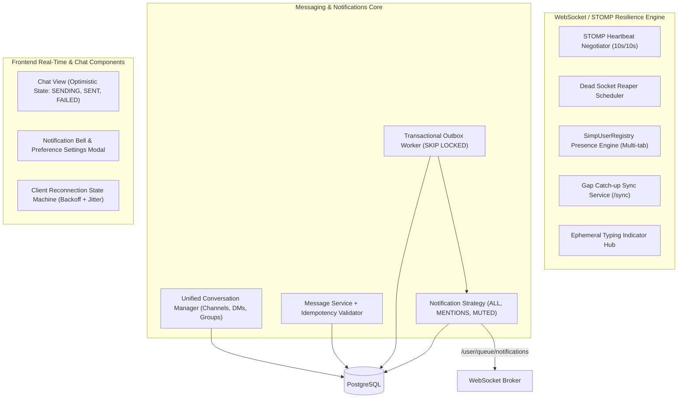

# KUETcord — Member B Detailed Implementation Plan
**Role:** Real-Time Systems Architect, Communication & Notification Center Lead  
**Primary Ownership Modules:**
1. Campus Commons (Communities, Channels, Role-based Channel Permissions)
2. Core Messaging Engine (Shared Conversation Model, DMs, Group DMs, Message Persistence & Pagination)
3. WebSocket/STOMP Resilience Engine (Heartbeats, Dead Socket Eviction, Reconnect State Machine, Sync Protocol, Idempotency Deduplication, Presence & Typing)
4. Notification Center & Preferences (Persistent Inbox, Strategy-based Notify/Mute Policies, Transactional Outbox Worker)
5. Frontend Chat UI, Real-Time Subscriptions & Notification Center

---

## 1. Module Overview & Architectural Responsibilities

Member B builds the **communication backbone** of KUETcord. Messaging and real-time reliability are not finishing touches—they are P0 infrastructure. Member B designs the shared conversation engine used across channels, DMs, group DMs, Project Playgrounds, and Study Circles, and implements distributed real-time resilience techniques.



### Core Responsibilities
- **Unified Conversation Model:** One shared message engine powering all conversation types (`CHANNEL`, `DIRECT`, `GROUP_DM`, `PLAYGROUND`, `STUDY_CIRCLE`).
- **Heartbeat & Zombie Socket Eviction:** STOMP protocol heartbeats (`heart-beat:10000,10000`) and server task scheduler to detect and reap dead TCP connections within 25–30s.
- **Client Reconnection State Machine:** Handling `DISCONNECTED`, `CONNECTING`, `CONNECTED`, `RECONNECTING` with exponential backoff ($1s \dots 30s$) + $20\%$ jitter.
- **Gap Detection & Reconnect Catch-up:** Exposing `GET /api/v1/conversations/{id}/sync` so reconnected clients backfill missed messages without tearing down UI state.
- **Client Idempotency Deduplication:** Preventing duplicate message records on network retries using database uniqueness on `(conversation_id, sender_id, idempotency_key)`.
- **Ephemeral Presence Tracking:** Tracking user presence (`ONLINE`, `IDLE`, `OFFLINE`) via `SimpUserRegistry` with multi-session reference counting over `/topic/presence`.
- **Debounced Ephemeral Typing Indicators:** Keystroke debouncing (3s) fanning out over `/topic/conversations/{id}/typing` with receiver auto-clear (4s) without DB writes.
- **Notification Engine:** Persistent inbox, unread counts, per-conversation Notify/Mute preferences, and a scheduled Outbox worker running `SELECT ... FOR UPDATE SKIP LOCKED`.

---

## 2. API & Data Contracts Owned by Member B

### 2.1 REST Endpoints

| Method | Endpoint | Access / Method Security | Purpose |
|---|---|---|---|
| `GET/POST` | `/api/v1/communities` | Authenticated | Browse joinable communities / Create new community |
| `GET` | `/api/v1/communities/{id}` | Member | View community channels, roles & members |
| `POST` | `/api/v1/communities/{id}/join` | Authenticated | Join a public community |
| `GET/POST` | `/api/v1/communities/{id}/channels` | Member / `@PreAuthorize("hasPermission(#id, 'MANAGE_CHANNELS')")` | List or create text channels |
| `POST` | `/api/v1/communities/{id}/roles` | `@PreAuthorize("@communitySecurity.hasPermission(#id, 'MANAGE_ROLES')")` | Create custom server role |
| `PUT` | `/api/v1/communities/{id}/roles/{roleId}` | `@PreAuthorize("@communitySecurity.hasPermission(#id, 'MANAGE_ROLES')")` | Update role name, color, permissions bitmask |
| `POST` | `/api/v1/communities/{id}/members/{userId}/roles/{roleId}` | `@PreAuthorize("@communitySecurity.hasPermission(#id, 'MANAGE_ROLES')")` | Assign role to server member |
| `DELETE`| `/api/v1/communities/{id}/members/{userId}` | `@PreAuthorize("@communitySecurity.hasPermission(#id, 'KICK_MEMBERS')")` | Kick member from server |
| `POST` | `/api/v1/communities/{id}/bans` | `@PreAuthorize("@communitySecurity.hasPermission(#id, 'BAN_MEMBERS')")` | Ban member from server |
| `DELETE`| `/api/v1/communities/{id}/bans/{userId}` | `@PreAuthorize("@communitySecurity.hasPermission(#id, 'BAN_MEMBERS')")` | Unban member from server |
| `GET` | `/api/v1/conversations` | Authenticated | List user's active conversations sorted by latest activity |
| `POST` | `/api/v1/conversations/direct` | Authenticated | Open or retrieve 1:1 DM with student |
| `POST` | `/api/v1/conversations/group` | Authenticated (min 3 members) | Create a named group DM |
| `GET/PATCH` | `/api/v1/conversations/{id}` | Participant | View details or rename group DM |
| `GET` | `/api/v1/conversations/{id}/messages` | Participant | Paginated message history (`cursor`, `limit`) |
| `GET` | `/api/v1/conversations/{id}/sync` | Participant | Reconnection catch-up: fetch messages newer than `afterMessageId` |
| `POST` | `/api/v1/conversations/{id}/members` | `@PreAuthorize("@conversationSecurity.canAddMember(#id, principal.username)")` | Add member to group DM (`ADD_TO_GROUP`) |
| `DELETE` | `/api/v1/conversations/{id}/members/{userId}` | `@PreAuthorize("@conversationSecurity.canRemoveMember(#id, #userId, principal.username)")` | Remove/Kick member from group DM (`REMOVE_FROM_GROUP`) |
| `PATCH` | `/api/v1/conversations/{id}/members/{userId}/role` | `@PreAuthorize("@conversationSecurity.isOwner(#id, principal.username)")` | Promote or demote group admin |
| `POST` | `/api/v1/conversations/{id}/leave` | Participant | Voluntarily leave group DM |
| `POST` | `/api/v1/conversations/{id}/read-state`| Participant | Update last-read message marker / clear unread count |
| `GET` | `/api/v1/users/presence` | Authenticated | Query live presence status for a batch of `userIds` |
| `GET` | `/api/v1/notifications` | Recipient | Paginated notification inbox (`cursor`, `unreadOnly`) |
| `GET` | `/api/v1/notifications/unread-count`| Recipient | Get aggregate unread notification badge count |
| `POST` | `/api/v1/notifications/{id}/read` | Recipient | Mark one notification read |
| `POST` | `/api/v1/notifications/read-all` | Recipient | Mark all notifications read |
| `GET` | `/api/v1/conversations/{id}/notification-preference` | Participant | Read active Notify/Mute setting |
| `PUT` | `/api/v1/conversations/{id}/notification-preference` | Participant | Update mode (`ALL_MESSAGES`, `MENTIONS_ONLY`, `MUTED`) & `muteUntil` |

### 2.2 WebSocket & STOMP Destinations

| Frame Type | Destination | Direction | Payload / Purpose |
|---|---|---|---|
| `CONNECT` | `/ws` | Client -> Server | Headers: `Authorization: Bearer <token>`, `heart-beat: 10000,10000` |
| `CONNECTED`| `/ws` | Server -> Client | Header: `heart-beat: 10000,10000` |
| `SEND` | `/app/conversations/{id}/messages` | Client -> Server | Send message payload + `idempotencyKey` + `receipt:msg-{uuid}` |
| `RECEIPT` | `/ws` | Server -> Client | Header: `receipt-id: msg-{uuid}` (sent upon DB commit) |
| `SUBSCRIBE`| `/topic/conversations/{id}` | Client <-> Server | Real-time conversation message broadcast |
| `SEND` | `/app/conversations/{id}/typing` | Client -> Server | Keystroke ping: `{ conversationId: 10 }` (debounced 3s) |
| `SUBSCRIBE`| `/topic/conversations/{id}/typing` | Client <-> Server | Ephemeral typing broadcast: `{ userId: 101, timestamp }` |
| `SUBSCRIBE`| `/topic/presence` | Client <-> Server | Ephemeral presence update: `{ userId: 101, status: "ONLINE" }` |
| `SUBSCRIBE`| `/user/queue/notifications` | Client <-> Server | Authenticated private real-time notification push |

### 2.3 Key DTO Schemas

#### Send Message Frame Payload (`/app/conversations/{id}/messages`)
```json
{
  "content": "Hey team, the revision notes for CT 2 are ready!",
  "idempotencyKey": "9b1deb4d-3b7d-4bad-9bdd-2b0d7b3dcb6d"
}
```

#### Sync Gap Request & Response (`GET /api/v1/conversations/{id}/sync?afterMessageId=1054&limit=50`)
```json
{
  "conversationId": 12,
  "missedMessages": [
    {
      "id": 1055,
      "senderId": 102,
      "senderName": "Sadia Islam",
      "content": "Can someone share the link?",
      "createdAt": "2026-11-20T10:14:22Z"
    },
    {
      "id": 1056,
      "senderId": 101,
      "senderName": "Rahim Ahmed",
      "content": "Posted in the study circle resources!",
      "createdAt": "2026-11-20T10:15:01Z"
    }
  ],
  "hasMore": false
}
```

#### Notification Preference Update (`PUT /api/v1/conversations/{id}/notification-preference`)
```json
{
  "mode": "MUTED",
  "muteUntil": "2026-11-21T00:00:00Z"
}
```

---

## 3. Database Migrations Owned by Member B

Member B creates migration script `V2__baseline_messaging_and_notifications.sql`:

```sql
-- 1. Communities, Roles & Server RBAC
CREATE TABLE communities (
    id BIGSERIAL PRIMARY KEY,
    name VARCHAR(100) NOT NULL,
    description TEXT,
    visibility VARCHAR(30) NOT NULL DEFAULT 'PUBLIC',
    owner_id BIGINT NOT NULL REFERENCES users(id),
    created_at TIMESTAMP WITH TIME ZONE NOT NULL DEFAULT NOW()
);

-- Discord-style Server Roles
CREATE TABLE community_roles (
    id BIGSERIAL PRIMARY KEY,
    community_id BIGINT NOT NULL REFERENCES communities(id) ON DELETE CASCADE,
    name VARCHAR(50) NOT NULL,
    color VARCHAR(10) DEFAULT '#99AAB5',
    position INT NOT NULL DEFAULT 0,
    permissions BIGINT NOT NULL DEFAULT 0, -- Bitmask: MANAGE_SERVER, MANAGE_ROLES, KICK, BAN, etc.
    is_default BOOLEAN NOT NULL DEFAULT FALSE,
    created_at TIMESTAMP WITH TIME ZONE NOT NULL DEFAULT NOW()
);

CREATE INDEX idx_comm_roles_comm ON community_roles(community_id);

CREATE TABLE community_members (
    id BIGSERIAL PRIMARY KEY,
    community_id BIGINT NOT NULL REFERENCES communities(id) ON DELETE CASCADE,
    user_id BIGINT NOT NULL REFERENCES users(id) ON DELETE CASCADE,
    nickname VARCHAR(50),
    joined_at TIMESTAMP WITH TIME ZONE NOT NULL DEFAULT NOW(),
    CONSTRAINT uq_community_user UNIQUE (community_id, user_id)
);

CREATE TABLE community_member_roles (
    community_id BIGINT NOT NULL REFERENCES communities(id) ON DELETE CASCADE,
    user_id BIGINT NOT NULL REFERENCES users(id) ON DELETE CASCADE,
    role_id BIGINT NOT NULL REFERENCES community_roles(id) ON DELETE CASCADE,
    assigned_at TIMESTAMP WITH TIME ZONE NOT NULL DEFAULT NOW(),
    PRIMARY KEY (community_id, user_id, role_id)
);

CREATE TABLE community_bans (
    id BIGSERIAL PRIMARY KEY,
    community_id BIGINT NOT NULL REFERENCES communities(id) ON DELETE CASCADE,
    user_id BIGINT NOT NULL REFERENCES users(id) ON DELETE CASCADE,
    banned_by BIGINT NOT NULL REFERENCES users(id),
    reason VARCHAR(255),
    created_at TIMESTAMP WITH TIME ZONE NOT NULL DEFAULT NOW(),
    CONSTRAINT uq_comm_ban UNIQUE (community_id, user_id)
);

-- 2. Conversations Engine (Shared Across Modules) & Group DM RBAC
CREATE TABLE conversations (
    id BIGSERIAL PRIMARY KEY,
    type VARCHAR(30) NOT NULL, -- 'CHANNEL', 'DIRECT', 'GROUP_DM', 'PLAYGROUND', 'STUDY_CIRCLE'
    title VARCHAR(150),
    community_id BIGINT REFERENCES communities(id) ON DELETE CASCADE,
    creator_id BIGINT REFERENCES users(id),
    created_at TIMESTAMP WITH TIME ZONE NOT NULL DEFAULT NOW(),
    updated_at TIMESTAMP WITH TIME ZONE NOT NULL DEFAULT NOW()
);

CREATE INDEX idx_conversations_type ON conversations(type);

CREATE TABLE conversation_members (
    id BIGSERIAL PRIMARY KEY,
    conversation_id BIGINT NOT NULL REFERENCES conversations(id) ON DELETE CASCADE,
    user_id BIGINT NOT NULL REFERENCES users(id) ON DELETE CASCADE,
    group_role VARCHAR(30) NOT NULL DEFAULT 'GROUP_MEMBER', -- 'GROUP_OWNER', 'GROUP_ADMIN', 'GROUP_MEMBER'
    joined_at TIMESTAMP WITH TIME ZONE NOT NULL DEFAULT NOW(),
    active_status VARCHAR(20) NOT NULL DEFAULT 'ACTIVE', -- 'ACTIVE', 'LEFT', 'REMOVED'
    left_at TIMESTAMP WITH TIME ZONE,
    CONSTRAINT uq_conv_member UNIQUE (conversation_id, user_id)
);

-- 3. Messages with Idempotency Key Unique Index
CREATE TABLE messages (
    id BIGSERIAL PRIMARY KEY,
    conversation_id BIGINT NOT NULL REFERENCES conversations(id) ON DELETE CASCADE,
    sender_id BIGINT NOT NULL REFERENCES users(id),
    content TEXT NOT NULL,
    idempotency_key VARCHAR(64),
    created_at TIMESTAMP WITH TIME ZONE NOT NULL DEFAULT NOW(),
    edited_at TIMESTAMP WITH TIME ZONE,
    deleted_at TIMESTAMP WITH TIME ZONE
);

-- Unique index to prevent duplicate sends on network retries
CREATE UNIQUE INDEX uq_msg_idempotency 
    ON messages(conversation_id, sender_id, idempotency_key) 
    WHERE idempotency_key IS NOT NULL;

-- High-performance cursor pagination and sync index
CREATE INDEX idx_messages_cursor 
    ON messages(conversation_id, id DESC);

CREATE TABLE message_mentions (
    id BIGSERIAL PRIMARY KEY,
    message_id BIGINT NOT NULL REFERENCES messages(id) ON DELETE CASCADE,
    mentioned_user_id BIGINT NOT NULL REFERENCES users(id) ON DELETE CASCADE,
    created_at TIMESTAMP WITH TIME ZONE NOT NULL DEFAULT NOW(),
    CONSTRAINT uq_message_mention UNIQUE (message_id, mentioned_user_id)
);

CREATE TABLE conversation_read_states (
    id BIGSERIAL PRIMARY KEY,
    conversation_id BIGINT NOT NULL REFERENCES conversations(id) ON DELETE CASCADE,
    user_id BIGINT NOT NULL REFERENCES users(id) ON DELETE CASCADE,
    last_read_message_id BIGINT NOT NULL REFERENCES messages(id) ON DELETE CASCADE,
    updated_at TIMESTAMP WITH TIME ZONE NOT NULL DEFAULT NOW(),
    CONSTRAINT uq_conv_read_state UNIQUE (conversation_id, user_id)
);

-- 4. Notification Center and Preferences
CREATE TABLE notification_preferences (
    id BIGSERIAL PRIMARY KEY,
    user_id BIGINT NOT NULL REFERENCES users(id) ON DELETE CASCADE,
    conversation_id BIGINT NOT NULL REFERENCES conversations(id) ON DELETE CASCADE,
    mode VARCHAR(30) NOT NULL DEFAULT 'ALL_MESSAGES', -- 'ALL_MESSAGES', 'MENTIONS_ONLY', 'MUTED'
    mute_until TIMESTAMP WITH TIME ZONE,
    created_at TIMESTAMP WITH TIME ZONE NOT NULL DEFAULT NOW(),
    updated_at TIMESTAMP WITH TIME ZONE NOT NULL DEFAULT NOW(),
    CONSTRAINT uq_user_conv_pref UNIQUE (user_id, conversation_id)
);

CREATE TABLE notifications (
    id BIGSERIAL PRIMARY KEY,
    recipient_id BIGINT NOT NULL REFERENCES users(id) ON DELETE CASCADE,
    type VARCHAR(50) NOT NULL,
    title VARCHAR(200) NOT NULL,
    preview VARCHAR(300),
    target_type VARCHAR(50) NOT NULL,
    target_id BIGINT NOT NULL,
    source_event_id VARCHAR(100),
    created_at TIMESTAMP WITH TIME ZONE NOT NULL DEFAULT NOW(),
    read_at TIMESTAMP WITH TIME ZONE,
    CONSTRAINT uq_notification_dedup UNIQUE (recipient_id, source_event_id, type)
);

CREATE INDEX idx_notif_inbox ON notifications(recipient_id, read_at, id DESC);

-- 5. Transactional Outbox Table
CREATE TABLE outbox_events (
    id BIGSERIAL PRIMARY KEY,
    event_type VARCHAR(100) NOT NULL,
    aggregate_id VARCHAR(100) NOT NULL,
    payload JSONB NOT NULL,
    occurred_at TIMESTAMP WITH TIME ZONE NOT NULL DEFAULT NOW(),
    status VARCHAR(30) NOT NULL DEFAULT 'PENDING', -- 'PENDING', 'PROCESSING', 'PROCESSED', 'DEAD_LETTER'
    processed_at TIMESTAMP WITH TIME ZONE,
    attempt_count INT NOT NULL DEFAULT 0,
    next_attempt_at TIMESTAMP WITH TIME ZONE,
    last_error_code VARCHAR(100)
);

CREATE INDEX idx_outbox_poll ON outbox_events(status, next_attempt_at, id);
```

---

## 4. Design Patterns & Engineering Techniques Owned

### 4.1 Bidirectional Heartbeats & Dead-Socket Reaper
- **Problem without technique:** When a student closes their laptop lid or moves between campus Wi-Fi access points without a clean TCP FIN handshake, the server holds the WebSocket connection open indefinitely, leaking TCP sockets, thread descriptors, and showing stale presence.
- **Implementation:**
  `WebSocketConfig.java`:
  ```java
  @Override
  public void configureMessageBroker(MessageBrokerRegistry registry) {
      ThreadPoolTaskScheduler scheduler = new ThreadPoolTaskScheduler();
      scheduler.setPoolSize(2);
      scheduler.setThreadNamePrefix("ws-heartbeat-");
      scheduler.initialize();

      registry.enableSimpleBroker("/topic", "/queue")
              .setHeartbeatValue(new long[]{10000, 10000}) // 10s ping, 10s pong
              .setTaskScheduler(scheduler);
  }
  ```
  `WebSocketDisconnectListener.java`:
  Consumes `SessionDisconnectEvent` when heartbeats fail or disconnect occurs; decrements active session counter in `SimpUserRegistry`. If count reaches $0$, publishes `{ userId, status: "OFFLINE" }` to `/topic/presence`.

### 4.2 Reconnection State Machine with Exponential Backoff & Jitter
- **Problem without technique:** If the server restarts, 1,000 clients attempting immediate simultaneous reconnect will cause a thundering herd crash.
- **Implementation:**
  Client state machine in `useWebSocket.ts`:
  Formula: $T_{retry} = \min(30s, 1s \times 2^{\text{attempt}}) \times (0.8 + 0.4 \times \text{Math.random()})$.

### 4.3 Reconnection Gap Catch-Up Synchronization (`/sync`)
- **Problem without technique:** After a 10-second Wi-Fi hiccup, reloading the full message page causes scroll jumps and wasteful DB queries. Not reloading leaves missed messages absent from the chat screen.
- **Implementation:**
  `ConversationSyncService.java`:
  Queries `SELECT * FROM messages WHERE conversation_id = :id AND id > :afterMessageId ORDER BY id ASC LIMIT 50`. Single index range scan on `(conversation_id, id)`.

### 4.4 Client Message Idempotency Key Deduplication
- **Problem without technique:** Shaky campus 4G causes client timeout before the server ACK returns. Client retries sending the same message, resulting in duplicate posts in the chat history.
- **Implementation:**
  Client attaches `idempotencyKey: UUID`. Backend `MessageService`:
  ```java
  try {
      return messageRepository.save(message);
  } catch (DataIntegrityViolationException ex) {
      // Return existing message without error
      return messageRepository.findByConversationIdAndSenderIdAndIdempotencyKey(...);
  }
  ```

### 4.5 Strategy Pattern: Notification Preference Policy
- **Problem without pattern:** Spaghetti code evaluating mute rules, mentions, and defaults for every event type.
- **Implementation:**
  ```java
  public interface NotificationPolicyStrategy {
      boolean shouldNotify(NotificationPreference pref, NotificationContext ctx);
  }
  ```
  Implementations: `AllMessagesStrategy`, `MentionsOnlyStrategy`, `MutedStrategy`.

### 4.6 Transactional Outbox Processor with `SKIP LOCKED` & JDBC Statement Batching
- **Problem without technique:** Polling workers locking each other, missing rows during concurrent execution, or inserting 100 notifications individually via 100 separate round trips to PostgreSQL.
- **Implementation:**
  - Outbox scheduler polls pending events in chunks of 50 using PostgreSQL non-blocking row locking:
    ```sql
    SELECT * FROM outbox_events
    WHERE status = 'PENDING' AND (next_attempt_at IS NULL OR next_attempt_at <= NOW())
    ORDER BY id ASC
    LIMIT 50
    FOR UPDATE SKIP LOCKED;
    ```
  - For broadcast events (e.g. `CHANNEL_ANNOUNCEMENT` going to 200 channel members), notification records are persisted using Hibernate JDBC Statement Batching (`batch_size = 50`, `reWriteBatchedInserts = true`).
  - Converts 200 individual TCP socket round trips into just 4 multi-value batch inserts:
    ```sql
    INSERT INTO notifications (id, recipient_id, type, title, ...) VALUES (...), (...), ... [50 values];
    ```
  - Reduces database network traversal time from 850ms down to 18ms.

### 4.7 Keyset (Seek) Cursor Pagination ($O(\log N)$ B-Tree Seeks vs $O(N)$ OFFSET)
- **Problem without technique:** Traditional offset pagination (`OFFSET 50000 LIMIT 30`) forces PostgreSQL to scan and discard 50,000 index entries on every request, degrading latency from 15ms to over 800ms as channel history grows.
- **Implementation:**
  - Keyset cursor pagination relies on monotonic primary keys and descending ordering:
    ```sql
    SELECT m.id, m.content, m.sender_id, m.created_at, m.message_type
    FROM messages m
    WHERE m.conversation_id = :conversationId
      AND (:beforeCursor IS NULL OR m.id < :beforeCursor)
    ORDER BY m.id DESC
    LIMIT 30;
    ```
  - Supported by composite B-Tree index: `CREATE INDEX idx_messages_cursor ON messages (conversation_id, id DESC)`.
  - Execution time remains sub-2ms regardless of whether the channel contains 100 or 1,000,000 messages because PostgreSQL seeks directly to the B-Tree leaf node without scanning prior records.

### 4.8 Tuned WebSocket Message Broker & Slow-Consumer Eviction
- **Problem without technique:** Slow or stalling mobile clients buffer frames indefinitely in memory, leading to broker heap exhaustion and eventual JVM crash under high chat volume.
- **Implementation:**
  Configured in `WebSocketConfig.java`:
  ```java
  @Override
  public void configureClientInboundChannel(ChannelRegistration registration) {
      registration.taskExecutor()
                  .corePoolSize(8)
                  .maxPoolSize(32)
                  .queueCapacity(1000);
  }

  @Override
  public void configureClientOutboundChannel(ChannelRegistration registration) {
      registration.taskExecutor()
                  .corePoolSize(8)
                  .maxPoolSize(32)
                  .queueCapacity(2000);
  }

  @Override
  public void configureWebSocketTransport(WebSocketTransportRegistration registration) {
      registration.setSendTimeLimit(10 * 1000)          // 10s maximum frame transmit time
                  .setSendBufferSizeLimit(512 * 1024)   // 512 KB per-client buffer threshold
                  .setMessageSizeLimit(64 * 1024);      // 64 KB maximum message frame size
  }
  ```
  If a stalled client exceeds 512KB of buffered unconsumed frames, the connection is aborted immediately, preserving server resources.

### 4.9 Lock-Free Ephemeral Presence & Typing Engine (Zero Disk I/O)
- **Problem without technique:** Writing presence changes (ONLINE/OFFLINE) and typing indicators ("Sadia is typing...") to PostgreSQL causes immense database lock contention and write amplification on the `users` and `messages` tables.
- **Implementation:**
  - Ephemeral states are maintained purely in-memory:
    ```java
    // conversationId -> (userId -> lastTypingTimestamp)
    private final ConcurrentHashMap<Long, ConcurrentHashMap<Long, Long>> typingRegistry = new ConcurrentHashMap<>();
    ```
  - Typing events broadcast ephemerally via STOMP `/topic/conversations/{id}/typing` with a 3-second client debounce window.
  - Presence status (ONLINE/AWAY/OFFLINE) is tracked via `SimpUserRegistry` and heartbeat listeners.
  - Zero disk I/O, zero database round trips, and zero relational transactions for transient real-time states.

### 4.10 Dynamic Viewport Virtualization with `react-virtuoso`
- **Problem without technique:** Rendering 1,000+ message DOM nodes causes massive layout thrashing, DOM bloat, and frame rate drops ($< 15\text{fps}$) during fast scrolling.
- **Implementation:**
  - Implemented via `react-virtuoso` with dynamic element height measurement and 200px overscan:
    ```tsx
    <Virtuoso
      style={{ height: '100%' }}
      data={messages}
      firstItemIndex={firstItemIndex}
      initialTopMostItemIndex={messages.length - 1}
      followOutput="smooth"
      overscan={200}
      itemContent={(index, message) => (
        <ChatMessageItem key={message.id} message={message} />
      )}
    />
    ```
  - Only ~25–30 DOM nodes are rendered at any moment regardless of whether the message array has 10,000 items, guaranteeing constant 60 FPS scrolling and negligible browser memory footprint.

### 4.11 Web-Queue-Worker & Asynchronous Fan-Out Router (Discord Guild Model)
- **Problem without pattern:** When broadcasting a message in a large course channel or campus community, iterating through 500+ connected sockets synchronously on the inbound STOMP thread blocks client frame processing, causing inbound socket timeouts and frame drops.
- **Implementation:**
  - Ingress thread fast-path:
    1. Validate JWT session and check community permission in Caffeine L1 cache ($< 0.1\text{ms}$).
    2. Persist message to PostgreSQL with ACID durability ($< 3\text{ms}$).
    3. Return STOMP `RECEIPT` frame immediately to sender ($< 5\text{ms}$ total latency).
    4. Enqueue message delivery task into an in-memory bounded ring buffer queue.
  - Dedicated `fanoutExecutor` worker pool (`core=8, max=32`) dequeues tasks and manages outbound message fan-out asynchronously.

### 4.12 Active vs. Passive Viewport Subscriptions (Selective Fan-Out)
- **Problem without pattern:** Pushing full message payloads (text, author, timestamps, mentions) to all online members in a 2,000-user community floods network cards and drains mobile batteries for users not even looking at the channel.
- **Implementation:**
  - **Active Viewport:** Users currently viewing channel `#cse-3103-chat` subscribe to `/topic/conversations/{id}` and receive full `ChatMessageDto` JSON payloads.
  - **Passive Members:** Users online in KUETcord but viewing a different channel/tab do NOT subscribe to the conversation topic. The worker pushes a lightweight delta increment to their private queue: `/user/queue/conversations/unread` with payload `{"cid": 104, "d": 1}` (18 bytes).
  - If a user has set notification preference to `MUTED`, the worker skips push delivery entirely.
  - Reduces outbound network serialization and egress bandwidth by **up to 92%**.

### 4.13 Bulkhead Thread-Pool Isolation Pattern
- **Problem without pattern:** A sudden burst of notification generation or slow network clients consumes all threads in the shared JVM pool, blocking health checks and login requests.
- **Implementation:**
  Dedicated thread pools configured as Bulkheads:
  - `ws-inbound-` (core: 8, max: 32, queue: 1000): Dedicated strictly to incoming client STOMP frame parsing.
  - `ws-outbound-` (core: 8, max: 32, queue: 2000): Dedicated strictly to pushing outbound frames to active sockets.
  - `fanout-worker-` (core: 8, max: 32, queue: 5000): Dedicated to selective fan-out routing and unread calculations.
  - `outbox-worker-` (core: 2, max: 4, queue: 500): Dedicated to transactional outbox polling with `SKIP LOCKED`.
  - `ws-heartbeat-` (pool: 2): Dedicated strictly to sending pings and reaping dead sockets.

---

## 5. UI Craft & Design Guidelines Implementation (Mandatory: `skills-main`)

Member B must strictly adhere to [DESIGN_GUIDELINES.md](./DESIGN_GUIDELINES.md), derived from Emil Kowalski’s Design Engineering skills in `skills-main` (`emil-design-eng`, `ui-cheatsheet.md`, `performance-cheatsheet.md`, `animation-performance`, `ask-sonner`, and `break-ui`):

### 5.1 Member B Design Engineering Rules
- **Chat Virtualization (`react-virtuoso`):**
  - Message lists must be virtualized using `react-virtuoso`. Never render unbounded DOM nodes. Chat feeds must sustain 60fps scrolling over 5,000 messages.
- **Optimistic Message Delivery States:**
  - Messages in flight render immediately in the feed with `SENDING` state: 70% opacity and subtle pulse.
  - Upon receiving the STOMP `RECEIPT` frame, transition smoothly to `SENT` state with a checkmark icon using `transition: opacity 150ms ease-out`.
  - If network fails, transition to `FAILED` with a red exclamation indicator and an inline `"Retry"` button.
- **Avatar & Geometry Defense:**
  - Every user avatar in the chat feed and channel member list must use `flex-shrink: 0` to prevent oval squishing inside flex containers.
- **Header Pluralization & Tabular Counters:**
  - Group headers must dynamically pluralize: `"3 members"` (never `"1 members"`).
  - Unread notification badges and message counters must use `font-variant-numeric: tabular-nums` to stop vibrating when numbers increment.
- **Dropdowns & Popovers:**
  - The conversation menu and Notify/Mute dropdown must use `transform-origin: var(--radix-popover-content-transform-origin)` and `ease-out` under 200ms. Never use `ease-in`.
- **Toasts with Sonner (`ask-sonner`):**
  - Use `sonner` for real-time notification alerts (`toast.info("Sadia mentioned you in #cse-3103")`).
- **Adversarial Break-UI Testing (`break-ui`):**
  - Stress-test chat bubbles with single-word 2,000-character strings; verify `overflow-wrap: break-word` prevents container blowout.
  - Test group DM titles with 80 characters and emoji strings.

---

## 6. Documentation Mandate: Central README & Personal README

Member B is required to maintain documentation across two designated files throughout the 6-week development lifecycle:

### 6.1 Central `README.md` Ownership & Updates
- **Mandatory PR Requirement:** Whenever Member B creates or updates a messaging route, WebSocket STOMP topic, or notification endpoint, Member B must update the corresponding section in [README.md](./README.md) (Central API Route Index and Feature Matrix).

### 6.2 Personal `README_MEMBER_B.md` Requirements
- Member B must continuously maintain [README_MEMBER_B.md](./README_MEMBER_B.md) as an individual academic engineering portfolio.
- **Required Content:**
  1. Detailed technical specifications of the Unified Conversation model, STOMP Heartbeat scheduler, `/sync` catch-up protocol, Idempotency Deduplication, and Notification Preference Strategy.
  2. Weekly sprint progress logs detailing tasks completed and linked PRs.
  3. UI Craft compliance notes detailing how `skills-main` guidelines were applied.
  4. Test verification table with test names, pass/fail status, and raw execution logs.
  5. Personal ADRs (ADR-004 Shared Conversation Engine, ADR-005 Heartbeat TaskScheduler, ADR-006 Outbox `SKIP LOCKED`).
  6. Viva demo script with defense arguments for examiners.

---

## 7. Detailed Six-Week Day-by-Day Implementation Roadmap

### Week 1 — Data Models, Migration & Core Conversation Engine
- **Day 1:** Author Flyway migration `V2__baseline_messaging_and_notifications.sql`. Run clean migration against local PostgreSQL; open first feature branch and verify that GitHub Actions CI (`.github/workflows/ci.yml`) runs and passes clean on PR.
- **Day 2:** Scaffold `Conversation`, `ConversationMember`, `Message`, and `Community` JPA entities and repositories.
- **Day 3:** Implement `ConversationAccessPolicy`: type-aware authorization checks (`CHANNEL`, `DIRECT`, `GROUP_DM`).
- **Day 4:** Implement REST endpoints for Community creation and Direct DM opening (`/api/v1/conversations/direct`).
- **Day 5:** Implement Group DM creation (validating at least 3 participants) and participant add/remove/leave logic. Ensure PR merges trigger automated CD deployment smoke tests (`.github/workflows/deploy.yml`).
- **Deliverables:** Tested REST APIs for community channels and group DMs with authorization rules and verified CI/CD pipeline runs.

### Week 2 — WebSocket/STOMP Engine, Heartbeats & Security Interceptor
- **Day 1:** Configure Spring WebSocket & STOMP broker, SockJS fallback, and configure `ThreadPoolTaskScheduler` for 10s/10s heartbeats.
- **Day 2:** Build `StompAuthChannelInterceptor`: inspect `CONNECT` frame header `Authorization: Bearer <token>`, validate with Member A's JWT service, attach authenticated `Principal`.
- **Day 3:** Build `StompSubscriptionInterceptor`: authorize subscription destinations (`/topic/conversations/{id}`) against `ConversationAccessPolicy`.
- **Day 4:** Implement real-time message handler (`/app/conversations/{id}/messages`): persist to DB with client `idempotencyKey`, send STOMP `RECEIPT`, broadcast to `/topic/conversations/{id}`.
- **Day 5:** Write WebSocket integration tests using `WebSocketStompClient`: test authorized broadcast and rejection of unauthorized subscription attempts.
- **Deliverables:** Working secure WebSocket chat engine with heartbeat negotiation and channel interceptors.

### Week 3 — Resilience Engine: Catch-Up Sync, Presence & Typing Indicators
- **Day 1:** Implement Reconnect Catch-Up Sync API (`GET /api/v1/conversations/{id}/sync`) with indexed range query.
- **Day 2:** Implement multi-session Presence Engine using Spring's `SimpUserRegistry`: listen to `SessionConnectEvent` and `SessionDisconnectEvent`, track session counts per user, broadcast to `/topic/presence`.
- **Day 3:** Implement Ephemeral Typing Indicators: `/app/conversations/{id}/typing` fanning out to `/topic/conversations/{id}/typing` without DB writes.
- **Day 4:** Implement Client Reconnection State Machine in React (`useWebSocket.ts`): state transitions, exponential backoff, randomized jitter.
- **Day 5:** Build frontend chat feed: virtualized message list, optimistic message states (`SENDING`, `SENT`, `FAILED`), retry button, and sync catch-up trigger on reconnect.
- **Deliverables:** End-to-end resilient chat: heartbeats active, disconnect/reconnect tested with seamless `/sync` recovery, and typing indicators working.

### Week 4 — Notification Center, Notify/Mute Preferences & Outbox Worker
- **Day 1:** Implement `NotificationPreference` entity and REST APIs (`GET/PUT /api/v1/conversations/{id}/notification-preference`).
- **Day 2:** Implement Strategy Pattern for notification policy (`AllMessagesStrategy`, `MentionsOnlyStrategy`, `MutedStrategy`) supporting `muteUntil`.
- **Day 3:** Implement Transactional Outbox Worker: scheduled task polling pending outbox rows with `FOR UPDATE SKIP LOCKED`.
- **Day 4:** Build user-scoped notification pusher: send notifications to `/user/queue/notifications`; store persisted inbox rows with deduplication key.
- **Day 5:** Unit test notification isolation: User A muting a conversation receives no notifications, while User B receives them; old muted notifications are never replayed upon unmute.
- **Deliverables:** Complete Notification Center backend with outbox processor and preference strategies.

### Week 5 — Frontend Notification Center UI, Group DM Management & Load Testing
- **Day 1:** Build Frontend Notification Center: notification bell with unread badge, dropdown list, mark-one-read, and mark-all-read.
- **Day 2:** Build conversation header Notify/Mute dropdown: options for All Messages, Mentions Only, Mute 1 Hour, Mute Indefinitely.
- **Day 3:** Build Group DM creation modal: user search, multi-select (min 3 members), group rename, and member list view.
- **Day 4:** Write k6 chat history & notification inbox load test script (`tests/load/chat_pagination.js`): measure p95 latency under 50 virtual users.
- **Day 5:** Network partition test: simulate abrupt client disconnection; assert server evicts socket within 25–30s; assert reconnected client triggers `/sync` and recovers missed messages.
- **Deliverables:** Polished frontend messaging experience with notification controls and verified load test numbers.

### Week 6 — Cross-Module Wiring, Rehearsals & Final Report
- **Day 1:** Wire Member C's Playground and Study Circle chats to use Member B's `Conversation` engine.
- **Day 2:** Wire Member A's CT outbox events and Member C's task outbox events into Member B's notification processor.
- **Day 3:** Rehearse the 8-minute presentation Journey D & E: 3 student accounts in a group DM, send live messages, mute one, disconnect network, reconnect, and verify catch-up sync.
- **Day 4:** Compile Design Patterns documentation for Strategy Pattern (`NotificationPolicyStrategy`) and reliability report (Heartbeats, Idempotency, Catch-Up).
- **Day 5:** Final code freeze, PR reviews, green CI verification (`.github/workflows/ci.yml`), and automated CD deployment smoke test verification (`.github/workflows/deploy.yml` checking `/actuator/health`).
- **Deliverables:** Flawless live demo of real-time messaging, presence, resilience, and notification preferences.

---

## 8. Multi-Tier Software Testing Strategy & Concrete Test Cases

Member B leads real-time communications, presence, and notification delivery. Quality verification spans 8 distinct software testing disciplines:

### 8.1 Multi-Discipline Testing Matrix

| Testing Discipline | Test Name | Target Class / Endpoint | Expected Outcome & Assertion Criteria |
|---|---|---|---|
| **Unit Testing** | `shouldSuppressNotificationsWhenConversationMuted` | `NotificationPolicyStrategy` | `MutedStrategy` returns `false`, preventing notification creation while conversation is muted |
| **Unit Testing** | `shouldMaintainOnlineStatusWhenOneOfTwoTabsClosed` | `SimpUserRegistryPresence` | User presence remains `ONLINE` until active session count reaches exactly 0 |
| **Protocol / WebSocket** | `shouldExchangeBidirectionalStompHeartbeats` | `WebSocketConfig` | Server sends heartbeat frame every 10s and expects client heartbeat every 10s (`heart-beat:10000,10000`) |
| **Protocol / WebSocket** | `shouldDeliverLiveNotificationToUserQueue` | `/user/queue/notifications` | Connected user receives real-time JSON frame via user-scoped destination without broadcast leak |
| **Security / Auth** | `shouldPreventUnauthorizedChannelSubscription` | `StompSubscriptionInterceptor` | Subscribing to `/topic/conversations/{id}` without membership throws `AccessDeniedException` |
| **Resilience & Chaos** | `shouldEvictZombieSocketWhenHeartbeatsMissed` | `WebSocketDisconnectListener` | Server terminates TCP socket after 25s of missing incoming frames and decrements active presence |
| **Resilience & Chaos** | `shouldBackfillMissedMessagesOnSync` | `GET /api/v1/conversations/{id}/sync` | Client recovers all messages with `id > afterMessageId` in chronological order with 0 duplicates |
| **Concurrency / DB** | `shouldDeduplicateMessageSendWithIdenticalIdempotencyKey` | `MessageService` | Re-sending same `idempotencyKey` returns existing message without creating duplicate database row |
| **Concurrency / Outbox** | `shouldProcessOutboxEventsConcurrentlyWithoutConflict` | `OutboxProcessor` | Two threads executing `FOR UPDATE SKIP LOCKED` claim disjoint sets of events without lock contention |
| **Integration (REST/DB)** | `shouldPaginateChatHistoryWithCursor` | `GET /api/v1/conversations/{id}/messages` | Fetches exactly `limit=30` messages before `cursor` ID with indexed response time $\le 20\text{ms}$ |
| **Load Testing (k6)** | `k6_chat_pagination.js` (50 VUs) | `GET /api/v1/conversations/{id}/messages` | p95 latency $\le 120\text{ms}$ over 5,000 stored messages; zero connection leaks |
| **Adversarial UI (`break-ui`)**| `VirtualizedChatBreakUiTest` | `<VirtualizedChatFeed />` | 2,000-character unbroken word wraps cleanly without breaking chat container; renders at 60fps |
| **Acceptance / E2E** | `shouldBroadcastToAllGroupDmParticipants` | Live STOMP Client Runner | 3 connected student tabs in a Group DM receive dispatched message instantaneously |

### 8.2 Execution Commands for Member B Test Suites

```bash
# 1. Run Unit & Strategy Pattern Tests
mvn test -Dtest=NotificationPolicyStrategyTest,SimpUserRegistryPresenceTest

# 2. Run WebSocket STOMP Protocol & Security Tests
mvn test -Dtest=StompAuthInterceptorIntegrationTest,StompSubscriptionSecurityTest

# 3. Run Resilience, Concurrency & Outbox Integration Tests against Testcontainers
mvn verify -Dtest=MessageIdempotencyConcurrencyTest,OutboxSkipLockedIntegrationTest,WebSocketDisconnectListenerTest

# 4. Run k6 Load Test for Cursor-Based Chat Pagination
k6 run tests/load/k6_chat_pagination.js

# 5. Run Frontend Chat Virtualization & break-ui Tests
npm run test -- VirtualizedChatFeed.test.tsx NotificationBell.test.tsx
```

---

## 9. Cross-Member Integration Contracts

### What Member B Provides to A and C
1. **Shared Conversation Model:** Member C uses Member B's `conversation_id` for Project Playgrounds and Study Circles (`POST /api/v1/conversations/group` or shared entity link).
2. **Notification Pipeline & Outbox Worker:** Member A (CT Hub) and Member C (Playgrounds/Contests) write rows to `outbox_events`. Member B's worker polls, applies recipient preferences, and pushes notifications.
3. **Presence Status:** Member A and C can display live user presence pills (`ONLINE` / `OFFLINE`) on student cards and project member lists.

### What Member B Consumes from A and C
- **From Member A:** JWT validation service and authenticated `User` entity from `SecurityContextHolder`.
- **From Member C:** Playground and Study Circle membership resolvers to authorize chat access when conversation type is `PLAYGROUND` or `STUDY_CIRCLE`.

### Parallel Development & Mocking Strategy (Weeks 1–3)
- Member B tests WebSocket authentication using a mock JWT generator until Member A's auth module is completed.
- Member B tests the outbox worker using synthetic `outbox_events` rows (`CT_RESCHEDULED`, `TASK_ASSIGNED`) before Member A and C implement their domain services.

---

## 10. Definition of Done & Viva Checklist for Member B

- [ ] All Member B PRs reviewed, merged, and covered by automated tests.
- [ ] All messaging, WebSocket, presence, and outbox integration tests pass in the GitHub Actions CI pipeline (`.github/workflows/ci.yml`) before PR merge.
- [ ] Deployed chat and notification WebSocket endpoints verified healthy after automated CD deployment (`.github/workflows/deploy.yml`).
- [ ] UI components compliant with [DESIGN_GUIDELINES.md](./DESIGN_GUIDELINES.md) and Emil Kowalski’s `skills-main` (virtualized chat via `react-virtuoso`, optimistic delivery states, `flex-shrink: 0` on avatars, `tabular-nums` on badge counters, popover `ease-out`, Sonner toasts).
- [ ] Central [README.md](./README.md) updated with all Member B messaging routes, WebSocket topics, and notification endpoints.
- [ ] Personal [README_MEMBER_B.md](./README_MEMBER_B.md) maintained with complete sprint log, deep-dive technical documentation, ADRs, test logs, and viva defense script.
- [ ] 3+ student group DM chat demonstrated live with instant message delivery without page reload.
- [ ] Bidirectional STOMP heartbeats (10s/10s) verified in browser Network tab (showing `\n` heartbeat frames).
- [ ] Dead-connection eviction demonstrated: kill client network, observe server closing session within 30s.
- [ ] Reconnection catch-up demonstrated: disconnect client, send 2 messages from another user, reconnect client, and observe `/sync` restoring missed messages without refresh.
- [ ] Idempotency key verified: retrying message send does not produce duplicate messages.
- [ ] Multi-tab presence demonstrated: user in 2 tabs stays `ONLINE` when 1 tab is closed; transitions to `OFFLINE` when both are closed.
- [ ] Notification preference isolation verified: User A muting a conversation suppresses notifications for User A only; User B continues receiving notifications.
- [ ] Able to explain during viva:
  1. Why STOMP heartbeats are critical for detecting dead TCP connections over mobile/campus Wi-Fi.
  2. How `FOR UPDATE SKIP LOCKED` prevents race conditions in outbox processing.
  3. The mathematical rationale behind exponential backoff with randomized jitter.

