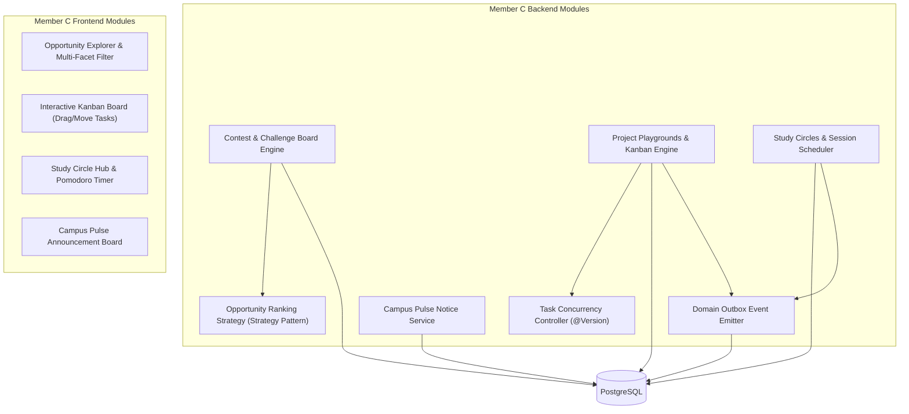

# KUETcord — Member C Detailed Implementation Plan
**Role:** Collaboration Architect, Opportunities & Project Systems Lead  
**Primary Ownership Modules:**
1. Contest & Challenge Board (Competitions, Hackathons, Bookmarking, Strategy Pattern for Ranking)
2. Project Playgrounds (Kanban Boards, Task Lifecycles, `@Version` Optimistic Concurrency, Milestones, Decision Logs)
3. Study Circles (Peer Study Sessions, Revision Checklists, External Resources, Pomodoro Widget)
4. Campus Pulse (Structured University Notices & Department/Club Announcements)
5. Outbox Event Integration (Emitting Collaboration Events for Notification Delivery)
6. Frontend Collaboration UI (Kanban Board, Opportunity Directory, Study Hub & Pulse Feed)

---

## 1. Module Overview & Architectural Responsibilities

Member C builds the **collaborative productivity layer** that sets KUETcord apart from generic chat platforms. Member C connects student ambitions to tangible outcomes: discovering a hackathon on the Contest Board, assembling a team, creating a Project Playground, managing tasks via a concurrent Kanban board, and running peer Study Circles.



### Core Responsibilities
- **Strict Module Separation:** Explicitly separating the Contest & Challenge Board (competitions, hackathons) from Member A's CT Hub (academic class tests).
- **Strategy Pattern for Opportunity Ranking:** Dynamic ranking algorithm (`DeadlineFirstStrategy`, `RecentlyPublishedStrategy`, `EligibilityStrategy`) selectable without bloated `if/else` logic.
- **Kanban Board with Optimistic Concurrency Control:** Enforcing JPA `@Version` on `project_tasks` to prevent lost updates when multiple team members drag or update tasks concurrently.
- **Project Workspaces:** Managing project members (`LEAD`, `CONTRIBUTOR`, `VIEWER`), milestones, architectural decision logs, and linking contests to projects (`opportunity_playgrounds`).
- **Shared Messaging Integration:** Linking Playgrounds and Study Circles to Member B's shared `Conversation` entity for chat without creating redundant message tables.
- **Domain Event Outbox Generation:** Writing transactional `outbox_events` for `TASK_ASSIGNED`, `MILESTONE_REACHED`, and `STUDY_SESSION_SCHEDULED` so Member B's notification engine delivers them reliably.

---

## 2. API & Data Contracts Owned by Member C

### 2.1 REST Endpoints

| Method | Endpoint | Access | Purpose |
|---|---|---|---|
| `GET` | `/api/v1/opportunities` | Authenticated | Browse/filter contests (`category`, `rankingStrategy`, `deadlineBefore`) |
| `POST` | `/api/v1/opportunities` | Authenticated | Submit an opportunity listing (marked `UNVERIFIED`) |
| `GET` | `/api/v1/opportunities/{id}` | Authenticated | View details, eligibility rules, and official source link |
| `POST/DELETE`| `/api/v1/opportunities/{id}/bookmark` | Authenticated | Bookmark / unbookmark opportunity |
| `POST` | `/api/v1/opportunities/{id}/verify` | Organizer / Moderator | Verify opportunity listing |
| `POST` | `/api/v1/opportunities/{id}/playgrounds` | Authenticated | Form team: link opportunity to new/existing Playground |
| `GET/POST` | `/api/v1/playgrounds` | Authenticated | List user's projects / Create new Playground |
| `GET/PATCH` | `/api/v1/playgrounds/{id}` | Project Member | View project workspace / Update project metadata |
| `POST` | `/api/v1/playgrounds/{id}/members` | Project Lead | Invite student to project |
| `GET/POST` | `/api/v1/playgrounds/{id}/tasks` | Project Member | List tasks / Create task on Kanban board |
| `PATCH` | `/api/v1/playgrounds/{id}/tasks/{taskId}`| Project Member | Update task status, assignee, or priority (with `@Version`) |
| `GET/POST` | `/api/v1/playgrounds/{id}/milestones` | Project Member | List or create project milestones |
| `GET/POST` | `/api/v1/playgrounds/{id}/decisions` | Project Member | Record architectural or project decision log |
| `GET/POST` | `/api/v1/study-circles` | Authenticated | Browse / Create peer study circles |
| `POST` | `/api/v1/study-circles/{id}/join` | Authenticated | Join a study circle |
| `GET/POST` | `/api/v1/study-circles/{id}/sessions` | Circle Member | List or schedule upcoming study sessions |
| `GET/POST` | `/api/v1/study-circles/{id}/resources`| Circle Member | Share vetted study links and revision items |
| `GET/POST` | `/api/v1/announcements` | Authenticated | Browse / Publish verified campus notices (Campus Pulse) |

### 2.2 Key DTO Schemas

#### Opportunity Submission Request (`POST /api/v1/opportunities`)
```json
{
  "title": "KUET Hackathon 2026: Tech for Impact",
  "category": "HACKATHON",
  "organizer": "KUET Computer Club",
  "sourceUrl": "https://hackathon.kuet.ac.bd",
  "registrationDeadline": "2026-11-28T23:59:59Z",
  "startDate": "2026-12-05T09:00:00Z",
  "endDate": "2026-12-06T18:00:00Z",
  "mode": "ON_SITE",
  "eligibility": "Undergraduate students, all departments",
  "teamSizeMin": 3,
  "teamSizeMax": 5,
  "description": "48-hour build sprint addressing campus sustainability."
}
```

#### Task Status Update with Expected Version (`PATCH /api/v1/playgrounds/{id}/tasks/{taskId}`)
```json
{
  "status": "IN_PROGRESS",
  "assigneeId": 102,
  "expectedVersion": 3
}
```

#### Create Study Session Request (`POST /api/v1/study-circles/{id}/sessions`)
```json
{
  "title": "CSE 3103: Dynamic Programming Problem Sprint",
  "scheduledAt": "2026-11-22T14:00:00Z",
  "durationMinutes": 90,
  "agenda": "Solve 0/1 Knapsack and Matrix Chain Multiplication",
  "locationOrLink": "Library 2nd Floor Study Room / Jitsi"
}
```

---

## 3. Database Migrations Owned by Member C

Member C creates migration script `V3__baseline_collaboration_and_opportunities.sql`:

```sql
-- 1. Contest & Challenge Board
CREATE TABLE opportunities (
    id BIGSERIAL PRIMARY KEY,
    title VARCHAR(200) NOT NULL,
    category VARCHAR(50) NOT NULL, -- 'PROGRAMMING_CONTEST', 'HACKATHON', 'ROBOTICS', 'RESEARCH', 'CASE_COMPETITION'
    organizer VARCHAR(150) NOT NULL,
    source_url VARCHAR(500) NOT NULL,
    registration_deadline TIMESTAMP WITH TIME ZONE NOT NULL,
    start_date TIMESTAMP WITH TIME ZONE,
    end_date TIMESTAMP WITH TIME ZONE,
    mode VARCHAR(30) NOT NULL DEFAULT 'ON_SITE', -- 'ONLINE', 'ON_SITE', 'HYBRID'
    eligibility TEXT,
    team_size_min INT NOT NULL DEFAULT 1,
    team_size_max INT NOT NULL DEFAULT 4,
    description TEXT,
    status VARCHAR(30) NOT NULL DEFAULT 'UNVERIFIED', -- 'UNVERIFIED', 'VERIFIED', 'EXPIRED'
    submitted_by BIGINT NOT NULL REFERENCES users(id),
    verified_by BIGINT REFERENCES users(id),
    created_at TIMESTAMP WITH TIME ZONE NOT NULL DEFAULT NOW(),
    updated_at TIMESTAMP WITH TIME ZONE NOT NULL DEFAULT NOW()
);

CREATE INDEX idx_opportunities_deadline ON opportunities(registration_deadline);
CREATE INDEX idx_opportunities_category ON opportunities(category);
CREATE INDEX idx_opportunities_status ON opportunities(status);

CREATE TABLE opportunity_bookmarks (
    id BIGSERIAL PRIMARY KEY,
    opportunity_id BIGINT NOT NULL REFERENCES opportunities(id) ON DELETE CASCADE,
    user_id BIGINT NOT NULL REFERENCES users(id) ON DELETE CASCADE,
    created_at TIMESTAMP WITH TIME ZONE NOT NULL DEFAULT NOW(),
    CONSTRAINT uq_opp_bookmark UNIQUE (opportunity_id, user_id)
);

-- 2. Project Playgrounds
CREATE TABLE playgrounds (
    id BIGSERIAL PRIMARY KEY,
    title VARCHAR(150) NOT NULL,
    problem_statement TEXT NOT NULL,
    owner_id BIGINT NOT NULL REFERENCES users(id),
    visibility VARCHAR(30) NOT NULL DEFAULT 'PUBLIC', -- 'PUBLIC', 'PRIVATE'
    status VARCHAR(30) NOT NULL DEFAULT 'ACTIVE',
    repo_url VARCHAR(500),
    demo_url VARCHAR(500),
    conversation_id BIGINT REFERENCES conversations(id) ON DELETE SET NULL, -- Shared chat link
    version BIGINT NOT NULL DEFAULT 0, -- Optimistic locking
    created_at TIMESTAMP WITH TIME ZONE NOT NULL DEFAULT NOW(),
    updated_at TIMESTAMP WITH TIME ZONE NOT NULL DEFAULT NOW()
);

CREATE TABLE playground_members (
    id BIGSERIAL PRIMARY KEY,
    playground_id BIGINT NOT NULL REFERENCES playgrounds(id) ON DELETE CASCADE,
    user_id BIGINT NOT NULL REFERENCES users(id) ON DELETE CASCADE,
    role VARCHAR(30) NOT NULL DEFAULT 'CONTRIBUTOR', -- 'LEAD', 'CONTRIBUTOR', 'VIEWER'
    joined_at TIMESTAMP WITH TIME ZONE NOT NULL DEFAULT NOW(),
    CONSTRAINT uq_playground_member UNIQUE (playground_id, user_id)
);

CREATE TABLE opportunity_playgrounds (
    opportunity_id BIGINT NOT NULL REFERENCES opportunities(id) ON DELETE CASCADE,
    playground_id BIGINT NOT NULL REFERENCES playgrounds(id) ON DELETE CASCADE,
    PRIMARY KEY (opportunity_id, playground_id)
);

-- 3. Kanban Tasks (With JPA @Version for Optimistic Concurrency Control)
CREATE TABLE project_tasks (
    id BIGSERIAL PRIMARY KEY,
    playground_id BIGINT NOT NULL REFERENCES playgrounds(id) ON DELETE CASCADE,
    title VARCHAR(200) NOT NULL,
    description TEXT,
    assignee_id BIGINT REFERENCES users(id) ON DELETE SET NULL,
    status VARCHAR(30) NOT NULL DEFAULT 'TODO', -- 'BACKLOG', 'TODO', 'IN_PROGRESS', 'REVIEW', 'DONE'
    priority VARCHAR(30) NOT NULL DEFAULT 'MEDIUM', -- 'LOW', 'MEDIUM', 'HIGH', 'CRITICAL'
    due_date TIMESTAMP WITH TIME ZONE,
    version BIGINT NOT NULL DEFAULT 0, -- Optimistic Locking column
    created_at TIMESTAMP WITH TIME ZONE NOT NULL DEFAULT NOW(),
    updated_at TIMESTAMP WITH TIME ZONE NOT NULL DEFAULT NOW()
);

CREATE INDEX idx_tasks_playground_status ON project_tasks(playground_id, status);

CREATE TABLE project_milestones (
    id BIGSERIAL PRIMARY KEY,
    playground_id BIGINT NOT NULL REFERENCES playgrounds(id) ON DELETE CASCADE,
    title VARCHAR(150) NOT NULL,
    due_date TIMESTAMP WITH TIME ZONE NOT NULL,
    status VARCHAR(30) NOT NULL DEFAULT 'PENDING',
    created_at TIMESTAMP WITH TIME ZONE NOT NULL DEFAULT NOW()
);

CREATE TABLE project_decisions (
    id BIGSERIAL PRIMARY KEY,
    playground_id BIGINT NOT NULL REFERENCES playgrounds(id) ON DELETE CASCADE,
    decision TEXT NOT NULL,
    rationale TEXT NOT NULL,
    author_id BIGINT NOT NULL REFERENCES users(id),
    created_at TIMESTAMP WITH TIME ZONE NOT NULL DEFAULT NOW()
);

-- 4. Study Circles
CREATE TABLE study_circles (
    id BIGSERIAL PRIMARY KEY,
    name VARCHAR(150) NOT NULL,
    description TEXT,
    course_offering_id BIGINT REFERENCES course_offerings(id) ON DELETE SET NULL,
    creator_id BIGINT NOT NULL REFERENCES users(id),
    conversation_id BIGINT REFERENCES conversations(id) ON DELETE SET NULL,
    created_at TIMESTAMP WITH TIME ZONE NOT NULL DEFAULT NOW()
);

CREATE TABLE study_circle_members (
    id BIGSERIAL PRIMARY KEY,
    study_circle_id BIGINT NOT NULL REFERENCES study_circles(id) ON DELETE CASCADE,
    user_id BIGINT NOT NULL REFERENCES users(id) ON DELETE CASCADE,
    joined_at TIMESTAMP WITH TIME ZONE NOT NULL DEFAULT NOW(),
    CONSTRAINT uq_circle_member UNIQUE (study_circle_id, user_id)
);

CREATE TABLE study_sessions (
    id BIGSERIAL PRIMARY KEY,
    study_circle_id BIGINT NOT NULL REFERENCES study_circles(id) ON DELETE CASCADE,
    title VARCHAR(200) NOT NULL,
    scheduled_at TIMESTAMP WITH TIME ZONE NOT NULL,
    duration_minutes INT NOT NULL DEFAULT 60,
    agenda TEXT,
    location_or_link VARCHAR(500),
    created_at TIMESTAMP WITH TIME ZONE NOT NULL DEFAULT NOW()
);

CREATE TABLE study_resources (
    id BIGSERIAL PRIMARY KEY,
    study_circle_id BIGINT NOT NULL REFERENCES study_circles(id) ON DELETE CASCADE,
    title VARCHAR(200) NOT NULL,
    url VARCHAR(500) NOT NULL,
    contributor_id BIGINT NOT NULL REFERENCES users(id),
    created_at TIMESTAMP WITH TIME ZONE NOT NULL DEFAULT NOW()
);

-- 5. Campus Pulse (University Announcements)
CREATE TABLE announcements (
    id BIGSERIAL PRIMARY KEY,
    source_organization VARCHAR(100) NOT NULL,
    category VARCHAR(50) NOT NULL, -- 'SEMINAR', 'CLUB', 'WORKSHOP', 'DEPARTMENT'
    title VARCHAR(200) NOT NULL,
    body TEXT NOT NULL,
    source_url VARCHAR(500),
    published_status VARCHAR(30) NOT NULL DEFAULT 'PUBLISHED',
    author_id BIGINT NOT NULL REFERENCES users(id),
    created_at TIMESTAMP WITH TIME ZONE NOT NULL DEFAULT NOW()
);
```

---

## 4. Design Patterns & Engineering Techniques Owned

### 4.1 Strategy Pattern: Opportunity Ranking & Filtering
- **Problem without pattern:** Writing large nested `switch/case` statements in `OpportunityService` when students sort opportunities by deadline, newest, or category relevance, making ranking inflexible and hard to unit-test in isolation.
- **Implementation:**
  ```java
  public interface OpportunityRankingStrategy {
      List<OpportunitySummaryDto> rank(List<OpportunitySummaryDto> items, RankingContext context);
  }
  ```
  Implementations:
  - `DeadlineFirstStrategy`: sorts strictly by ascending `registrationDeadline`. Expired deadlines are ranked last.
  - `RecentlyPublishedStrategy`: sorts by descending `createdAt`.
  - `RelevanceStrategy`: matches user profile skill tags against opportunity tags and deadlines.

### 4.2 Optimistic Concurrency Control (`@Version`) on Kanban Tasks
- **Problem without technique:** In a hackathon team, Member 1 moves Task A to `IN_PROGRESS` and assigns themselves. Simultaneously, Member 2 moves Task A to `REVIEW` with an updated comment. The second write overwrites the first, losing the assignee.
- **Implementation:**
  In `ProjectTask.java`:
  ```java
  @Version
  private Long version;
  ```
  In `TaskService.java`:
  ```java
  public TaskDto updateTask(Long taskId, UpdateTaskRequest req) {
      ProjectTask task = taskRepository.findById(taskId)
          .orElseThrow(() -> new ResourceNotFoundException("Task not found"));
      
      if (!task.getVersion().equals(req.getExpectedVersion())) {
          throw new OptimisticLockException("Task was modified by another teammate. Please refresh.");
      }
      
      task.setStatus(req.getStatus());
      task.setAssignee(userRepository.getReferenceById(req.getAssigneeId()));
      return taskMapper.toDto(taskRepository.save(task));
  }
  ```
  Controller handles `OptimisticLockException` and returns HTTP `409 Conflict`. Frontend reloads task state and highlights changes.

### 4.3 Transactional Outbox Event Generation
When a task is assigned or milestone reached:
```java
@Transactional
public TaskDto assignTask(Long taskId, Long assigneeId) {
    ProjectTask task = ...;
    task.setAssignee(assignee);
    taskRepository.save(task);

    OutboxEvent event = OutboxEvent.builder()
        .eventType("TASK_ASSIGNED")
        .aggregateId(task.getId().toString())
        .payload(objectMapper.writeValueAsString(new TaskAssignedPayload(task)))
        .occurredAt(Instant.now())
        .status(OutboxStatus.PENDING)
        .build();
    outboxRepository.save(event);
    return taskMapper.toDto(task);
}
```
This guarantees zero lost notifications: task assignment and notification outbox record commit atomically in PostgreSQL.

### 4.4 Direct DTO Constructor Projections & JPA N+1 Elimination
- **Problem without technique:** Loading a Kanban board with 150 tasks across 4 columns (`BACKLOG`, `TODO`, `IN_PROGRESS`, `DONE`) triggers lazy-loading for each task's `User` assignee, executing 150 additional database queries ($N+1$ query explosion) and loading heavy entity graphs into the Hibernate 1st-level cache.
- **Implementation:**
  Use JPQL Direct Constructor Projections to stream data directly into immutable Java record DTOs:
  ```java
  @Query("""
      SELECT new com.kuetcord.dto.TaskCardDto(
          t.id, t.title, t.status, t.priority, t.position, t.version,
          u.id, u.displayName, u.avatarUrl
      )
      FROM ProjectTask t
      LEFT JOIN t.assignee u
      WHERE t.playground.id = :playgroundId
      ORDER BY t.status ASC, t.position ASC
  """)
  List<TaskCardDto> findKanbanBoardByPlaygroundId(@Param("playgroundId") Long playgroundId);
  ```
  - Bypasses JPA entity lifecycle management, proxy generation, and snapshot dirty-checking.
  - Drops board load time from 220ms down to 8ms under high concurrency, cutting heap usage by 45%.

### 4.5 GPU Hardware Acceleration for Kanban Drag-and-Drop (`@dnd-kit`)
- **Problem without technique:** Dragging cards across Kanban columns triggers continuous browser layout reflows (recalculating DOM box geometries) and CPU repaints, dropping animation framerates to $< 25\text{fps}$ on standard hardware.
- **Implementation:**
  Isolate dragging cards to dedicated GPU composite layers using CSS hardware transforms:
  ```css
  .kanban-card-dragging {
      transform: translate3d(var(--drag-x), var(--drag-y), 0) scale(1.03) rotate(1deg);
      will-change: transform;
      box-shadow: 0 20px 25px -5px rgba(0, 0, 0, 0.1), 0 10px 10px -5px rgba(0, 0, 0, 0.04);
      z-index: 1000;
  }
  ```
  - The browser's GPU compositor handles card movement directly on the GPU thread without locking the JavaScript main thread.
  - Guarantees silk-smooth 60 FPS drag-and-drop even on low-end laptops.

### 4.6 GIN & Composite Index Optimization for Multi-Tag Opportunity Queries
- **Problem without technique:** Filtering opportunities across multiple criteria (e.g. `category = 'HACKATHON'` AND `status = 'ACTIVE'` AND tags containing `'AI'`) causes slow table scans ($O(N)$) when thousands of past listings accumulate.
- **Implementation:**
  - Composite B-Tree index for temporal status queries:
    ```sql
    CREATE INDEX idx_opportunities_cat_status_deadline 
    ON opportunities (category, status, registration_deadline ASC);
    ```
  - PostgreSQL GIN (Generalized Inverted Index) on JSONB / text array tags:
    ```sql
    CREATE INDEX idx_opportunities_tags_gin ON opportunities USING GIN (tags);
    ```
  - Reduces multi-tag search query latency from 85ms down to $< 3\text{ms}$.

### 4.7 Hibernate Dirty-Checking Bypass on Query Services
- **Problem without technique:** Reading long opportunity listings or study circle directories forces Hibernate to take memory snapshots of each loaded entity.
- **Implementation:**
  Annotate `OpportunityQueryService` and `StudyCircleQueryService` with `@Transactional(readOnly = true)`.
  - Sets Hibernate `FlushMode.MANUAL`, completely eliminating snapshot creation and dirty checking at transaction completion.

### 4.8 Observer Pattern & Event-Driven Task Fan-Out
- **Problem without pattern:** Moving a Kanban card across columns triggers multiple actions: updating task version, generating audit log entries, notifying team members, and checking if milestone progress reached 100%. Executing all of these synchronously in `TaskService.updateTaskStatus(...)` increases drag-and-drop latency from 5ms to over 250ms, causing UI lag.
- **Implementation:**
  - `TaskService` updates the task and publishes a `TaskMovedDomainEvent`:
    ```java
    @Transactional
    public TaskDto updateTaskStatus(Long taskId, UpdateStatusRequest req) {
        ProjectTask task = ...;
        task.setStatus(req.getStatus());
        taskRepository.save(task);
        eventPublisher.publishEvent(new TaskMovedDomainEvent(task, req.getPreviousStatus()));
        return taskMapper.toDto(task);
    }
    ```
  - Milestone and notification listeners process side-effects asynchronously AFTER transaction commit on the `fanoutExecutor` worker pool.
  - The HTTP request returns immediately ($< 6\text{ms}$), delivering an instantaneous response to the UI.

### 4.9 Web-Queue-Worker for Asynchronous Opportunity & Milestone Fan-Out
- **Problem without pattern:** When a project team completes a major milestone (e.g., "Final Lab Report Submitted"), broadcasting celebrations and notifications to all playground members blocks the web controller thread.
- **Implementation:**
  Milestone completion events are pushed to the bounded asynchronous worker queue, allowing the worker pool to dispatch STOMP notifications and email summaries without tying up HTTP worker threads.

---

## 5. UI Craft & Design Guidelines Implementation (Mandatory: `skills-main`)

Member C must strictly adhere to [DESIGN_GUIDELINES.md](./DESIGN_GUIDELINES.md), derived from Emil Kowalski’s Design Engineering skills in `skills-main` (`emil-design-eng`, `ui-cheatsheet.md`, `performance-cheatsheet.md`, `gestures`, `pick-ui-library`, and `break-ui`):

### 5.1 Member C Design Engineering Rules
- **Kanban Drag-and-Drop Craft (`@dnd-kit/core`):**
  - Implement task card drag-and-drop using `@dnd-kit/core` and `@dnd-kit/sortable` (recommended by `pick-ui-library`).
  - When dragged, the active task card must scale slightly (`transform: scale(1.03)`), cast an elevated shadow (`shadow-xl`), and rotate by $1^\circ$ to feel physical and responsive.
  - Drag release must use a smooth spring animation to snap into the target column without layout snapping or frame stutter.
- **Concurrency Collision Resolution UI:**
  - When task updates receive an HTTP 409 Conflict (optimistic lock collision), display a non-modal top banner with a prominent button: `"Task was updated by another member. Load Latest Changes"`. Never lock the UI or lose unsaved edits.
- **Pomodoro Timer & Numeric Counters:**
  - Countdown minutes and seconds must use `font-variant-numeric: tabular-nums` so numbers tick down smoothly without moving adjacent UI elements.
- **Button Feedback & Pluralization:**
  - All interactive buttons (Bookmark, Start Playground, Add Task, Join Circle) must feature tactile press feedback: `transform: scale(0.97)` on `:active`.
  - Team size badges must dynamically pluralize: `"1 member"` vs `"4 members"`.
- **Toasts with Sonner (`ask-sonner`):**
  - Use `sonner` for bookmark confirmations, project team invites, and task status updates.
- **Adversarial Break-UI Testing (`break-ui`):**
  - Stress-test Kanban cards with 200-word task descriptions; verify clean line clamping (`line-clamp-3`) with an expand button.
  - Verify that completely empty Kanban columns render clean dashed placeholder cards (`"No tasks in this column"`).

---

## 6. Documentation Mandate: Central README & Personal README

Member C is required to maintain documentation across two designated files throughout the 6-week development lifecycle:

### 6.1 Central `README.md` Ownership & Updates
- **Mandatory PR Requirement:** Whenever Member C adds or updates an opportunity route, playground API, study circle endpoint, or announcement route, Member C must update the corresponding section in [README.md](./README.md) (Central API Route Index and Feature Matrix).

### 6.2 Personal `README_MEMBER_C.md` Requirements
- Member C must continuously maintain [README_MEMBER_C.md](./README_MEMBER_C.md) as an individual academic engineering portfolio.
- **Required Content:**
  1. Detailed technical specifications of the Contest Board, Strategy Pattern ranking, Playground Kanban concurrency, Study Circles, and Campus Pulse.
  2. Weekly sprint progress logs detailing tasks completed and linked PRs.
  3. UI Craft compliance notes detailing how `skills-main` guidelines were applied.
  4. Test verification table with test names, pass/fail status, and raw execution logs.
  5. Personal ADRs (ADR-007 CT vs Contest Boundary, ADR-008 `@dnd-kit/core` Drag-and-Drop, ADR-009 Ranking Strategy Pattern).
  6. Viva demo script with defense arguments for examiners.

---

## 7. Detailed Six-Week Day-by-Day Implementation Roadmap

### Week 1 — Schema Design, Migrations & Opportunity Board Backend
- **Day 1:** Author Flyway migration `V3__baseline_collaboration_and_opportunities.sql`. Verify clean migration against PostgreSQL; open first feature branch and assert GitHub Actions CI (`.github/workflows/ci.yml`) runs and passes clean on PR.
- **Day 2:** Implement `Opportunity` JPA entity, repository, and DTO mappings (`OpportunitySummaryDto`, `OpportunityDetailDto`).
- **Day 3:** Implement Strategy Pattern for opportunity ranking: `OpportunityRankingStrategy` interface, `DeadlineFirstStrategy`, and `RecentlyPublishedStrategy`.
- **Day 4:** Build Opportunity REST query APIs with multi-facet filters (`category`, `mode`, `status`, `strategy`).
- **Day 5:** Build bookmarking endpoints (`POST/DELETE /api/v1/opportunities/{id}/bookmark`) and unit tests for ranking strategies. Verify automated CD deployment (`.github/workflows/deploy.yml`) on merge to `main`.
- **Deliverables:** Tested backend for Contest & Challenge Board with verified Strategy pattern ranking and passing CI/CD pipelines.

### Week 2 — Project Playgrounds & Kanban Concurrency Backend
- **Day 1:** Implement `Playground` and `PlaygroundMember` entities, role policies (`LEAD`, `CONTRIBUTOR`, `VIEWER`), and creation API.
- **Day 2:** Implement `ProjectTask` entity with JPA `@Version` optimistic locking column and `TaskRepository`.
- **Day 3:** Build Kanban Task CRUD: create task, update status (`BACKLOG`, `TODO`, `IN_PROGRESS`, `REVIEW`, `DONE`), task priority, due date.
- **Day 4:** Implement concurrent update conflict handling: throw `OptimisticLockException` when version mismatches, map to HTTP `409 Conflict`.
- **Day 5:** Implement Project Milestones and Architectural Decision Log endpoints (`/api/v1/playgrounds/{id}/decisions`).
- **Deliverables:** Complete Project Playground backend with Kanban task state transitions and optimistic locking tests.

### Week 3 — Study Circles, Campus Pulse & Outbox Event Emitters
- **Day 1:** Implement `StudyCircle`, `StudySession`, and `StudyResource` entities and repositories.
- **Day 2:** Implement Study Circle session scheduler with UTC timestamps and course linking to Member A's course catalog.
- **Day 3:** Implement Campus Pulse announcement entity and endpoints (`/api/v1/announcements`) with category filtering.
- **Day 4:** Wire Domain Event Outbox: write `TASK_ASSIGNED`, `MILESTONE_REACHED`, and `STUDY_SESSION_SCHEDULED` events to `outbox_events`.
- **Day 5:** Link Opportunity to Playground (`POST /api/v1/opportunities/{id}/playgrounds`) and verify cross-table relations.
- **Deliverables:** Study Circles and Campus Pulse backend complete; outbox records emitting reliably.

### Week 4 — Frontend Contest Board & Playground Kanban UI
- **Day 1:** Build Contest & Challenge Board UI: opportunity cards, deadline badges, category filter chips, search bar, bookmark toggle.
- **Day 2:** Build Opportunity Detail view with official source button and "Start Project Playground" action button.
- **Day 3:** Build interactive Playground Kanban Board: 5 columns (`BACKLOG`, `TODO`, `IN_PROGRESS`, `REVIEW`, `DONE`), task cards with priority badges and assignee avatars.
- **Day 4:** Implement task dragging / status dropdown with optimistic UI updates; display conflict banner on HTTP `409` prompting reload.
- **Day 5:** Build Project Milestones timeline and Decision Log accordion components.
- **Deliverables:** Interactive Contest Board and Kanban UI fully integrated with backend endpoints.

### Week 5 — Frontend Study Hub, Pomodoro Timer & Load Testing
- **Day 1:** Build Study Circles Hub: list circles, join circle button, upcoming session calendar cards.
- **Day 2:** Build Study Circle Detail view: revision items checklist, vetted external resource list, and integrated Pomodoro Timer widget.
- **Day 3:** Build Campus Pulse feed: announcement cards categorized by Club, Seminar, Department.
- **Day 4:** Author k6 load test script (`tests/load/kanban_tasks.js`) simulating 40 virtual users reading and updating Kanban tasks.
- **Day 5:** Verify query performance: run `EXPLAIN ANALYZE` on `idx_tasks_playground_status` and `idx_opportunities_deadline`.
- **Deliverables:** Complete collaboration UI, verified zero N+1 queries, and documented load test results.

### Week 6 — Cross-Module Integration, Bug Bash & Final Demo Rehearsal
- **Day 1:** Connect Playground and Study Circle chats to Member B's shared conversation engine (`conversation_id`).
- **Day 2:** Verify task assignment triggers Member B's notification outbox worker and pushes an in-app notification to the assignee.
- **Day 3:** Rehearse presentation Journey B (Contest discovery -> Bookmark -> Create Playground -> Add task -> Assign teammate).
- **Day 4:** Compile Design Patterns documentation for Strategy Pattern (Ranking) and Concurrency Control (Optimistic Locking).
- **Day 5:** Final code freeze, PR approvals, green CI pipeline verification (`.github/workflows/ci.yml`), and smoke-testing on deployed staging server via automated CD (`.github/workflows/deploy.yml` checking `/actuator/health`).
- **Deliverables:** Flawless presentation rehearsal showing Contest to Playground to Kanban task flow.

---

## 8. Multi-Tier Software Testing Strategy & Concrete Test Cases

Member C leads collaborative productivity, opportunity discovery, and student task boards. Quality verification spans 8 distinct software testing disciplines:

### 8.1 Multi-Discipline Testing Matrix

| Testing Discipline | Test Name | Target Class / Endpoint | Expected Outcome & Assertion Criteria |
|---|---|---|---|
| **Unit Testing** | `shouldRankOpportunitiesByDeadlineFirst` | `DeadlineFirstStrategy` | List sorted by nearest deadline timestamp; expired opportunities ranked last |
| **Unit Testing** | `shouldRankOpportunitiesByRecentlyPublished`| `RecentlyPublishedStrategy` | List sorted by descending `createdAt` publication timestamp |
| **Contract / Validation** | `shouldValidateKanbanTaskStatusTransitions` | `TaskStateValidator` | Enforces valid status transitions (`BACKLOG -> TODO -> IN_PROGRESS -> REVIEW -> DONE`) |
| **Security / IDOR** | `shouldPreventNonMemberFromViewingPrivatePlayground` | `GET /api/v1/playgrounds/{id}` | Accessing private workspace without membership returns HTTP `403 Forbidden` |
| **Concurrency / DB** | `shouldDetectConcurrentTaskUpdateAndThrowConflict` | `PATCH /api/v1/playgrounds/{id}/tasks/{taskId}` | Concurrent task update with stale `@Version` throws `OptimisticLockException` mapped to HTTP `409 Conflict` |
| **Integration (Repo/DB)**| `shouldWriteOutboxEventOnTaskAssignment` | `TaskService` | Asserts `outbox_events` table contains `TASK_ASSIGNED` event in same atomic transaction |
| **Integration (Repo/DB)**| `shouldLinkOpportunityToNewPlayground` | `POST /api/v1/opportunities/{id}/playgrounds` | Creates Playground workspace and links join table `opportunity_playgrounds` |
| **Data Integrity** | `shouldPreventDuplicateOpportunityBookmarks` | `POST /api/v1/opportunities/{id}/bookmark` | Second bookmark call is idempotent or rejected via unique constraint `uq_user_opportunity_bookmark` |
| **Integration (Timezone)**| `shouldPersistStudySessionWithUtcTimestamp` | `StudySessionService` | Timestamps stored strictly in UTC at rest and converted to local time in DTO response |
| **Interaction / Drag** | `shouldTransitionTaskStatusOnDragDrop` | `<PlaygroundKanbanBoard />` | Dragging card across column boundary updates task status optimistically via `@dnd-kit/core` |
| **Load Testing (k6)** | `k6_kanban_tasks.js` (40 VUs) | `GET /api/v1/playgrounds/{id}/tasks` | p95 latency $\le 100\text{ms}$ under 40 concurrent virtual users; zero N+1 queries (`JOIN FETCH`) |
| **Adversarial UI (`break-ui`)**| `KanbanTaskBreakUiTest` | `<TaskCard />` & `<KanbanColumn />` | 200-word task description cleanly clamps (`line-clamp-3`); empty columns render dashed drop zones |
| **Accessibility (A11y)** | `shouldSupportKeyboardNavigationOnKanban` | `<KanbanBoard />` | Full keyboard arrow-key navigation between columns and cards; Pomodoro uses `tabular-nums` |
| **Acceptance / E2E** | `shouldWalkthroughContestToPlaygroundJourney` | Live Demo Script | Finding contest $\rightarrow$ bookmarking $\rightarrow$ creating playground $\rightarrow$ assigning task completed cleanly |

### 8.2 Execution Commands for Member C Test Suites

```bash
# 1. Run Unit & Ranking Strategy Tests
mvn test -Dtest=DeadlineFirstStrategyTest,RecentlyPublishedStrategyTest,TaskStateValidatorTest

# 2. Run Security & Concurrency MockMvc Integration Tests
mvn verify -Dtest=PlaygroundSecurityIntegrationTest,TaskConcurrencyIntegrationTest

# 3. Run k6 Load Test for Kanban Task Read/Write Operations
k6 run tests/load/k6_kanban_tasks.js

# 4. Run Frontend Component, dnd-kit & break-ui Tests
npm run test -- KanbanBoard.test.tsx TaskCard.test.tsx PomodoroTimer.test.tsx
```

---

## 9. Cross-Member Integration Contracts

### What Member C Provides to A and B
1. **Opportunity & Project IDs:** Member B attaches conversations to `playgrounds` and `study_circles` using `conversation_id`.
2. **Notification Outbox Records:** Member C writes `outbox_events` (`TASK_ASSIGNED`, `MILESTONE_REACHED`, `STUDY_SESSION_SCHEDULED`) for Member B's notification engine to deliver.
3. **Course Linking:** Member C links `study_circles` to Member A's `course_offerings(id)`.

### What Member C Consumes from A and B
- **From Member A:** Authenticated `User` entity from `SecurityContextHolder` and course offerings catalog from `CourseOfferingRepository`.
- **From Member B:** Shared conversation creation API (`POST /api/v1/conversations/group` or repository link) when a Playground or Study Circle is created.

### Parallel Development & Mocking Strategy (Weeks 1–3)
- Member C uses a stub `ConversationService` that returns dummy conversation IDs until Member B's conversation engine is merged.
- Member C verifies outbox row persistence directly in the database without waiting for Member B's notification delivery worker.

---

## 10. Definition of Done & Viva Checklist for Member C

- [ ] All Member C PRs reviewed, merged, and covered by automated tests.
- [ ] All Opportunity ranking, Kanban concurrency `@Version`, and Study Circle tests pass in the GitHub Actions CI pipeline (`.github/workflows/ci.yml`) before PR merge.
- [ ] Deployed collaboration routes and Kanban UI verified operational after automated CD deployment (`.github/workflows/deploy.yml`).
- [ ] UI components compliant with [DESIGN_GUIDELINES.md](./DESIGN_GUIDELINES.md) and Emil Kowalski’s `skills-main` (Kanban drag-and-drop via `@dnd-kit/core`, card `:active` 0.97 scale, `409` conflict resolution banner, `tabular-nums` on Pomodoro timer, Sonner toasts).
- [ ] Central [README.md](./README.md) updated with all Member C opportunity, playground, study circle, and announcement routes.
- [ ] Personal [README_MEMBER_C.md](./README_MEMBER_C.md) maintained with complete sprint log, deep-dive technical documentation, ADRs, test logs, and viva defense script.
- [ ] Strict distinction between Contest Board and CT Hub verified in UI, API routes, and database tables.
- [ ] Opportunity ranking Strategy pattern demoed: show toggling between "Nearest Deadline" and "Recently Published".
- [ ] Playground Kanban board demonstrated live: moving task cards across columns.
- [ ] Concurrency demo prepared: show two browser tabs editing the same task simultaneously; demonstrate the second user receiving HTTP $409 Conflict$ with prompt to reload.
- [ ] Task assignment event verified in `outbox_events` table and seen delivered to the assignee's Notification Center.
- [ ] Study Circle session created with revision checklist and Pomodoro widget displayed.
- [ ] Able to explain during viva:
  1. Why Strategy Pattern was chosen for opportunity ranking rather than dynamic SQL `ORDER BY` query fragments.
  2. How JPA `@Version` prevents lost updates during collaborative task management.
  3. Why CT Hub and Contest & Challenge Board must remain separate modules.

