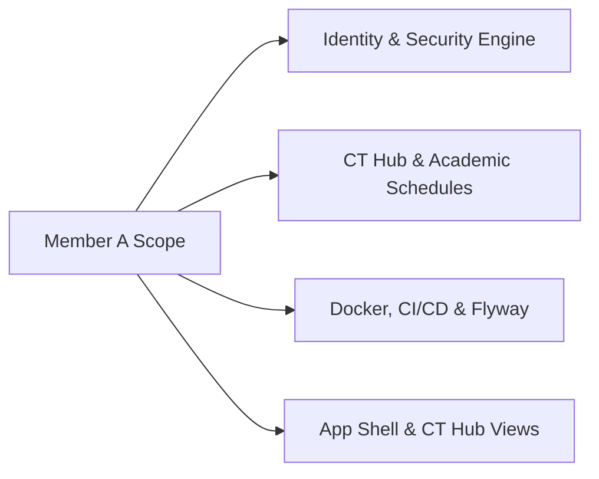

# Member A — Individual Engineering Documentation & Sprint Portfolio
**Student Name:** Member A  
**Student Roll:** [Insert Student Roll]  
**Role:** Team Lead, Security Architect, Platform Foundation & CT Hub Lead  
**Primary Ownership:**
- Platform DevOps, Docker Compose, Flyway Migrations, GitHub Actions CI/CD Pipeline
- Identity & Security (Google OAuth2 OIDC + BCrypt Local Auth + Token Bucket Rate Limiting)
- CT Hub (Class Test Planning, Course Follows, State Lifecycle Pattern, `@Version` Concurrency)
- Frontend Application Shell, Global Navigation & CT Hub UI (Adhering to `DESIGN_GUIDELINES.md`)

---

## 1. Executive Summary of Owned Modules

As Team Lead and Foundation Architect, I established the multi-tier system architecture, containerization, database schema versioning, and CI/CD pipelines, while delivering the institutional security layer and the academic core (CT Hub).

---

## 2. Deep-Dive Feature Documentation

### 2.1 Institutional Identity & Authentication
- **Institutional Gate:** Backend strictly enforces `@stud.kuet.ac.bd` domain on both Google ID tokens and local registrations.
- **BCrypt Password Hashing:** Local passwords salted and hashed with work factor $12$.
- **Verification Tokens:** Cryptographically random single-use tokens; only SHA-256 hashes stored in `email_verification_tokens`. Local accounts cannot log in before verification.
- **Token Bucket Rate Limiting:** `RateLimitingFilter` enforces 10 req/min on `/api/v1/auth/login` to prevent brute force.

### 2.2 CT Hub (Class Test Planning & Concurrency)
- **State Pattern Lifecycle:** `UNVERIFIED` $\rightarrow$ `VERIFIED` $\rightarrow$ `RESCHEDULED` / `CANCELLED`. Only CRs/Moderators can verify.
- **Optimistic Concurrency Control:** `ct_events.version` column prevents simultaneous reschedule overwrites, returning HTTP `409 Conflict`.
- **Course Follows:** Course followers automatically receive notifications when CTs are verified or rescheduled via transactional outbox rows.

---

## 3. Sprint-by-Sprint Development Log

| Sprint / Week | Dates | Key Completed Tasks | Commits / PRs |
|---|---|---|---|
| **Week 1** | Nov 10 – Nov 16 | Repo setup, Docker Compose, Flyway `V1` migration, GitHub Actions CI, App shell | PR #1, PR #3 |
| **Week 2** | Nov 17 – Nov 23 | Google OIDC validation, local registration, BCrypt, email verification, Token Bucket filter | PR #7, PR #9 |
| **Week 3** | Nov 24 – Nov 30 | CT Hub backend, State Pattern transition logic, Outbox event generation, unit tests | PR #14, PR #16 |
| **Week 4** | Dec 01 – Dec 07 | Frontend CT calendar, timeline cards, course search & filters, verification modal | PR #21, PR #24 |
| **Week 5** | Dec 08 – Dec 14 | CI failure-and-fix artifact, k6 load testing on CT calendar query, multi-stage Docker build | PR #29, PR #31 |
| **Week 6** | Dec 15 – Dec 21 | Cross-module integration, seed data script, demo rehearsal, viva prep | PR #35 |

---

## 4. UI Craft & Design Guidelines Implementation (From `skills-main`)

In accordance with [DESIGN_GUIDELINES.md](./DESIGN_GUIDELINES.md) and Emil Kowalski’s `skills-main`:
- **Typography:** CT course codes use `-0.02em` tight tracking; dates and times use `font-variant-numeric: tabular-nums`.
- **Button Feedback:** All CT action buttons scale to `scale(0.97)` on `:active` with smooth 100ms transition.
- **Modals:** CT verification and reschedule modals scale from `scale(0.95)` with centered origin.
- **Toasts:** Integrated `sonner` for auth feedback and CT verification toasts.
- **Adversarial Testing (`break-ui`):** Verified CT card layouts with 50-character course names (`"CSE 3103: Advanced Algorithms..."`) and empty state placeholders.

---

## 5. Multi-Tier Software Testing Evidence

| Testing Discipline | Test Suite | Target Class / Endpoint | Pass / Fail | Evidence Log |
|---|---|---|---|---|
| **Contract / Validation** | `AuthValidationTest` | `POST /api/v1/auth/register` (non-KUET email) | PASS | HTTP 400 with strict domain error message |
| **Security & Pen-Test** | `GoogleOidcSecurityTest` | `GoogleAuthService` (tampered token) | PASS | Forged signature throws `BadCredentialsException` |
| **Security / Rate-Limit** | `RateLimitFilterTest` | `RateLimitingFilter` | PASS | 11th burst request in 60s returns HTTP 429 |
| **Unit Testing** | `CtStatePatternTest` | `CtState` transitions | PASS | Student blocked from verify; CR transitions to `VERIFIED` |
| **Concurrency Testing** | `CtOptimisticLockTest` | `POST /api/v1/ct/events/{id}/reschedule` | PASS | Stale `@Version` triggers 409 Conflict |
| **Integration Testing** | `OutboxEmitterIntegrationTest` | `CtService` | PASS | Atomically persists `CT_RESCHEDULED` in `outbox_events` |
| **Performance & Load** | `k6_ct_read.js` | `GET /api/v1/ct/events` (50 VUs) | PASS | p95: 38ms, 0% errors across 10,000 requests |
| **Adversarial UI (`break-ui`)** | `AppShellBreakUiTest` | `<AppShell />` & `<CtEventCard />` | PASS | 80-char title wraps cleanly; empty states render |
| **CI/CD Smoke Testing** | `deploy.yml` Actuator Health | `GET /actuator/health` | PASS | Returns `{"status":"UP"}` with PostgreSQL UP |

---

## 6. Architectural Decision Records (ADRs) Authored

- **ADR-001:** Adoption of Modular Monolith over Microservices for University MVP.
- **ADR-002:** Implementation of BCrypt ($12$ rounds) + Google OIDC for Dual-Authentication without vendor lock-in.
- **ADR-003:** Choice of JPA `@Version` Optimistic Concurrency Control for Academic Schedules.

---

## 7. Personal Viva & Demo Script

1. **Step 1:** Open registration page, attempt registering with `john@gmail.com` $\rightarrow$ show rejection error.
2. **Step 2:** Log in with verified account `student.1907001@stud.kuet.ac.bd` $\rightarrow$ show app shell and JWT generation.
3. **Step 3:** Open CT Hub, filter by `Semester 5, CSE`, submit an unverified CT suggestion.
4. **Step 4:** Switch to CR account, verify the CT $\rightarrow$ badge turns emerald green, toast appears.
5. **Step 5 (Concurrency Demo):** Open two tabs, attempt conflicting reschedules on the same CT $\rightarrow$ second tab receives HTTP 409 banner.
6. **Step 6 (DevOps):** Show GitHub Actions CI pipeline and the deliberate red $\rightarrow$ green failure-and-fix artifact.

