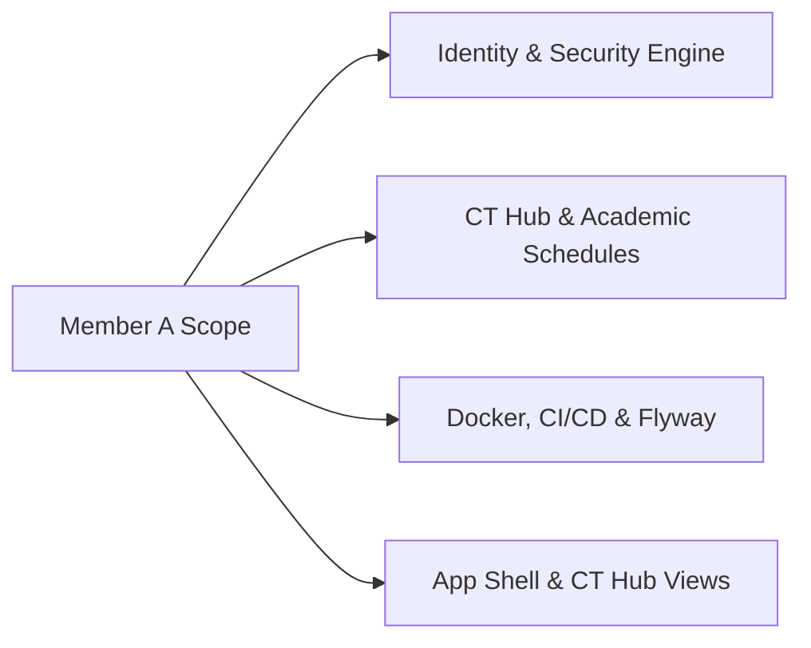

# Member A — Individual Engineering Documentation & Sprint Portfolio
**Student Name:** Member A  
**Student Roll:** [Insert Student Roll]  
**Role:** Team Lead, Security Architect, Platform Foundation & CT Hub Lead  
**Primary Ownership:**
- Platform DevOps, Docker Compose, Flyway Migrations, GitHub Actions CI/CD Pipeline
- Identity & Security (Google OAuth2 OIDC + BCrypt Local Auth + Token Bucket Rate Limiting)
- CT Hub (Class Test Planning, Course Follows, State Lifecycle Pattern, `@Version` Concurrency)
- Frontend Application Shell, Global Navigation & CT Hub UI (Adhering to `DESIGN_GUIDELINES.md`)

---

## 1. Executive Summary of Owned Modules

As Team Lead and Foundation Architect, I established the multi-tier system architecture, containerization, database schema versioning, and CI/CD pipelines, while delivering the institutional security layer and the academic core (CT Hub).

---

## 2. Deep-Dive Feature Documentation

### 2.1 Institutional Identity & Authentication
- **Institutional Gate:** Backend strictly enforces KUET student (`@stud.kuet.ac.bd`) and faculty (`@kuet.ac.bd`, `@<dept>.kuet.ac.bd`) domains on both Google ID tokens and local registrations; faculty accounts automatically receive `ROLE_TEACHER`.
- **BCrypt Password Hashing:** Local passwords salted and hashed with work factor $12$.
- **Verification Tokens:** Cryptographically random single-use tokens; only SHA-256 hashes stored in `email_verification_tokens`. Local accounts cannot log in before verification.
- **Token Bucket Rate Limiting:** `RateLimitingFilter` enforces 10 req/min on `/api/v1/auth/login` to prevent brute force.

### 2.2 CT Hub (Class Test Planning & Concurrency)
- **State Pattern Lifecycle & Teacher Approval (`V10`):** `UNVERIFIED` $\rightarrow$ `VERIFIED` $\rightarrow$ `RESCHEDULED` / `CANCELLED`. CRs propose CTs by searching active `ROLE_TEACHER` accounts (`GET /api/v1/ct/teachers?q=`), emitting `CT_APPROVAL_REQUESTED` outbox + email alerts; only the assigned Teacher (or Moderator/Admin) can approve; both CRs and assigned Teachers can reschedule/cancel with automatic teacher notifications.
- **Optimistic Concurrency Control:** `ct_events.version` column prevents simultaneous reschedule overwrites, returning HTTP `409 Conflict`.
- **Course Follows:** Course followers automatically receive notifications when CTs are verified or rescheduled via transactional outbox rows.

### 2.3 Observability Stack (Prometheus & Grafana)
- **Actuator Metrics & Histograms:** `application.yml` exposes `/actuator/prometheus` and enables `http.server.requests` percentile histograms and `application` metric tags.
- **Prometheus Scraper:** `monitoring/prometheus/prometheus.yml` scrapes both Docker (`backend:8080`) and native (`host.docker.internal:8080`) instances every 5s.
- **Auto-Provisioned Grafana Dashboard:** `monitoring/grafana/provisioning/` automatically registers the Prometheus datasource (`http://prometheus:9090`) and loads `monitoring/grafana/dashboards/kuetcord-observability.json` (RPS, p50/p95/p99 latency, JVM Heap/RSS 512MB budget, GC pauses, HikariCP pools).

---

## 3. Sprint-by-Sprint Development Log

| Sprint / Phase | Actual / Planned Dates | Key Completed / Planned Tasks | Commits / PRs |
|---|---|---|---|
| **Phase 1 (Week 1)** | Nov 09, 2026 | Repo setup, Docker Compose, Flyway `V1`–`V3` baseline, GitHub Actions CI, App shell, Scrum & QA Excel Trackers | PR #1 |
| **Phase 2 (Week 2)** | Nov 14, 2026 | Institutional `@KuetEmail` validator, BCrypt (`PasswordService`), SHA-256 verification tokens, Google OIDC (`GoogleAuthService`), JWT filter, Token Bucket (`RateLimitingFilter`), `AuthController`, `UserController` | PR #2 |
| **Phase 3 (Week 3)** | Nov 21, 2026 | CT Hub backend (`CourseOffering`, `CourseFollow`, `CtEvent`, `CtEventHistory`), State Pattern (`CtState`), `@Version` optimistic locking, SingleFlight `RequestCoalescer`, atomic `outbox_events`, unit/security/concurrency tests | PR #6 |
| **Phase 4 (Week 4)** | Nov 24, 2026 | Authenticated `<AppShell />`, sidebar nav & breadcrumbs, Institutional Auth Portal (`/auth`), CT Hub course browser, follow toggles, timeline cards, Radix modals (`scale(0.95)`), HTTP 409 conflict banner, Sonner toasts & `break-ui` stress tests | PR #9 |
| **Phase 5 (Observability)** | Nov 16, 2026 | Prometheus HTTP latency histograms, scraper config (`monitoring/prometheus/`), auto-provisioned Grafana datasource & dashboard (`monitoring/grafana/`) | PR #3 |
| **Phase 6 (Week 6)** | Dec 06 – Dec 12, 2026 | Cross-module integration, seed data script, demo rehearsal, viva prep | Planned |

---

## 4. UI Craft & Design Guidelines Implementation (From `skills-main`)

In accordance with [DESIGN_GUIDELINES.md](./DESIGN_GUIDELINES.md) and Emil Kowalski’s `skills-main`:
- **Typography:** CT course codes use `-0.02em` tight tracking; dates and times use `font-variant-numeric: tabular-nums`.
- **Button Feedback:** All CT action buttons scale to `scale(0.97)` on `:active` with smooth 100ms transition.
- **Modals:** CT verification and reschedule modals scale from `scale(0.95)` with centered origin.
- **Toasts:** Integrated `sonner` for auth feedback and CT verification toasts.
- **Adversarial Testing (`break-ui`):** Verified CT card layouts with 50-character course names (`"CSE 3103: Advanced Algorithms..."`) and empty state placeholders.

---

## 5. Multi-Tier Software Testing Evidence

| Testing Discipline | Test Suite | Target Class / Endpoint | Pass / Fail | Evidence Log |
|---|---|---|---|---|
| **Contract / Validation** | `EmailDomainValidatorTest` | `@KuetEmail` & `EmailDomainValidator` | PASS | Accepts `@stud.kuet.ac.bd`; rejects gmail/yahoo/spoofed subdomains |
| **Unit Testing** | `BCryptHashingUnitTest` | `PasswordService` | PASS | Verifies `$2a$12$` BCrypt hashes and random per-password salting |
| **Security / Tokens** | `VerificationTokenServiceTest` | `VerificationTokenService` | PASS | Verifies SHA-256 hash at rest, 15m TTL, single-use rejection |
| **Security / OIDC** | `GoogleAuthServiceTest` | `GoogleAuthService` | PASS | Forged signature throws `BadCredentialsException`; enforces `@stud.kuet.ac.bd` |
| **Security / Rate-Limit** | `TokenBucketRateLimiterTest` & `AuthControllerSecurityTest` | `RateLimitingFilter` & `/api/v1/auth/**` | PASS | 11th burst login in 60s returns HTTP 429 + `Retry-After: 60` |
| **Integration (DB)** | `AuthFlowIntegrationIT` | PostgreSQL 16 + Flyway + `/api/v1/auth/**` + `/api/v1/me` | PASS | Verified in CI (Run `43498480126`): Flyway schema, unverified 403 gate, token consume, JWT profile PATCH |
| **Unit Testing** | `CtStatePatternTest` & `RequestCoalescerUnitTest` | `CtState` transitions & SingleFlight `RequestCoalescer` | PASS | Verifies legal/illegal CT transitions (terminal `CANCELLED`) and 12-thread single-query coalescing |
| **Security / RBAC & Concurrency** | `CtHubControllerSecurityTest` | `/api/v1/ct/courses/**` & `/api/v1/ct/events/**` | PASS | `ROLE_STUDENT` blocked with HTTP 403; `ROLE_CR` allowed; stale `@Version` returns HTTP 409 |
| **Integration (DB/Outbox)** | `CtHubConcurrencyAndOutboxIT` | PostgreSQL 16 + Flyway + `CtEventService` + `outbox_events` | PASS | Verified in CI (Run `44892579267`): `@Version` 409 conflict, terminal cancel, history audit trail, and atomic `CT_VERIFIED`/`CT_RESCHEDULED`/`CT_CANCELLED` outbox rows |
| **Performance & Load** | `k6_ct_read.js` | `GET /api/v1/ct/events` (50 VUs) | PLANNED | Phase 5 target: p95 <= 150ms under 50 VUs |
| **Adversarial UI (`break-ui`)** | `App.test.tsx`, `format.test.ts`, `CtHub.break-ui.test.tsx`, `AuthPage.test.tsx` | `<AppShell />`, `<CtHubPage />`, `<AuthPage />` | PASS | Verifies 80+ char course titles, long Unicode names, 1-word names, singular pluralization, empty states, CR vs Student RBAC, and `@stud.kuet.ac.bd` client gate |
| **CI/CD Smoke Testing** | `deploy.yml` Actuator Health | `GET /actuator/health` | PLANNED | Phase 5 target: Returns `{"status":"UP"}` with PostgreSQL UP |

---

## 6. Architectural Decision Records (ADRs) Authored

- **ADR-001:** Adoption of Modular Monolith over Microservices for University MVP.
- **ADR-002:** Implementation of BCrypt ($12$ rounds) + Google OIDC for Dual-Authentication without vendor lock-in.
- **ADR-003:** Choice of JPA `@Version` Optimistic Concurrency Control for Academic Schedules.

---

## 7. Personal Viva & Demo Script

1. **Step 1:** Open registration page, attempt registering with `john@gmail.com` $\rightarrow$ show rejection error.
2. **Step 2:** Log in with verified account `student.1907001@stud.kuet.ac.bd` $\rightarrow$ show app shell and JWT generation.
3. **Step 3:** Open CT Hub, filter by `Semester 5, CSE`, submit an unverified CT suggestion.
4. **Step 4:** Switch to CR account, verify the CT $\rightarrow$ badge turns emerald green, toast appears.
5. **Step 5 (Concurrency Demo):** Open two tabs, attempt conflicting reschedules on the same CT $\rightarrow$ second tab receives HTTP 409 banner.
6. **Step 6 (DevOps):** Show GitHub Actions CI pipeline and the deliberate red $\rightarrow$ green failure-and-fix artifact.

