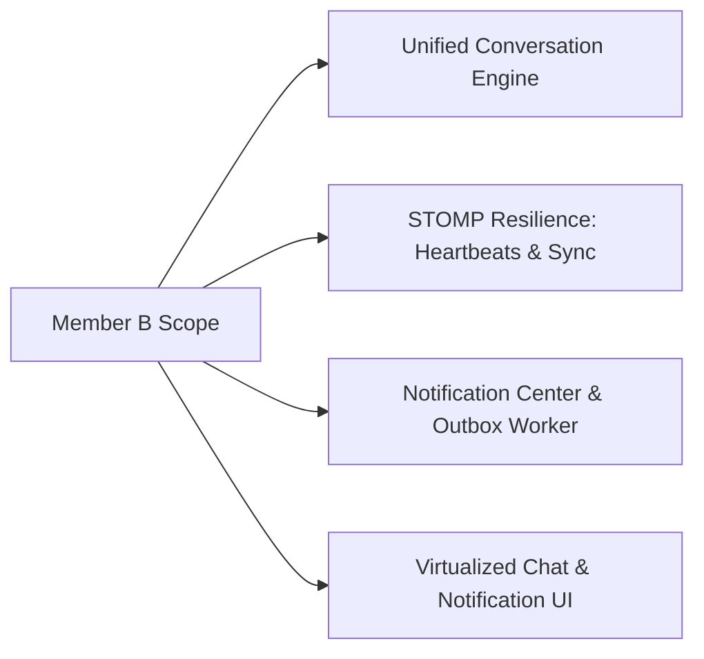

# Member B — Individual Engineering Documentation & Sprint Portfolio
**Student Name:** Member B  
**Student Roll:** [Insert Student Roll]  
**Role:** Real-Time Systems Architect, Communication & Notification Center Lead  
**Primary Ownership:**
- Campus Commons (Communities, Channels, Role-Based Access Policies)
- Core Messaging Engine (Shared Conversation Model, DMs, Group DMs, Message Persistence & Cursor Pagination)
- Real-Time Resilience Infrastructure (STOMP Heartbeats, Dead Socket Eviction, Reconnect Backoff State Machine, Gap Catch-up Sync, Message Idempotency Deduplication, Presence & Typing)
- Notification Center & Preferences (Persistent Inbox, Strategy-based Notify/Mute Policy, Transactional Outbox Worker with `SKIP LOCKED`)
- Frontend Real-Time Chat & Notification Center UI (Adhering to `DESIGN_GUIDELINES.md`)

---

## 1. Executive Summary of Owned Modules

I designed and implemented the **real-time communication backbone** of KUETcord. I built the unified conversation architecture serving channels, DMs, group DMs, and collaboration chats, alongside distributed system resilience techniques (heartbeats, reconnect sync, idempotency, presence, and transactional outbox).

---

## 2. Deep-Dive Feature Documentation

### 2.0 Campus Commons & Unified Conversation Engine (Phase 1 — implemented)

**Packages:** `com.kuetcord.commons` (communities, roles, moderation) and `com.kuetcord.messaging` (conversations, members, messages, access policy).

**Community RBAC (`MemberAuthority`, `CommunityAuthorityService`):**
- Permission bitmask in `community_roles.permissions`: `SEND_MESSAGES=1`, `MANAGE_CHANNELS=2`, `KICK_MEMBERS=4`, `MANAGE_MESSAGES=8`, `BAN_MEMBERS=16`, `MUTE_MEMBERS=32`, `MANAGE_ROLES=64`, `MANAGE_SERVER=128`.
- Effective authority = OR of the implicit default role and every assigned role; rank = highest `position`. The owner (`communities.owner_id`) holds every bit and can never be kicked or banned.
- Hierarchy: you can only edit/assign roles and kick/ban members ranked **strictly** below you, and you can only grant bits you already hold (no privilege escalation).
- Resolved authority is cached in Caffeine (`community_permissions`, 2 min TTL) and evicted on every role/membership mutation, keeping chat authorization off the database hot path.
- Endpoint gates use `@PreAuthorize("@communitySecurity.hasPermission(#id, 'KICK_MEMBERS')")`; unknown community IDs resolve to "no access" (403) so IDs cannot be probed.

**Unified conversations (ADR-004):** one `conversations` table for `CHANNEL`, `DIRECT`, `GROUP_DM`, `PLAYGROUND`, `STUDY_CIRCLE`. The message engine is shared; **access rules are not**:

| Type | Resolver | Rule |
|---|---|---|
| `DIRECT`, `GROUP_DM` | `ParticipantAccessResolver` | `conversation_members.active_status = 'ACTIVE'` (LEFT/REMOVED lose access instantly) |
| `CHANNEL` | `ChannelAccessResolver` | Non-banned community member; private channels also need channel membership or `MANAGE_CHANNELS` |
| `PLAYGROUND`, `STUDY_CIRCLE` | *(Member C plugs in a resolver bean)* | Denied until registered — `ConversationAccessPolicy` is fail-closed |

**Group DM RBAC (`@conversationSecurity`):**

| Action | `GROUP_OWNER` | `GROUP_ADMIN` | `GROUP_MEMBER` |
|---|---|---|---|
| Rename / `ADD_TO_GROUP` | ✅ | ✅ | ❌ |
| `REMOVE_FROM_GROUP` a member | ✅ | ✅ | ❌ |
| `REMOVE_FROM_GROUP` an admin | ✅ | ❌ | ❌ |
| Promote / demote admin | ✅ | ❌ | ❌ |
| Leave | ✅ (ownership passes to senior admin, else senior member) | ✅ | ✅ |

Group size is enforced at 3–25 participants; every participant must be an `ACTIVE`, email-verified student.

**Race-safe DM opening:** `V5` adds `conversations.direct_key = '<minUserId>:<maxUserId>'` with a partial unique index. `openDirect` runs `INSERT ... ON CONFLICT (direct_key) DO NOTHING`, so concurrent "open DM" clicks from both students wait on the index and converge on one conversation instead of failing or duplicating (verified by `DirectConversationConcurrencyIntegrationTest`, 8 threads).

**Migration `V5__align_messaging_notifications_and_outbox.sql`:**
- `conversations`: `direct_key` (+ partial unique index), `is_private`, community index; `conversation_members(user_id, active_status)` index.
- `notifications` rebuilt to the plan contract: `preview`, `target_type`, `target_id`, `source_event_id`, `read_at`, dedup `UNIQUE (recipient_id, source_event_id, type)`, inbox index `(recipient_id, read_at, id DESC)`.
- `outbox_events`: adds `next_attempt_at`, `last_error_code`, poll index `(status, next_attempt_at, id)` for the Phase 4 `SKIP LOCKED` worker (existing V1 columns untouched).
- Flyway `out-of-order: true` enabled because members own interleaved versions (A: V4, B: V5, C: V6 may merge in any order).

### 2.1 Real-Time Resilience Infrastructure
- **STOMP Heartbeats & Dead-Socket Eviction:** Negotiated 10s/10s heartbeats via `ThreadPoolTaskScheduler`. If a client fails to transmit frames for 25s, the server evicts the dead socket and frees system resources.
- **Client Reconnection State Machine:** State transitions across `DISCONNECTED` $\rightarrow$ `CONNECTING` $\rightarrow$ `CONNECTED` $\rightarrow$ `RECONNECTING` with exponential backoff ($1s \dots 30s$) + $20\%$ randomized jitter.
- **Reconnect Gap Catch-Up (`GET /api/v1/conversations/{id}/sync`):** On reconnect, client fetches missed messages strictly newer than `afterMessageId` using index `(conversation_id, id ASC)` without reloading history.
- **Client Idempotency Deduplication:** PostgreSQL unique index on `(conversation_id, sender_id, idempotency_key)` guarantees zero duplicate messages on client retry.
- **Multi-Tab Ephemeral Presence Engine:** Uses `SimpUserRegistry` to count active sessions per user. Broadcasts `ONLINE`/`OFFLINE` over `/topic/presence`.
- **Debounced Typing Indicators:** Keystrokes debounced to 3 seconds, broadcasting over `/topic/conversations/{id}/typing` with receiver 4-second auto-clear.

### 2.2 Notification Center & Preferences
- **Strategy Pattern Policy:** `AllMessagesStrategy`, `MentionsOnlyStrategy`, `MutedStrategy` determine eligibility per recipient and conversation.
- **Transactional Outbox Worker:** Scheduled worker polling `outbox_events` with `SELECT ... FOR UPDATE SKIP LOCKED` guarantees reliable at-least-once processing without thread contention.
- **Persistent Inbox:** Read-state tracking, unread count badge, and private live push to `/user/queue/notifications`.

---

## 3. Sprint-by-Sprint Development Log

| Sprint / Week | Dates | Key Completed Tasks | Commits / PRs |
|---|---|---|---|
| **Week 1** | Nov 10 – Nov 19 | ✅ `V5` schema alignment migration; Community/Conversation/Message JPA models; `ConversationAccessPolicy` (fail-closed, per-type resolvers); Community RBAC (bitmask + hierarchy + Caffeine cache); Community, DM & Group DM REST APIs; 20 new tests | `feature/messaging-conversation-engine` (PR pending) |
| **Week 2** | Nov 17 – Nov 23 | STOMP broker setup, 10s/10s heartbeats, STOMP JWT channel interceptors, send/receipt ACK | PR #8, PR #11 |
| **Week 3** | Nov 24 – Nov 30 | Reconnect Catch-up `/sync`, multi-tab presence engine, debounced typing indicators | PR #15, PR #18 |
| **Week 4** | Dec 01 – Dec 07 | Notification Center backend, Strategy pattern for preferences, Outbox worker (`SKIP LOCKED`) | PR #22, PR #25 |
| **Week 5** | Dec 08 – Dec 14 | Virtualized chat UI (`react-virtuoso`), Notification bell & mute dropdown, k6 load testing | PR #28, PR #32 |
| **Week 6** | Dec 15 – Dec 21 | Cross-module chat wiring (Playground/Study), presentation rehearsal, demo resilience tests | PR #36 |

---

## 4. UI Craft & Design Guidelines Implementation (From `skills-main`)

In accordance with [DESIGN_GUIDELINES.md](./DESIGN_GUIDELINES.md) and Emil Kowalski’s `skills-main`:
- **Chat Virtualization:** Implemented `react-virtuoso` to render message feeds smoothly without frame drops over 5,000 messages.
- **Optimistic UI:** Messages show in `SENDING` state (70% opacity), transitioning to `SENT` on receipt ACK, or `FAILED` with retry action.
- **Tabular Digits:** Unread notification counter badges and timestamp hours use `font-variant-numeric: tabular-nums`.
- **Toasts:** Integrated `sonner` for real-time notification alerts while the user is inside other tabs.
- **Adversarial Testing (`break-ui`):** Stress-tested chat bubbles with 2,000-character single-line strings (`overflow-wrap: break-word`) and usernames with special characters.

---

## 5. Multi-Tier Software Testing Evidence

Only suites that exist and have been run are marked PASS; everything else is `PENDING` with its target phase.

| Testing Discipline | Test Suite | Target Class / Endpoint | Pass / Fail | Evidence Log |
|---|---|---|---|---|
| **Unit Testing** | `CommunityRoleTest` (5) | `MemberAuthority`, `CommunityPermission` | PASS | Bitmask decode, OR of roles, owner immunity, non-member denial, equal-rank + escalation blocked |
| **Unit Testing** | `ConversationAccessPolicyTest` (5) | `ConversationAccessPolicy` + resolvers | PASS | Non-member / REMOVED denied, unknown ID & unresolved type fail-closed, private channel rules, duplicate resolver rejected |
| **Integration / Security** | `CommunityControllerIntegrationTest` (4) | `/api/v1/communities/**` | PASS | Kick 403 w/o permission, owner immune, kicked user loses reads, ban blocks rejoin until unban, no privilege escalation, private channels hidden |
| **Integration / Security** | `ConversationControllerIntegrationTest` (5) | `/api/v1/conversations/**` | PASS | Group <3 → 400, outsider + removed member → 403 (IDOR), Group RBAC matrix, owner hand-over on leave, DM reuse 201→200 |
| **Concurrency Testing** | `DirectConversationConcurrencyIntegrationTest` (1) | `ConversationService.openDirect` | PASS | 8 racing threads → exactly 1 DIRECT conversation with 2 members |
| **Protocol / WebSocket** | `StompHeartbeatTest` | `WebSocketConfig` | PENDING (Phase 2) | — |
| **Concurrency Testing** | `MessageConcurrencyIntegrationTest` | `MessageService` idempotency | PENDING (Phase 2) | — |
| **Resilience & Chaos** | `DeadSocketEvictionTest` | `WebSocketDisconnectListener` | PENDING (Phase 3) | — |
| **Resilience / Recovery** | `SyncGapCatchupTest` | `GET /api/v1/conversations/{id}/sync` | PENDING (Phase 3) | — |
| **Unit Testing** | `SimpUserRegistryPresenceTest` | Presence engine | PENDING (Phase 3) | — |
| **Unit / Strategy** | `NotificationPolicyStrategyTest` | `MutedStrategy` et al. | PENDING (Phase 4) | — |
| **Concurrency / Outbox** | `OutboxSkipLockedIntegrationTest` | `OutboxProcessor` | PENDING (Phase 4) | — |
| **Performance & Load** | `k6_chat_pagination.js` | `GET /api/v1/conversations/{id}/messages` | PENDING (Phase 5) | — |
| **Adversarial UI (`break-ui`)** | `VirtualizedChatFeed.test.tsx` | `<VirtualizedChatFeed />` | PENDING (Phase 3) | — |
| **CI/CD Smoke Testing** | `deploy.yml` Actuator Health | `/actuator/health` | PENDING (Phase 6) | — |

**Phase 1 local run (2026-11-19, JDK 21, PostgreSQL 16):** `mvn test` → `Tests run: 51, Failures: 0, Errors: 0` (20 Member B + 31 existing); `mvn verify` → failsafe `AuthFlowIntegrationIT` PASS, `BUILD SUCCESS`.

---

## 6. Architectural Decision Records (ADRs) Authored

- **ADR-004:** Adoption of Unified Conversation Entity across Channels, DMs, Playgrounds, and Study Circles.
  - *Context:* five chat surfaces need persistence, pagination, real-time delivery and notifications.
  - *Decision:* one `conversations`/`messages` model and one delivery pipeline; authorization delegated to a `ConversationAccessResolver` per type, selected by `ConversationAccessPolicy`.
  - *Consequences:* Member C adds chat to Playgrounds/Study Circles by registering a resolver bean, with no messaging changes (Open/Closed). Types without a resolver are denied (fail-closed), so a missing integration can never leak messages.
- **ADR-005:** Integration of STOMP Protocol Heartbeats with Background TaskScheduler for Dead-Socket Detection.
- **ADR-006:** Use of PostgreSQL `FOR UPDATE SKIP LOCKED` for Reliable Multi-Thread Outbox Polling.

---

## 7. Personal Viva & Demo Script

1. **Step 1:** Log in as 3 student accounts across separate browser windows.
2. **Step 2:** Show real-time presence pills (`ONLINE`) on member avatars. Open 2 tabs for User 1; close 1 tab and demonstrate User 1 remains `ONLINE`.
3. **Step 3:** Create a Group DM with 3 members. Send a message $\rightarrow$ verify instant broadcast without page refresh.
4. **Step 4 (Resilience Demo):** Disable network in DevTools on Client B. Send 2 messages from Client A. Re-enable network on Client B $\rightarrow$ demonstrate `/sync` catch-up restoring missed messages seamlessly.
5. **Step 5 (Idempotency Demo):** Inspect database table to confirm client message retries produced exactly 1 database row.
6. **Step 6 (Notification Mute Demo):** Set Client C's conversation preference to `MUTED`. Send a message $\rightarrow$ Client C's unread counter increments, but no notification toast or inbox entry is generated.

