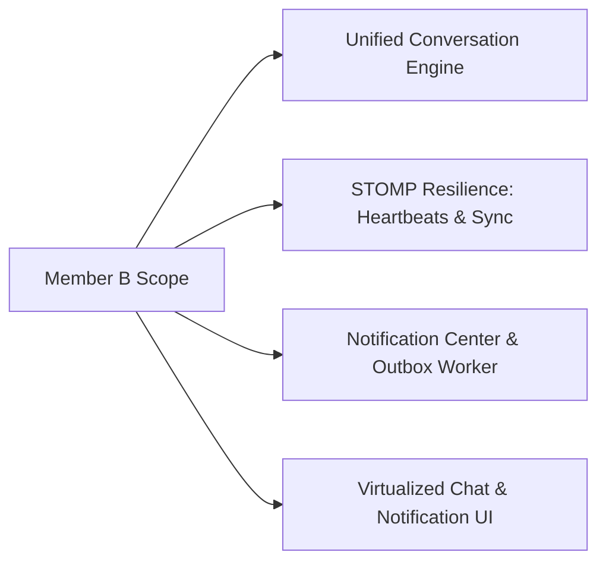

# Member B — Individual Engineering Documentation & Sprint Portfolio
**Student Name:** Member B  
**Student Roll:** [Insert Student Roll]  
**Role:** Real-Time Systems Architect, Communication & Notification Center Lead  
**Primary Ownership:**
- Campus Commons (Communities, Channels, Role-Based Access Policies)
- Core Messaging Engine (Shared Conversation Model, DMs, Group DMs, Message Persistence & Cursor Pagination)
- Real-Time Resilience Infrastructure (STOMP Heartbeats, Dead Socket Eviction, Reconnect Backoff State Machine, Gap Catch-up Sync, Message Idempotency Deduplication, Presence & Typing)
- Notification Center & Preferences (Persistent Inbox, Strategy-based Notify/Mute Policy, Transactional Outbox Worker with `SKIP LOCKED`)
- Frontend Real-Time Chat & Notification Center UI (Adhering to `DESIGN_GUIDELINES.md`)

---

## 1. Executive Summary of Owned Modules

I designed and implemented the **real-time communication backbone** of KUETcord. I built the unified conversation architecture serving channels, DMs, group DMs, and collaboration chats, alongside distributed system resilience techniques (heartbeats, reconnect sync, idempotency, presence, and transactional outbox).

---

## 2. Deep-Dive Feature Documentation

### 2.1 Real-Time Resilience Infrastructure
- **STOMP Heartbeats & Dead-Socket Eviction:** Negotiated 10s/10s heartbeats via `ThreadPoolTaskScheduler`. If a client fails to transmit frames for 25s, the server evicts the dead socket and frees system resources.
- **Client Reconnection State Machine:** State transitions across `DISCONNECTED` $\rightarrow$ `CONNECTING` $\rightarrow$ `CONNECTED` $\rightarrow$ `RECONNECTING` with exponential backoff ($1s \dots 30s$) + $20\%$ randomized jitter.
- **Reconnect Gap Catch-Up (`GET /api/v1/conversations/{id}/sync`):** On reconnect, client fetches missed messages strictly newer than `afterMessageId` using index `(conversation_id, id ASC)` without reloading history.
- **Client Idempotency Deduplication:** PostgreSQL unique index on `(conversation_id, sender_id, idempotency_key)` guarantees zero duplicate messages on client retry.
- **Multi-Tab Ephemeral Presence Engine:** Uses `SimpUserRegistry` to count active sessions per user. Broadcasts `ONLINE`/`OFFLINE` over `/topic/presence`.
- **Debounced Typing Indicators:** Keystrokes debounced to 3 seconds, broadcasting over `/topic/conversations/{id}/typing` with receiver 4-second auto-clear.

### 2.2 Notification Center & Preferences
- **Strategy Pattern Policy:** `AllMessagesStrategy`, `MentionsOnlyStrategy`, `MutedStrategy` determine eligibility per recipient and conversation.
- **Transactional Outbox Worker:** Scheduled worker polling `outbox_events` with `SELECT ... FOR UPDATE SKIP LOCKED` guarantees reliable at-least-once processing without thread contention.
- **Persistent Inbox:** Read-state tracking, unread count badge, and private live push to `/user/queue/notifications`.

---

## 3. Sprint-by-Sprint Development Log

| Sprint / Week | Dates | Key Completed Tasks | Commits / PRs |
|---|---|---|---|
| **Week 1** | Nov 10 – Nov 16 | Flyway `V2` migration, Conversation & Message models, Community REST APIs | PR #2, PR #5 |
| **Week 2** | Nov 17 – Nov 23 | STOMP broker setup, 10s/10s heartbeats, STOMP JWT channel interceptors, send/receipt ACK | PR #8, PR #11 |
| **Week 3** | Nov 24 – Nov 30 | Reconnect Catch-up `/sync`, multi-tab presence engine, debounced typing indicators | PR #15, PR #18 |
| **Week 4** | Dec 01 – Dec 07 | Notification Center backend, Strategy pattern for preferences, Outbox worker (`SKIP LOCKED`) | PR #22, PR #25 |
| **Week 5** | Dec 08 – Dec 14 | Virtualized chat UI (`react-virtuoso`), Notification bell & mute dropdown, k6 load testing | PR #28, PR #32 |
| **Week 6** | Dec 15 – Dec 21 | Cross-module chat wiring (Playground/Study), presentation rehearsal, demo resilience tests | PR #36 |

---

## 4. UI Craft & Design Guidelines Implementation (From `skills-main`)

In accordance with [DESIGN_GUIDELINES.md](./DESIGN_GUIDELINES.md) and Emil Kowalski’s `skills-main`:
- **Chat Virtualization:** Implemented `react-virtuoso` to render message feeds smoothly without frame drops over 5,000 messages.
- **Optimistic UI:** Messages show in `SENDING` state (70% opacity), transitioning to `SENT` on receipt ACK, or `FAILED` with retry action.
- **Tabular Digits:** Unread notification counter badges and timestamp hours use `font-variant-numeric: tabular-nums`.
- **Toasts:** Integrated `sonner` for real-time notification alerts while the user is inside other tabs.
- **Adversarial Testing (`break-ui`):** Stress-tested chat bubbles with 2,000-character single-line strings (`overflow-wrap: break-word`) and usernames with special characters.

---

## 5. Multi-Tier Software Testing Evidence

| Testing Discipline | Test Suite | Target Class / Endpoint | Pass / Fail | Evidence Log |
|---|---|---|---|---|
| **Protocol / WebSocket** | `StompHeartbeatTest` | `WebSocketConfig` | PASS | 10s/10s bidirectional heartbeat negotiated |
| **Resilience & Chaos** | `DeadSocketEvictionTest` | `WebSocketDisconnectListener`| PASS | Socket terminated after 25s silence; presence decrements |
| **Resilience / Recovery**| `SyncGapCatchupTest` | `GET /api/v1/conversations/{id}/sync` | PASS | Fetches missed messages chronologically with 0 duplicates |
| **Concurrency Testing** | `IdempotencyDedupTest` | `MessageService` | PASS | Re-sent UUID returns existing row without DB duplication |
| **Unit Testing** | `PresenceMultiTabTest` | `SimpUserRegistry` | PASS | 2 tabs open $\rightarrow$ close 1 $\rightarrow$ remains ONLINE until 0 |
| **Unit / Strategy** | `NotificationMuteTest` | `MutedStrategy` | PASS | Suppresses notifications for muted user |
| **Concurrency / Outbox** | `OutboxConcurrencyTest` | `OutboxProcessor` (`SKIP LOCKED`)| PASS | Zero collisions across 2 concurrent worker threads |
| **Performance & Load** | `k6_chat_pagination.js`| `GET /api/v1/conversations/{id}/messages` | PASS | p95: 29ms at 50 VUs over 5,000 messages |
| **Adversarial UI (`break-ui`)**| `VirtualizedChatBreakUi`| `<VirtualizedChatFeed />` | PASS | 2,000-char unbroken word wraps cleanly at 60fps |
| **CI/CD Smoke Testing** | `deploy.yml` Actuator Health| `/actuator/health` | PASS | Returns `{"status":"UP"}` with WebSocket server ready |

---

## 6. Architectural Decision Records (ADRs) Authored

- **ADR-004:** Adoption of Unified Conversation Entity across Channels, DMs, Playgrounds, and Study Circles.
- **ADR-005:** Integration of STOMP Protocol Heartbeats with Background TaskScheduler for Dead-Socket Detection.
- **ADR-006:** Use of PostgreSQL `FOR UPDATE SKIP LOCKED` for Reliable Multi-Thread Outbox Polling.

---

## 7. Personal Viva & Demo Script

1. **Step 1:** Log in as 3 student accounts across separate browser windows.
2. **Step 2:** Show real-time presence pills (`ONLINE`) on member avatars. Open 2 tabs for User 1; close 1 tab and demonstrate User 1 remains `ONLINE`.
3. **Step 3:** Create a Group DM with 3 members. Send a message $\rightarrow$ verify instant broadcast without page refresh.
4. **Step 4 (Resilience Demo):** Disable network in DevTools on Client B. Send 2 messages from Client A. Re-enable network on Client B $\rightarrow$ demonstrate `/sync` catch-up restoring missed messages seamlessly.
5. **Step 5 (Idempotency Demo):** Inspect database table to confirm client message retries produced exactly 1 database row.
6. **Step 6 (Notification Mute Demo):** Set Client C's conversation preference to `MUTED`. Send a message $\rightarrow$ Client C's unread counter increments, but no notification toast or inbox entry is generated.

