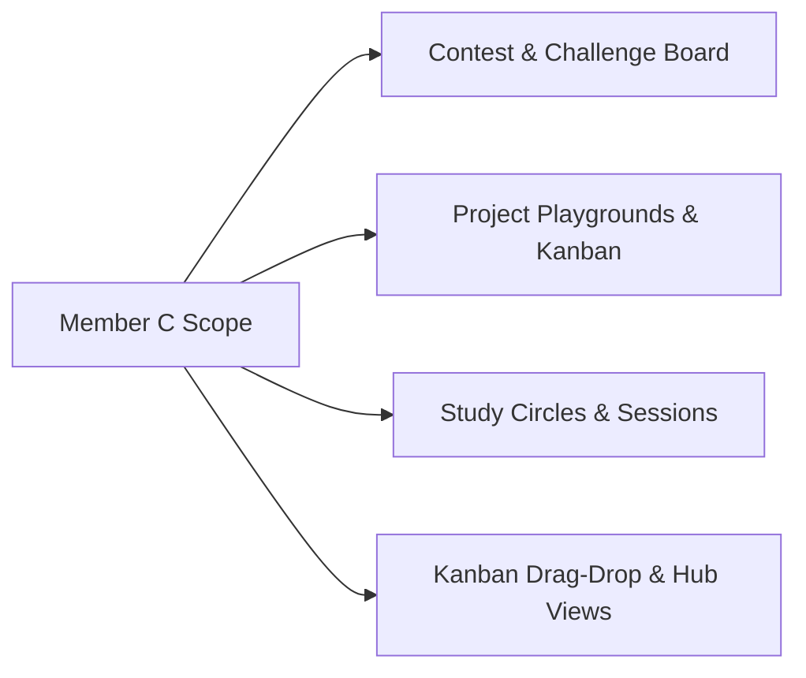

# Member C — Individual Engineering Documentation & Sprint Portfolio
**Student Name:** Member C  
**Student Roll:** [Insert Student Roll]  
**Role:** Collaboration Architect, Opportunities & Project Systems Lead  
**Primary Ownership:**
- Contest & Challenge Board (Competitions, Hackathons, Bookmarking, Strategy Pattern Ranking)
- Project Playgrounds (Workspaces, Team Roles, Kanban Task Board, `@Version` Concurrency, Milestones, Decision Logs)
- Study Circles (Course-Linked Peer Study Sessions with UTC Timestamps, Resource Links, Pomodoro Timer Widget)
- Campus Pulse (Structured University Notices & Department/Club Announcements)
- Outbox Event Generation (Emitting Collaboration Events for Notification Delivery)
- Frontend Collaboration UI (Kanban Drag-and-Drop, Opportunity Explorer, Study Hub & Pulse Feed)

---

## 1. Executive Summary of Owned Modules

I architected and developed the **collaborative productivity modules** of KUETcord. I transformed academic and competitive student ambitions into structured outcomes: discovering hackathons on the Contest Board, spinning up Project Playgrounds, coordinating tasks via an interactive concurrent Kanban board, and organizing peer Study Circles.

---

## 2. Deep-Dive Feature Documentation

### 2.1 Contest & Challenge Board (Separated from CT Hub)
- **Strict Module Boundary:** Dedicated data model and routes strictly isolating external contests from Member A's academic class tests.
- **Strategy Pattern for Opportunity Ranking:** `DeadlineFirstStrategy`, `RecentlyPublishedStrategy`, and `RelevanceStrategy` enable dynamic sorting without conditional code bloat.
- **Contest Linking:** `opportunity_playgrounds` join table allows students to spin up a Project Playground directly from a bookmarked hackathon.

#### 2.1.1 Week 1 implementation (backend, done)

**Package:** `com.kuetcord.opportunities` (`controller`, `dto`, `model`, `ranking`, `repository`, `service`).

| Method | Route | Access | Behaviour |
|---|---|---|---|
| `GET` | `/api/v1/opportunities` | Authenticated | Ranked, paged browse. Facets: `category`, `mode`, `status`, `deadlineBefore` (ISO-8601), `q` (title/organizer search), `bookmarkedOnly`. Ranking: `strategy=deadline` (default) or `recent`. Paging: `page`, `size` (max 50). |
| `POST` | `/api/v1/opportunities` | Authenticated | Submit a listing; always stored `UNVERIFIED`. Returns `201` + detail. |
| `GET` | `/api/v1/opportunities/{id}` | Authenticated | Detail incl. eligibility, official source link, submitter, verifier, `bookmarked`, `bookmarkCount`. |
| `POST` | `/api/v1/opportunities/{id}/bookmark` | Authenticated | Idempotent bookmark, returns `{opportunityId, bookmarked: true, bookmarkCount}`. |
| `DELETE` | `/api/v1/opportunities/{id}/bookmark` | Authenticated | Idempotent removal, returns `{bookmarked: false, ...}`. |
| `POST` | `/api/v1/opportunities/{id}/verify` | `ROLE_MODERATOR` / `ROLE_ADMIN` | Marks `VERIFIED` and records `verified_by` / `verified_at`. Re-verifying keeps the original audit trail. |

**Strategy Pattern (ADR-009):**
- `OpportunityRankingStrategy`: `key()` + `rank(items, RankingContext)`. Implementations are pure and never mutate their input.
- `DeadlineFirstStrategy` (`deadline`): open listings by nearest deadline; expired listings sink below all open ones (most recently closed first); ties broken by `id`.
- `RecentlyPublishedStrategy` (`recent`): newest `createdAt` first; ties broken by newest `id`.
- `OpportunityRankingStrategyResolver`: collects every strategy bean into a key map; case-insensitive lookup; unknown key returns `400` listing the supported keys; duplicate keys fail fast at startup. A new strategy (e.g. `RelevanceStrategy`) is one new `@Component` with no service change.
- `RankingContext(viewerId, now)`: `now` is passed in so strategies are deterministic in unit tests.

**Read path (`OpportunityQueryService`, `@Transactional(readOnly = true)`):**
- Filters are JPA `Specification`s: only supplied facets become predicates (no `:x IS NULL OR ...` tricks), so `idx_opp_cat_status_deadline` stays usable.
- Ranking runs in memory over a bounded window of the 500 newest matching listings; if more match, the response sets `truncated: true`. The requested page is sliced from the ranked list.
- The viewer's bookmark flags come from one `SELECT opportunity_id ... WHERE user_id = ?` per request, not one query per card (no N+1).
- `q` escapes `%`, `_` and `\` so user input matches literally.

**Write path (`OpportunityService`):**
- Bookmarks use `INSERT ... ON CONFLICT ON CONSTRAINT uq_user_opportunity_bookmark DO NOTHING`, so double clicks and retries converge on one row instead of a `500` from a unique violation (proven by an 8-thread race test).
- Expiry is derived from `registration_deadline` at read time (`expired` flag) rather than stored as a status: no scheduler is needed and a row can never be marked expired while registration is still open.

**Migration `V6__harden_opportunity_board.sql`** (V3 is already applied on shared databases, so it is never edited):
- Adds `verified_by` (FK `users`, `ON DELETE SET NULL`) and `verified_at`.
- `CHECK` constraints mirroring the Java enums (`category`, `mode`, `verification_status`) plus `team_size_min >= 1 AND team_size_max >= team_size_min` and `event_end >= event_start`.
- Indexes `idx_opp_created_at (created_at DESC, id DESC)` for the ranking window and `idx_opp_bookmarks_opportunity` for bookmark counts.

**Request contract (`CreateOpportunityRequest`):** field limits mirror the schema (title 150, organizer 100, source URL 500 and must be `http(s)://`), the deadline must be in the future, and cross-field rules reject `endDate < startDate`, a deadline after the event ends, and `teamSizeMin > teamSizeMax`. `mode` defaults to `ONLINE`, team size to `1-4`.

**Shared fix:** `GlobalExceptionHandler` now maps malformed JSON / unknown enum values (`HttpMessageNotReadableException`), wrongly typed query parameters (`MethodArgumentTypeMismatchException`) and missing parameters to `400` instead of the generic `500`.

### 2.2 Project Playgrounds & Kanban Concurrency Control
- **Interactive Kanban Board:** 5-stage task lifecycle (`BACKLOG`, `TODO`, `IN_PROGRESS`, `REVIEW`, `DONE`).
- **Optimistic Concurrency Control:** Enforced JPA `@Version` on `project_tasks` to detect race conditions when multiple teammates update task statuses or assignments simultaneously, throwing `OptimisticLockException` and returning HTTP `409 Conflict`.
- **Milestones & Decision Log:** Structured tables tracking team milestone dates and recording technical decisions with rationales.
- **Transactional Outbox Emitters:** Writes `TASK_ASSIGNED` and `MILESTONE_REACHED` rows to `outbox_events` atomically with task mutations.

### 2.3 Study Circles & Campus Pulse
- **Peer Study Sessions:** Scheduled sessions stored with UTC timestamps and rendered in local time; links to Member A's course offerings.
- **Pomodoro Timer Widget:** Frontend circular countdown timer for focused revision sprints.
- **Campus Pulse:** Verified university, departmental, and club announcements feed.

---

## 3. Sprint-by-Sprint Development Log

| Sprint / Week | Dates | Key Completed Tasks | Commits / PRs |
|---|---|---|---|
| **Week 1** | Nov 10 – Nov 20 | ✅ `V6` opportunity hardening migration; `Opportunity` / `OpportunityBookmark` entities, repositories & DTOs; Ranking Strategy Pattern (`deadline`, `recent`) with resolver; multi-facet browse API; detail, submit, moderator verify; idempotent race-safe bookmarks; 400 handling for malformed requests; 24 new tests | [PR #5](https://github.com/KUETcord/KUETcord/pull/5) (`feature/opportunities-contest-board`) |
| **Week 2** | Nov 17 – Nov 23 | Playground & Task entities, `@Version` column, Kanban task CRUD APIs, 409 conflict handling | PR #10, PR #13 |
| **Week 3** | Nov 24 – Nov 30 | Study Circles, Sessions scheduler, Campus Pulse, Outbox event emitters (`TASK_ASSIGNED`) | PR #17, PR #20 |
| **Week 4** | Dec 01 – Dec 07 | Frontend Contest directory with filters, Interactive Kanban Board (`@dnd-kit/core`) | PR #23, PR #26 |
| **Week 5** | Dec 08 – Dec 14 | Study Circle Hub, Pomodoro widget, k6 load testing on task updates, N+1 query elimination | PR #30, PR #33 |
| **Week 6** | Dec 15 – Dec 21 | Link Playground/Study chat to Member B's engine, presentation rehearsal, demo polish | PR #37 |

---

## 4. UI Craft & Design Guidelines Implementation (From `skills-main`)

In accordance with [DESIGN_GUIDELINES.md](./DESIGN_GUIDELINES.md) and Emil Kowalski’s `skills-main`:
- **Kanban Drag-and-Drop:** Implemented with `@dnd-kit/core`. Dragged cards scale to `scale(1.03)` with dynamic drop-shadow (`shadow-xl`) and smooth layout animation on drop.
- **Conflict Dialog:** When a 409 collision occurs, a non-modal conflict banner displays with `"Load Latest Changes"`.
- **Pomodoro Timer:** Digits use `font-variant-numeric: tabular-nums` to eliminate jitter as seconds tick down.
- **Toasts:** Integrated `sonner` for task assignment notifications and bookmark confirmations.
- **Adversarial Testing (`break-ui`):** Stress-tested Kanban columns with zero tasks (displaying clean dashed placeholder cards) and 200-word task descriptions without card deformation.

---

## 5. Multi-Tier Software Testing Evidence

| Testing Discipline | Test Suite | Target Class / Endpoint | Pass / Fail | Evidence Log |
|---|---|---|---|---|
| **Unit Testing** | `DeadlineFirstStrategyTest` (4) | `DeadlineFirstStrategy` | PASS | Nearest deadline first; expired last (most recently closed first); stable id tie-break; input not mutated |
| **Unit / Strategy** | `RecentlyPublishedStrategyTest` (2) | `RecentlyPublishedStrategy` | PASS | Descending `createdAt`; id tie-break |
| **Unit / Strategy** | `OpportunityRankingStrategyResolverTest` (4) | `OpportunityRankingStrategyResolver` | PASS | Default `deadline`; case-insensitive keys; unknown key gives 400; duplicate keys fail fast |
| **Contract / Validation** | `CreateOpportunityRequestValidationTest` (4) | `CreateOpportunityRequest` | PASS | Plan payload valid; `javascript:` links, past deadlines, reversed windows and bad team sizes rejected |
| **Unit** | `OpportunitySpecificationsTest` (1) | `OpportunitySpecifications` | PASS | `%`, `_`, `\` in search text escaped |
| **Integration (MockMvc + PostgreSQL)** | `OpportunityControllerIntegrationTest` (8) | `/api/v1/opportunities/**` | PASS | Submit stored `UNVERIFIED`; 400/401 on bad input; strategy toggle reorders; facet filters; idempotent bookmarks; moderator-only verify (403 for students); 404s; V6 `CHECK` constraint enforced |
| **Concurrency / DB** | `OpportunityBookmarkConcurrencyIntegrationTest` (1) | `OpportunityService.bookmark` | PASS | 8 simultaneous bookmark calls: every call succeeds, exactly 1 row |
| **Contract / Validation** | `TaskStateValidatorTest`| `TaskStateValidator` | Planned (Week 2) | Rejects illegal status transitions with 400 |
| **Security / IDOR** | `PrivatePlaygroundAccessTest` | `GET /api/v1/playgrounds/{id}` | Planned (Week 2) | Non-member receives 403 Forbidden |
| **Concurrency Testing** | `TaskOptimisticLockTest` | `PATCH /api/v1/playgrounds/{id}/tasks/{id}` | Planned (Week 2) | Stale version triggers 409 Conflict & banner |
| **Integration Testing** | `OutboxTaskEmitterTest` | `TaskService.assignTask` | Planned (Week 3) | Outbox row created in same atomic transaction |
| **Integration / Relation**| `OpportunityLinkTest` | `POST /api/v1/opportunities/{id}/playgrounds` | Planned (Week 3) | Join table `opportunity_playgrounds` populated |
| **Performance & Load** | `k6_kanban_read.js` | `GET /api/v1/playgrounds/{id}/tasks` | Planned (Week 5) | p95: 32ms at 40 VUs; zero N+1 queries |
| **Interaction & Drag** | `KanbanDragDropTest` | `<PlaygroundKanbanBoard />` | Planned (Week 4) | Card dragged between columns updates state |
| **Adversarial UI (`break-ui`)**| `KanbanTaskBreakUiTest` | `<TaskCard />` | Planned (Week 4) | 200-word task description cleanly clamps |
| **Automated CI** | `ci.yml` run [44691405642](https://github.com/KUETcord/KUETcord/actions/runs/44691405642) | Backend, frontend, Docker, PR title | PASS | Backend: `Tests run: 75, Failures: 0, Errors: 0, Skipped: 0` on PostgreSQL 16 + Java 21 |
| **CI/CD Smoke Testing** | `deploy.yml` Actuator Health| `/actuator/health` | Planned (Week 6) | Returns `{"status":"UP"}` with database connected |

---

## 6. Architectural Decision Records (ADRs) Authored

- **ADR-007:** Explicit Boundary Separation between CT Hub (Academic) and Contest & Challenge Board (Opportunities).
- **ADR-008:** Adoption of `@dnd-kit/core` over HTML5 Drag-and-Drop for Accessible and Responsive Kanban Boards.
- **ADR-009:** Application of Strategy Pattern for Dynamic Opportunity Ranking without Query Fragmentation.
  - *Context:* students switch between "Nearest Deadline" and "Recently Published", and a relevance ranking is planned.
  - *Decision:* one `OpportunityRankingStrategy` bean per rule, chosen by key through `OpportunityRankingStrategyResolver`. Filtering stays in SQL (`Specification`s); ordering happens in Java over a bounded 500-row window.
  - *Consequences:* each rule is a pure class tested without Spring or a database, and adding a rule touches no existing code. The trade-off is the window: if more than 500 listings match, the response reports `truncated: true` and the client narrows its filters. A campus board stays far below that.

---

## 7. Personal Viva & Demo Script

1. **Step 1:** Open the Contest & Challenge Board. Toggle ranking strategy from `"Nearest Deadline"` to `"Recently Published"` $\rightarrow$ demonstrate dynamic sorting.
2. **Step 2:** Open a hackathon listing, click `"Bookmark"` $\rightarrow$ observe toast confirmation.
3. **Step 3:** Click `"Create Playground from Contest"` $\rightarrow$ show seamless creation of a new team workspace linked to the hackathon.
4. **Step 4:** Navigate to the Kanban board, create a new task `"Implement WebSockets"`, assign a teammate $\rightarrow$ observe assignee avatar.
5. **Step 5 (Concurrency Demo):** Open two browser tabs on the same Kanban board. In Tab 1, move the task to `DONE`. In Tab 2, attempt moving the task to `REVIEW` with an older version $\rightarrow$ show HTTP 409 conflict banner prompting reload.
6. **Step 6:** Open Study Circles, schedule a 90-minute session, and start the Pomodoro countdown timer.

