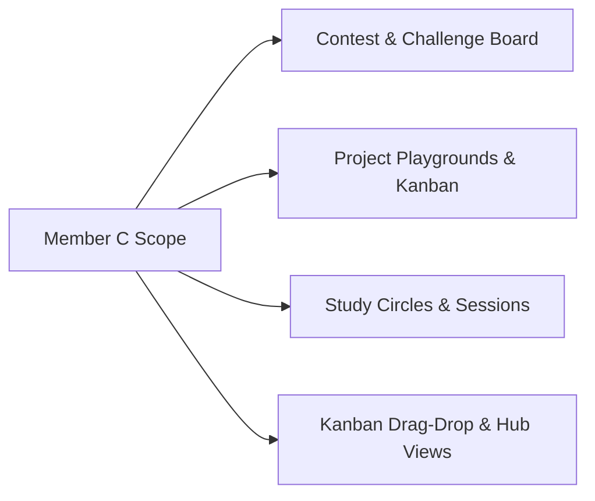

# Member C — Individual Engineering Documentation & Sprint Portfolio
**Student Name:** Member C  
**Student Roll:** [Insert Student Roll]  
**Role:** Collaboration Architect, Opportunities & Project Systems Lead  
**Primary Ownership:**
- Contest & Challenge Board (Competitions, Hackathons, Bookmarking, Strategy Pattern Ranking)
- Project Playgrounds (Workspaces, Team Roles, Kanban Task Board, `@Version` Concurrency, Milestones, Decision Logs)
- Study Circles (Course-Linked Peer Study Sessions with UTC Timestamps, Resource Links, Pomodoro Timer Widget)
- Campus Pulse (Structured University Notices & Department/Club Announcements)
- Outbox Event Generation (Emitting Collaboration Events for Notification Delivery)
- Frontend Collaboration UI (Kanban Drag-and-Drop, Opportunity Explorer, Study Hub & Pulse Feed)

---

## 1. Executive Summary of Owned Modules

I architected and developed the **collaborative productivity modules** of KUETcord. I transformed academic and competitive student ambitions into structured outcomes: discovering hackathons on the Contest Board, spinning up Project Playgrounds, coordinating tasks via an interactive concurrent Kanban board, and organizing peer Study Circles.

---

## 2. Deep-Dive Feature Documentation

### 2.1 Contest & Challenge Board (Separated from CT Hub)
- **Strict Module Boundary:** Dedicated data model and routes strictly isolating external contests from Member A's academic class tests.
- **Strategy Pattern for Opportunity Ranking:** `DeadlineFirstStrategy`, `RecentlyPublishedStrategy`, and `RelevanceStrategy` enable dynamic sorting without conditional code bloat.
- **Contest Linking:** `opportunity_playgrounds` join table allows students to spin up a Project Playground directly from a bookmarked hackathon.

#### 2.1.1 Week 1 implementation (backend, done)

**Package:** `com.kuetcord.opportunities` (`controller`, `dto`, `model`, `ranking`, `repository`, `service`).

| Method | Route | Access | Behaviour |
|---|---|---|---|
| `GET` | `/api/v1/opportunities` | Authenticated | Ranked, paged browse. Facets: `category`, `mode`, `status`, `deadlineBefore` (ISO-8601), `q` (title/organizer search), `bookmarkedOnly`. Ranking: `strategy=deadline` (default) or `recent`. Paging: `page`, `size` (max 50). |
| `POST` | `/api/v1/opportunities` | Authenticated | Submit a listing; always stored `UNVERIFIED`. Returns `201` + detail. |
| `GET` | `/api/v1/opportunities/{id}` | Authenticated | Detail incl. eligibility, official source link, submitter, verifier, `bookmarked`, `bookmarkCount`. |
| `POST` | `/api/v1/opportunities/{id}/bookmark` | Authenticated | Idempotent bookmark, returns `{opportunityId, bookmarked: true, bookmarkCount}`. |
| `DELETE` | `/api/v1/opportunities/{id}/bookmark` | Authenticated | Idempotent removal, returns `{bookmarked: false, ...}`. |
| `POST` | `/api/v1/opportunities/{id}/verify` | `ROLE_MODERATOR` / `ROLE_ADMIN` | Marks `VERIFIED` and records `verified_by` / `verified_at`. Re-verifying keeps the original audit trail. |

**Strategy Pattern (ADR-009):**
- `OpportunityRankingStrategy`: `key()` + `rank(items, RankingContext)`. Implementations are pure and never mutate their input.
- `DeadlineFirstStrategy` (`deadline`): open listings by nearest deadline; expired listings sink below all open ones (most recently closed first); ties broken by `id`.
- `RecentlyPublishedStrategy` (`recent`): newest `createdAt` first; ties broken by newest `id`.
- `OpportunityRankingStrategyResolver`: collects every strategy bean into a key map; case-insensitive lookup; unknown key returns `400` listing the supported keys; duplicate keys fail fast at startup. A new strategy (e.g. `RelevanceStrategy`) is one new `@Component` with no service change.
- `RankingContext(viewerId, now)`: `now` is passed in so strategies are deterministic in unit tests.

**Read path (`OpportunityQueryService`, `@Transactional(readOnly = true)`):**
- Filters are JPA `Specification`s: only supplied facets become predicates (no `:x IS NULL OR ...` tricks), so `idx_opp_cat_status_deadline` stays usable.
- Ranking runs in memory over a bounded window of the 500 newest matching listings; if more match, the response sets `truncated: true`. The requested page is sliced from the ranked list.
- The viewer's bookmark flags come from one `SELECT opportunity_id ... WHERE user_id = ?` per request, not one query per card (no N+1).
- `q` escapes `%`, `_` and `\` so user input matches literally.

**Write path (`OpportunityService`):**
- Bookmarks use `INSERT ... ON CONFLICT ON CONSTRAINT uq_user_opportunity_bookmark DO NOTHING`, so double clicks and retries converge on one row instead of a `500` from a unique violation (proven by an 8-thread race test).
- Expiry is derived from `registration_deadline` at read time (`expired` flag) rather than stored as a status: no scheduler is needed and a row can never be marked expired while registration is still open.

**Migration `V6__harden_opportunity_board.sql`** (V3 is already applied on shared databases, so it is never edited):
- Adds `verified_by` (FK `users`, `ON DELETE SET NULL`) and `verified_at`.
- `CHECK` constraints mirroring the Java enums (`category`, `mode`, `verification_status`) plus `team_size_min >= 1 AND team_size_max >= team_size_min` and `event_end >= event_start`.
- Indexes `idx_opp_created_at (created_at DESC, id DESC)` for the ranking window and `idx_opp_bookmarks_opportunity` for bookmark counts.

**Request contract (`CreateOpportunityRequest`):** field limits mirror the schema (title 150, organizer 100, source URL 500 and must be `http(s)://`), the deadline must be in the future, and cross-field rules reject `endDate < startDate`, a deadline after the event ends, and `teamSizeMin > teamSizeMax`. `mode` defaults to `ONLINE`, team size to `1-4`.

**Shared fix:** `GlobalExceptionHandler` now maps malformed JSON / unknown enum values (`HttpMessageNotReadableException`), wrongly typed query parameters (`MethodArgumentTypeMismatchException`) and missing parameters to `400` instead of the generic `500`.

### 2.2 Project Playgrounds & Kanban Concurrency Control
- **Interactive Kanban Board:** 5-stage task lifecycle (`BACKLOG`, `TODO`, `IN_PROGRESS`, `REVIEW`, `DONE`).
- **Optimistic Concurrency Control:** Enforced JPA `@Version` on `project_tasks` to detect race conditions when multiple teammates update task statuses or assignments simultaneously, throwing `OptimisticLockException` and returning HTTP `409 Conflict`.
- **Milestones & Decision Log:** Structured tables tracking team milestone dates and recording technical decisions with rationales.
- **Transactional Outbox Emitters:** Writes `TASK_ASSIGNED` and `MILESTONE_REACHED` rows to `outbox_events` atomically with task mutations.

#### 2.2.1 Week 2 implementation (backend, done)

**Package:** `com.kuetcord.playgrounds` (`access`, `controller`, `dto`, `model`, `repository`, `service`).

| Method | Route | Access | Behaviour |
|---|---|---|---|
| `GET` | `/api/v1/playgrounds` | Authenticated | "My playgrounds": every workspace the caller belongs to with `myRole` and `memberCount`, most recently updated first. |
| `POST` | `/api/v1/playgrounds` | Authenticated | Create a workspace (`title`, `problemStatement`, up to 8 `tags`, `visibility` default `PUBLIC`, `repoUrl`, `demoUrl`). The creator becomes `LEAD`. Returns `201`. |
| `GET` | `/api/v1/playgrounds/{id}` | Member, or anyone for `PUBLIC` | Workspace header: metadata, members, per-column `taskCounts`, `myRole`, `version`. |
| `PATCH` | `/api/v1/playgrounds/{id}` | `LEAD` | Partial metadata edit incl. `status` (`PLANNING`, `IN_PROGRESS`, `COMPLETED`, `ARCHIVED`). Requires `expectedVersion`; `""` clears a link, `[]` clears tags. |
| `POST` | `/api/v1/playgrounds/{id}/members` | `LEAD` | Invite an existing student as `LEAD`, `CONTRIBUTOR` (default) or `VIEWER`. Already a member: `409`; unknown user: `404`. |
| `GET` | `/api/v1/playgrounds/{id}/tasks` | Member, or anyone for `PUBLIC` | Kanban board: always 5 columns in order `BACKLOG`, `TODO`, `IN_PROGRESS`, `REVIEW`, `DONE`; cards ordered by `position`, each with `assignee` and `version`. |
| `POST` | `/api/v1/playgrounds/{id}/tasks` | `LEAD` / `CONTRIBUTOR` | Create a card (`status` default `BACKLOG`, `priority` default `MEDIUM`, optional `assigneeId`, `dueDate`). It goes to the bottom of its column. |
| `GET` | `/api/v1/playgrounds/{id}/tasks/{taskId}` | Member, or anyone for `PUBLIC` | Full card incl. description. |
| `PATCH` | `/api/v1/playgrounds/{id}/tasks/{taskId}` | `LEAD` / `CONTRIBUTOR` | Move / assign / re-prioritise / edit. Requires `expectedVersion`; `clearAssignee` / `clearDueDate` remove values. A moved card goes to the bottom of the new column. |
| `DELETE` | `/api/v1/playgrounds/{id}/tasks/{taskId}?expectedVersion=n` | `LEAD` / `CONTRIBUTOR` | Delete a card, `204`. A stale version is `409`. |
| `GET` / `POST` | `/api/v1/playgrounds/{id}/milestones` | read: viewers; write: `LEAD` / `CONTRIBUTOR` | Timeline, soonest first; `overdue` is derived (still `PENDING` and past `dueDate`). |
| `GET` / `POST` | `/api/v1/playgrounds/{id}/decisions` | read: viewers; write: `LEAD` / `CONTRIBUTOR` | Append-only decision log (`decision`, optional `rationale`), newest first, with author name. |

**Roles (`PlaygroundAccessPolicy`, one place for every check):**
- `PlaygroundRole.grants(permission)`: `VIEW` for every role, `EDIT_BOARD` for `LEAD` and `CONTRIBUTOR`, `MANAGE` (metadata, invitations) for `LEAD` only.
- Non-members can only read, and only `PUBLIC` playgrounds. A `PRIVATE` playground answers **404** (not 403) to non-members, so outsiders cannot even discover that it exists by probing IDs.
- An `ARCHIVED` playground is frozen: board, milestone, decision and invitation writes return `409` until a lead `PATCH`es the status back. Reads keep working.
- Only `LEAD` / `CONTRIBUTOR` members can be assignees; assigning a `VIEWER` or an outsider is a `400`.
- These are per-playground roles, so they are checked against `playground_members` in the service layer, not with `@PreAuthorize` on the global JWT roles.

**Optimistic concurrency on cards (ADR-010):**
- `ProjectTask` and `Playground` carry JPA `@Version`. Clients echo the `version` they last saw as `expectedVersion`.
- A stale `expectedVersion` is rejected before anything is written (`VersionGuard` throws `OptimisticLockException`).
- When two requests carry the same, current version at the same instant, both pass that check; PostgreSQL's row lock serialises their `UPDATE ... WHERE id = ? AND version = ?`, the loser matches zero rows and Spring raises `ObjectOptimisticLockingFailureException`.
- Both paths are mapped to **409 Conflict** by the shared `GlobalExceptionHandler`, which the Week 4 Kanban UI turns into a "reload" banner. Proven by a 6-thread race test (exactly one winner) and a MockMvc lost-update test (the second write is refused and the first survives).
- Cards may move between any two columns. A Kanban board is a shared picture of the work rather than a gated workflow, and teams regularly send a card from `REVIEW` back to `IN_PROGRESS`, so there is no transition validator.

**Read path without N+1:** the board, member list and decision log are JPQL constructor projections (`TaskCardDto`, `PlaygroundMemberDto`, `DecisionDto`) that `LEFT JOIN` the user row. A board with any number of cards is one query, with no entity proxies or dirty-checking snapshots. Column grouping happens in Java because the status column is a string and would sort alphabetically in SQL.

**Migration `V9__harden_playgrounds_and_kanban.sql`** (V3 is never edited; Member C owns V3, V6, V9):
- `playgrounds.version` for metadata edits; `CHECK`s on `visibility`, `status`, member `role`, task `status` / `priority`, `position >= 0` and milestone `status` (`PENDING`, `COMPLETED`).
- `project_tasks.position` (card order inside a column; existing rows are backfilled oldest-first) and `created_by`; `project_milestones.description` and `created_by`.
- Indexes: `idx_pg_members_user` ("my playgrounds"), partial `idx_tasks_assignee`, `idx_milestones_playground_due`, `idx_decisions_playground_created`.
- Verified against `db/seed/test_fixtures.sql`: the seeded playground, members and four tasks load cleanly on V1-V9.

**Invitations are race-safe:** members are added with `INSERT ... ON CONFLICT ON CONSTRAINT uq_playground_user DO NOTHING`. A double-click or two leads inviting the same student gives one row and a clean `409`, never a `500`.

**Not in Week 2 (by plan):** outbox events for `TASK_ASSIGNED` / `MILESTONE_REACHED`, marking milestones complete, linking an opportunity to a playground, and the shared team chat (`conversation_id`) are Week 3 and Week 6 work.

#### 2.2.2 Week 4 implementation (frontend: Contest Board & Kanban UI, done)

**Screens** (mounted in Member A's `AppShell`, replacing the placeholder slots):

| Route | Screen | What it does |
|---|---|---|
| `/opportunities` | `OpportunitiesPage` | Ranked contest cards with deadline badges ("2 days left", "Closed"), category chips, a debounced title/organizer search, a "Nearest deadline / Recently published" strategy toggle, a "Bookmarked" filter and optimistic bookmark toggles with rollback. |
| `/opportunities/:id` | `OpportunityDetailPage` | Eligibility, dates, team size, mode, an "Official source" button (new tab, `rel="noopener noreferrer"`), bookmark count, the teams already formed, and **Start Project Playground**, which creates a linked team and opens its board (disabled once registration has closed). |
| `/playgrounds` | `PlaygroundsPage` | "My playgrounds" with role, member count and last update, plus a quick create form. |
| `/playgrounds/:id` | `PlaygroundWorkspacePage` | Header (members, tags, repo, "Formed for" contest links) and Radix tabs: **Board**, **Milestones**, **Decision log**. |

**Kanban board (`KanbanBoard`, Days 3-4):**
- Five fixed columns in order, with counts and a dotted placeholder in empty columns ("No tasks in review").
- Cards show priority badge, due date (overdue in red), and the assignee's initials avatar (`shrink-0`).
- Cards move by **drag and drop** (`@dnd-kit/core`, pointer and keyboard sensors) or by a per-card **status dropdown**, the accessible path. Both call one `moveTask` handler.
- **Optimistic update:** the card jumps to the bottom of its new column at once (same rule as the server), then `PATCH` sends `expectedVersion`. On success the card takes the server's new version.
- **On 409:** only that card rolls back, and a non-modal `ConflictBanner` explains that a teammate changed it first. **Load Latest Changes** reloads the board.
- A new-task form offers only LEAD and CONTRIBUTOR members as assignees. VIEWERs, visitors and archived playgrounds get a read-only board.
- The lifted card is rendered in a `DragOverlay` with `scale(1.03)` and `shadow-xl` (transform and opacity only, no layout animation).

**Milestones and decisions (Day 5):** `MilestoneTimeline` is a vertical rail, soonest first, with an overdue badge and "Mark reached / Reopen" (the PATCH that emits `MILESTONE_REACHED`). `DecisionLog` is an accessible accordion (`aria-expanded` / `aria-controls`), newest first, with the rationale revealed on expand; a newly recorded decision opens at the top.

**One data layer, two sources (`lib/collab`):**
- Every screen talks to a `CollabSource` interface.
- `liveCollabSource` calls the Spring API with the shared `request()` client (JWT, `ApiError` with HTTP status).
- In preview mode, `demoCollabSource` serves an in-memory store that enforces the same rules as the server: per-playground roles, the archived freeze, mandatory `expectedVersion` with a real `ApiError(409)`, end-of-column moves, idempotent bookmarks, and DeadlineFirst ranking.
- Switching the preview role in the sidebar re-scopes it. The Teacher sees the demo board as a read-only VIEWER; the CR as LEAD.
- **Preview: simulate a teammate edit** moves a card behind your back, so the 409 banner can be shown live in a demo.
- Pure board logic (`moveCard`, `replaceCard`, `deadlineBadge`) lives in `lib/collab/kanban.ts` and is unit-tested.

### 2.3 Study Circles & Campus Pulse
- **Peer Study Sessions:** Scheduled sessions stored with UTC timestamps and rendered in local time; links to Member A's course offerings.
- **Pomodoro Timer Widget:** Frontend circular countdown timer for focused revision sprints.
- **Campus Pulse:** Verified university, departmental, and club announcements feed.

#### 2.3.1 Week 3 implementation (backend, done)

**Packages:** `com.kuetcord.studycircles` and `com.kuetcord.pulse` (new), plus `playgrounds.event` and the opportunity link in `com.kuetcord.playgrounds`. `UserRefDto` moved to `common.dto` so all three modules share it.

| Method | Route | Access | Behaviour |
|---|---|---|---|
| `GET` | `/api/v1/study-circles` | Authenticated | Directory, newest first; `courseOfferingId`, `q`, `mine`, `page`, `size` (max 50). Cards: `course`, `memberCount`, `myRole`, `nextSessionAt`. |
| `POST` | `/api/v1/study-circles` | Authenticated | Create; optional `courseOfferingId` must exist in Member A's catalog (`404` otherwise). Creator becomes `HOST`. |
| `GET` | `/api/v1/study-circles/{id}` | Authenticated | Circle page: course, creator, members, `resourceCount`; `nextSession` only for members. |
| `POST` | `/api/v1/study-circles/{id}/join` | Authenticated | Join as `ATTENDEE`; `201` first time, `200` afterwards (idempotent, a HOST stays HOST). |
| `GET` / `POST` | `/api/v1/study-circles/{id}/sessions` | Circle member | Upcoming sessions (in-progress included) or `includePast=true`; schedule with `title`, `scheduledAt`, `durationMinutes` (15-480, default 60), `agenda`, `locationOrLink`. |
| `GET` / `POST` | `/api/v1/study-circles/{id}/resources` | Circle member | Share http(s) links as `NOTES`, `QUESTION_BANK`, `SLIDES`, `RECORDING`; newest first with contributor. |
| `GET` | `/api/v1/announcements` | Authenticated | Campus Pulse feed, newest first; `category`, `organization` (case-insensitive), paging. |
| `GET` | `/api/v1/announcements/{id}` | Authenticated | One notice. |
| `POST` | `/api/v1/announcements` | `ROLE_TEACHER` / `ROLE_MODERATOR` / `ROLE_ADMIN` | Publish a verified notice; students get `403`, so the feed never carries rumours. |
| `PATCH` | `/api/v1/playgrounds/{id}/milestones/{milestoneId}` | `LEAD` / `CONTRIBUTOR` | `COMPLETED` marks the milestone reached (records `completedAt` / `completedBy`); `PENDING` reopens it. |
| `POST` | `/api/v1/opportunities/{id}/playgrounds` | Authenticated (`LEAD` to link an existing playground) | Form a team: `{}` one-click PUBLIC "`<title>` Team" playground, `{"newPlayground": {...}}`, or `{"playgroundId": n}`. `201` new link, `200` already linked. |
| `GET` | `/api/v1/opportunities/{id}/playgrounds` | Authenticated | Teams for the contest the caller may see (PUBLIC, or PRIVATE ones they belong to). |

**Session scheduler:**
- Every time is an `Instant` stored as `TIMESTAMP WITH TIME ZONE` and returned as UTC (`...Z`). A client may send any offset: `2026-11-22T20:00:00+06:00` is stored and returned as `2026-11-22T14:00:00Z`; the UI renders local time.
- `endsAt` is derived (`scheduledAt + durationMinutes`), never stored, so it can't drift.
- A session that overlaps another one in the same circle is rejected with `409`. The check treats sessions as half-open intervals, so back-to-back sessions are allowed. It is a check-then-insert, so two members creating clashing sessions in the same instant could both succeed; a PostgreSQL exclusion constraint would close that gap if it ever matters.
- Sessions and resources are members-only so the open directory cannot be scraped for meeting links.

**Transactional outbox (ADR-011):** events go to the shared `outbox_events` table through Member A's `OutboxEventPublisher` for Member B's notification engine. Each payload carries `recipientIds`.

| Event | Aggregate | Written when | Recipients |
|---|---|---|---|
| `TASK_ASSIGNED` | `PROJECT_TASK` | A card is created for, or handed to, someone other than the actor | The new assignee |
| `MILESTONE_REACHED` | `PROJECT_MILESTONE` | A milestone goes from `PENDING` to `COMPLETED` | Every member except the completer |
| `STUDY_SESSION_SCHEDULED` | `STUDY_SESSION` | A session is scheduled (payload includes `courseCode`) | Every circle member except the scheduler |

- The emitters are `@Transactional(propagation = MANDATORY)`: they refuse to run outside the transaction that changes the state, so an event can never be committed without its change, or survive a rollback.
- `TASK_ASSIGNED` is emitted after the versioned write succeeds, so a `409` card update leaves no stray event. Self-assignment, re-saving the same assignee, moving or unassigning a card notify nobody.
- Completion is a single `UPDATE ... SET status = 'COMPLETED' WHERE id = ? AND status = 'PENDING'`. When several teammates tick a milestone at once, PostgreSQL's row lock lets exactly one statement match, so exactly one `MILESTONE_REACHED` is written (proven by a 6-thread test). Completing again is a no-op.

**Opportunity -> Playground (Day 5):** the playground is created and linked in one transaction, so there is never an orphan team without its contest. Links use `INSERT ... ON CONFLICT DO NOTHING` (idempotent) and record `linked_by` / `linked_at`. The playground header now lists `linkedOpportunities`.

**No N+1:** a directory page costs a fixed five queries (circles, member counts, the viewer's roles, next session starts, courses) whatever its size. Members, sessions, resources and decision/link lists are JPQL constructor projections joining the user row. The announcement feed loads every author on a page in one query.

**Migration `V12__study_circles_pulse_and_collaboration_links.sql`** (Member C owns V3, V6, V9, V12):
- `CHECK`s: circle member role, session duration 15-480, resource category, announcement category.
- `study_sessions.created_by`; `project_milestones.completed_at` / `completed_by`; `opportunity_playgrounds.linked_by` / `linked_at`.
- Indexes: circle members by user, circles by course and by creation date, sessions by circle and start, resources by circle and date, the unfiltered announcement feed, and links by playground.

**Not in Week 3 (by plan):** the frontend for all of this (Weeks 4-5) and linking circles and playgrounds to shared chat (`conversation_id`, Week 6).

---

## 3. Sprint-by-Sprint Development Log

| Sprint / Week | Dates | Key Completed Tasks | Commits / PRs |
|---|---|---|---|
| **Week 1** | Nov 10 – Nov 20 | ✅ `V6` opportunity hardening migration; `Opportunity` / `OpportunityBookmark` entities, repositories & DTOs; Ranking Strategy Pattern (`deadline`, `recent`) with resolver; multi-facet browse API; detail, submit, moderator verify; idempotent race-safe bookmarks; 400 handling for malformed requests; 24 new tests | [PR #5](https://github.com/KUETcord/KUETcord/pull/5) (`feature/opportunities-contest-board`) |
| **Week 2** | Nov 17 – Nov 23 | ✅ `V9` playground/Kanban hardening migration; `Playground`, `PlaygroundMember`, `ProjectTask`, `ProjectMilestone`, `ProjectDecision` entities; `LEAD` / `CONTRIBUTOR` / `VIEWER` access policy (private playgrounds hidden with 404, archived playgrounds frozen); playground create / list / detail / PATCH / invite APIs; Kanban board + task CRUD with `@Version` optimistic locking mapped to 409; milestones and decision log endpoints; N+1-free projections; 38 new tests | [PR #8](https://github.com/KUETcord/KUETcord/pull/8) (`feature/playgrounds-kanban-board`) |
| **Week 3** | Nov 24 – Nov 30 | ✅ `V12` migration; Study Circles (directory with course filter, join, members-only sessions and resources); UTC session scheduler with overlap guard; Campus Pulse feed with staff-only publishing; transactional outbox events `TASK_ASSIGNED`, `MILESTONE_REACHED`, `STUDY_SESSION_SCHEDULED`; milestone completion (exactly-once under races); opportunity -> playground team formation; 32 new tests | [PR #12](https://github.com/KUETcord/KUETcord/pull/12) (`feature/study-circles-pulse-outbox`) |
| **Week 4** | Dec 01 – Dec 07 | ✅ Contest Board UI (deadline badges, category chips, search, strategy toggle, optimistic bookmarks); opportunity detail with official source and "Start Project Playground"; playground list and workspace; drag-and-drop + dropdown Kanban with optimistic moves, rollback and the 409 "Load Latest Changes" banner; milestone timeline and decision-log accordion; demo data source that enforces the server rules; 32 new frontend tests | `feature/contest-board-kanban-ui` |
| **Week 5** | Dec 08 – Dec 14 | Study Circle Hub, Pomodoro widget, k6 load testing on task updates, N+1 query elimination | PR #30, PR #33 |
| **Week 6** | Dec 15 – Dec 21 | Link Playground/Study chat to Member B's engine, presentation rehearsal, demo polish | PR #37 |

---

## 4. UI Craft & Design Guidelines Implementation (From `skills-main`)

In accordance with [DESIGN_GUIDELINES.md](./DESIGN_GUIDELINES.md) and Emil Kowalski’s `skills-main`:
- **Kanban Drag-and-Drop (Week 4):** `@dnd-kit/core` with pointer (6px activation distance, so the card's dropdown stays clickable) and keyboard sensors. The lifted card renders in a `DragOverlay` at `scale(1.03)` with `shadow-xl`; only `transform` and `opacity` animate.
- **Conflict Banner (Week 4):** on a 409 the card snaps back and a non-modal `role="alert"` banner offers **Load Latest Changes**. The rest of the board stays usable.
- **Buttons:** global `scale(0.97)` press feedback; async buttons show an inline `Loader2` spinner with a fixed `min-width` so they do not jump; disabled buttons use `cursor-not-allowed opacity-50`.
- **Numbers and dates:** counts, deadlines, due dates and timestamps use `tabular-nums`; counts go through `pluralize` ("1 opportunity", "0 teams").
- **Toasts:** `sonner` for bookmarks, new tasks, milestones and decisions, and the preview teammate edit; never `alert()`.
- **Adversarial Testing (`break-ui`):** empty columns show dotted placeholders; 110-character card titles clamp to 3 lines with the full title in `title`; long Unicode names ("Aleksandra Wiśniewska-Kowalczyk") and two-letter names ("Jo") render clean initials on non-shrinking avatars.
- **Pomodoro Timer (Week 5, planned):** digits will use `tabular-nums` to avoid jitter.

---

## 5. Multi-Tier Software Testing Evidence

| Testing Discipline | Test Suite | Target Class / Endpoint | Pass / Fail | Evidence Log |
|---|---|---|---|---|
| **Unit Testing** | `DeadlineFirstStrategyTest` (4) | `DeadlineFirstStrategy` | PASS | Nearest deadline first; expired last (most recently closed first); stable id tie-break; input not mutated |
| **Unit / Strategy** | `RecentlyPublishedStrategyTest` (2) | `RecentlyPublishedStrategy` | PASS | Descending `createdAt`; id tie-break |
| **Unit / Strategy** | `OpportunityRankingStrategyResolverTest` (4) | `OpportunityRankingStrategyResolver` | PASS | Default `deadline`; case-insensitive keys; unknown key gives 400; duplicate keys fail fast |
| **Contract / Validation** | `CreateOpportunityRequestValidationTest` (4) | `CreateOpportunityRequest` | PASS | Plan payload valid; `javascript:` links, past deadlines, reversed windows and bad team sizes rejected |
| **Unit** | `OpportunitySpecificationsTest` (1) | `OpportunitySpecifications` | PASS | `%`, `_`, `\` in search text escaped |
| **Integration (MockMvc + PostgreSQL)** | `OpportunityControllerIntegrationTest` (8) | `/api/v1/opportunities/**` | PASS | Submit stored `UNVERIFIED`; 400/401 on bad input; strategy toggle reorders; facet filters; idempotent bookmarks; moderator-only verify (403 for students); 404s; V6 `CHECK` constraint enforced |
| **Concurrency / DB** | `OpportunityBookmarkConcurrencyIntegrationTest` (1) | `OpportunityService.bookmark` | PASS | 8 simultaneous bookmark calls: every call succeeds, exactly 1 row |
| **Unit / Roles** | `PlaygroundRoleTest` (9) | `PlaygroundRole.grants` | PASS | Full role x permission matrix: LEAD manages, CONTRIBUTOR edits the board, VIEWER only reads |
| **Security / IDOR** | `PlaygroundAccessPolicyTest` (4) | `PlaygroundAccessPolicy` | PASS | Member roles applied; outsiders read PUBLIC only; PRIVATE answers the same 404 as a missing playground; ARCHIVED rejects writes with 409 |
| **Contract / Validation** | `PlaygroundRequestValidationTest` (4) | Playground and task request DTOs | PASS | Tag limits and comma-free tags; http(s) links; mandatory `expectedVersion`; `assigneeId` + `clearAssignee` together rejected; defaults `BACKLOG` / `MEDIUM` |
| **Unit** | `PlaygroundTagsTest` (2) | `PlaygroundService.normalizeTags`, `Playground.tagList` | PASS | Trim + case-insensitive de-dup; seed-format tag column round-trips |
| **Integration (MockMvc + PostgreSQL)** | `PlaygroundControllerIntegrationTest` (8) | `/api/v1/playgrounds/**` | PASS | Creator becomes LEAD; PRIVATE is 404 to outsiders; LEAD-only invites with 409 on duplicate; stale PATCH 409; archive freezes writes until reopened; 400 validation; V9 `CHECK`s enforced |
| **Integration / Concurrency contract** | `ProjectTaskControllerIntegrationTest` (7) | `/api/v1/playgrounds/{id}/tasks/**` | PASS | 5 ordered columns with positions and assignee names; move + assign bumps version; **lost update refused with 409 and the first write survives**; assignee rules; VIEWER read-only; cross-playground task id 404; versioned delete |
| **Integration** | `ProjectJournalControllerIntegrationTest` (3) | `/milestones`, `/decisions` | PASS | Milestones soonest first with `overdue`; decision log newest first with author; VIEWER cannot write |
| **Concurrency / DB** | `ProjectTaskConcurrencyIntegrationTest` (1) | `ProjectTaskService.update` | PASS | 6 simultaneous moves of one card from version 0: exactly one wins, all others get optimistic-lock errors, final version 1 |
| **Automated CI (Week 2)** | `ci.yml` run [44923408358](https://github.com/KUETcord/KUETcord/actions/runs/44923408358) | Backend, frontend, Docker, PR title | PASS | Backend: `Tests run: 142, Failures: 0, Errors: 0, Skipped: 0` on PostgreSQL 16 + Java 21 |
| **Integration / Outbox** | `PlaygroundOutboxIntegrationTest` (5) | `ProjectTaskService`, `ProjectMilestoneService` | PASS | `TASK_ASSIGNED` with assignee, actor and recipients; none for self-assign / same assignee / move / unassign / a 409 update; `MILESTONE_REACHED` once, to every other member; idempotent re-complete; reopen and reach again; VIEWER 403 |
| **Concurrency / Atomicity** | `MilestoneCompletionConcurrencyIntegrationTest` (2) | `ProjectMilestoneService`, `PlaygroundOutboxEmitter` | PASS | 6 simultaneous completions: all succeed, exactly one event; emitter refuses to run outside a transaction |
| **Integration / Relation** | `OpportunityPlaygroundControllerIntegrationTest` (4) | `/api/v1/opportunities/{id}/playgrounds` | PASS | One-click team (title, description, category tag, LEAD, `linkedOpportunities`); LEAD-only linking, 201 then 200; PRIVATE teams hidden from outsiders; `linked_by` recorded; 400/404 cases; FK enforced |
| **Unit / Contract** | `OpportunityPlaygroundDefaultsTest` (3) | `OpportunityPlaygroundLinkService` | PASS | Default team fits the 150-char title and 5000-char statement limits; ambiguous link request rejected |
| **Integration (MockMvc + PostgreSQL)** | `StudyCircleControllerIntegrationTest` (5) | `/api/v1/study-circles/**` | PASS | HOST on create with catalog course; unknown course 404; idempotent join (201/200); course / name / mine filters with counts, my role, next session; LIKE wildcards literal; next session hidden from outsiders; V12 `CHECK` |
| **Integration / Scheduler** | `StudySessionControllerIntegrationTest` (5) | `/sessions`, `/resources` | PASS | `+06:00` input returned as UTC with derived `endsAt`; `STUDY_SESSION_SCHEDULED` to the other members with course code; overlap 409, back-to-back allowed; past / 10-min / 600-min 400; upcoming vs history; members-only; resources newest first |
| **Security / RBAC** | `AnnouncementControllerIntegrationTest` (4) | `/api/v1/announcements/**` | PASS | Teacher and moderator publish, student 403; newest first; category and case-insensitive organization filters; paging; 400/404; V12 `CHECK` |
| **Contract / Validation** | `StudyRequestValidationTest` (3), `StudyCircleSpecificationsTest` (1) | Session / resource DTOs, directory search | PASS | Duration bounds and default; future start; derived `endsAt`; http(s) links; LIKE escaping |
| **Automated CI (Week 3)** | `ci.yml` run [45450163646](https://github.com/KUETcord/KUETcord/actions/runs/45450163646) | Backend, frontend, Docker, PR title | PASS | Backend: `Tests run: 188, Failures: 0, Errors: 0, Skipped: 0` on PostgreSQL 16 + Java 21 |
| **Performance & Load** | `k6_kanban_read.js` | `GET /api/v1/playgrounds/{id}/tasks` | Planned (Week 5) | p95: 32ms at 40 VUs; zero N+1 queries |
| **Unit (Vitest)** | `kanban.test.ts` (6) | `moveCard`, `replaceCard`, `addCard`, `deadlineBadge` | PASS | End-of-column move without mutating the rollback snapshot; same-column no-op; rollback and commit; closed / today / urgent / soon / far badges; malformed date safe |
| **Contract (Vitest)** | `demoCollabSource.test.ts` (6) | Demo `CollabSource` | PASS | DeadlineFirst and Recent ranking; version bump and 409 on stale version; teammate edit forces 409; VIEWER 403; start-playground links contest and makes caller LEAD; idempotent bookmarks |
| **Interaction & Concurrency UI** | `KanbanBoard.test.tsx` (5) | `<KanbanBoard />` | PASS | 5 ordered columns and placeholders; **optimistic move before the server answers, with `expectedVersion`**; **409 rolls the card back, shows the banner, "Load Latest Changes" reloads**; VIEWER read-only; VIEWERs not offered as assignees |
| **Integration UI** | `OpportunitiesPage.test.tsx` (4), `OpportunityDetailPage.test.tsx` (4) | `/opportunities`, `/opportunities/:id` | PASS | Ranked cards and badges; strategy toggle reorders; category / search filters and empty state; optimistic bookmark + Bookmarked filter; source link `noopener`; "Start Project Playground" opens the new linked board; closed contest disables it; unknown id handled |
| **Integration UI** | `PlaygroundWorkspacePage.test.tsx` (4) | `/playgrounds/:id` | PASS | Preview teammate edit, then the user's move conflicts, then reload shows the teammate's change; milestone timeline order, overdue badge, "Mark reached"; decision accordion expand and new entry; Teacher preview is a read-only VIEWER |
| **Adversarial UI (`break-ui`)** | `Collab.break-ui.test.tsx` (3) | `<KanbanBoard />`, `<Avatar />` | PASS | 110-char title clamped with full `title`; Unicode name initials; "Jo"; dotted empty column; exact pluralization |
| **Frontend full suite** | `npm run typecheck && npm test && npm run build` | Whole frontend | PASS | `Test Files 17 passed (17)`, `Tests 69 passed (69)`; production build succeeds |
| **Automated CI** | `ci.yml` run [44691405642](https://github.com/KUETcord/KUETcord/actions/runs/44691405642) | Backend, frontend, Docker, PR title | PASS | Backend: `Tests run: 75, Failures: 0, Errors: 0, Skipped: 0` on PostgreSQL 16 + Java 21 |
| **CI/CD Smoke Testing** | `deploy.yml` Actuator Health| `/actuator/health` | Planned (Week 6) | Returns `{"status":"UP"}` with database connected |

---

## 6. Architectural Decision Records (ADRs) Authored

- **ADR-007:** Explicit Boundary Separation between CT Hub (Academic) and Contest & Challenge Board (Opportunities).
- **ADR-008:** Adoption of `@dnd-kit/core` over HTML5 Drag-and-Drop for Accessible and Responsive Kanban Boards.
- **ADR-009:** Application of Strategy Pattern for Dynamic Opportunity Ranking without Query Fragmentation.
  - *Context:* students switch between "Nearest Deadline" and "Recently Published", and a relevance ranking is planned.
  - *Decision:* one `OpportunityRankingStrategy` bean per rule, chosen by key through `OpportunityRankingStrategyResolver`. Filtering stays in SQL (`Specification`s); ordering happens in Java over a bounded 500-row window.
  - *Consequences:* each rule is a pure class tested without Spring or a database, and adding a rule touches no existing code. The trade-off is the window: if more than 500 listings match, the response reports `truncated: true` and the client narrows its filters. A campus board stays far below that.
- **ADR-010:** Optimistic Locking with a Client-Supplied `expectedVersion` for Kanban Cards.
  - *Context:* teammates drag and re-assign the same cards during a hackathon. Last-write-wins silently loses an assignee or a status change; pessimistic `SELECT ... FOR UPDATE` would hold row locks across user think-time and does not fit stateless REST.
  - *Decision:* `@Version` on `project_tasks` and `playgrounds`. Every `PATCH` / `DELETE` must send the version the client last saw; a mismatch is rejected before any change, and a true race is caught by the versioned `UPDATE`. Both become `409 Conflict`.
  - *Consequences:* no locks are held between requests and no write is lost. The cost is that a client must reload and retry on 409, which the Week 4 UI handles with a reload banner. Making `expectedVersion` mandatory (400 when missing) means no client can opt out by accident.
- **ADR-011:** Collaboration Notifications through the Transactional Outbox, Emitted Exactly Once.
  - *Context:* assigning a card, reaching a milestone and scheduling a study session must notify people. Sending from the request thread (or a post-commit listener) can lose the notification if the process dies after commit, or send one for a change that rolled back.
  - *Decision:* write the event to `outbox_events` in the same transaction as the change, through `@Transactional(propagation = MANDATORY)` emitters that cannot run on their own. Events that could be triggered twice by a race (milestone completion) are guarded by a conditional `UPDATE ... WHERE status = 'PENDING'`, and an event is written only when that statement changed a row.
  - *Consequences:* a notification exists if and only if its change committed, and Member B's worker can deliver it later with retries. Payloads include `recipientIds` so the worker does not re-query membership. Rows stay `PENDING` until Member B's notification worker picks them up (the `idx_outbox_poll` index and retry columns from V5 are already in place for it).

---

## 7. Personal Viva & Demo Script

1. **Step 1:** Open the Contest & Challenge Board. Toggle ranking strategy from `"Nearest Deadline"` to `"Recently Published"` $\rightarrow$ demonstrate dynamic sorting.
2. **Step 2:** Open a hackathon listing, click `"Bookmark"` $\rightarrow$ observe toast confirmation.
3. **Step 3:** Click `"Create Playground from Contest"` $\rightarrow$ show seamless creation of a new team workspace linked to the hackathon.
4. **Step 4:** Navigate to the Kanban board, create a new task `"Implement WebSockets"`, assign a teammate $\rightarrow$ observe assignee avatar.
5. **Step 5 (Concurrency Demo):** Open two browser tabs on the same Kanban board. In Tab 1, move the task to `DONE`. In Tab 2, attempt moving the task to `REVIEW` with an older version $\rightarrow$ show HTTP 409 conflict banner prompting reload. *(Without a backend: in preview mode click "Preview: simulate a teammate edit", then move that card.)*
6. **Step 6:** Open Study Circles, schedule a 90-minute session, and start the Pomodoro countdown timer.

