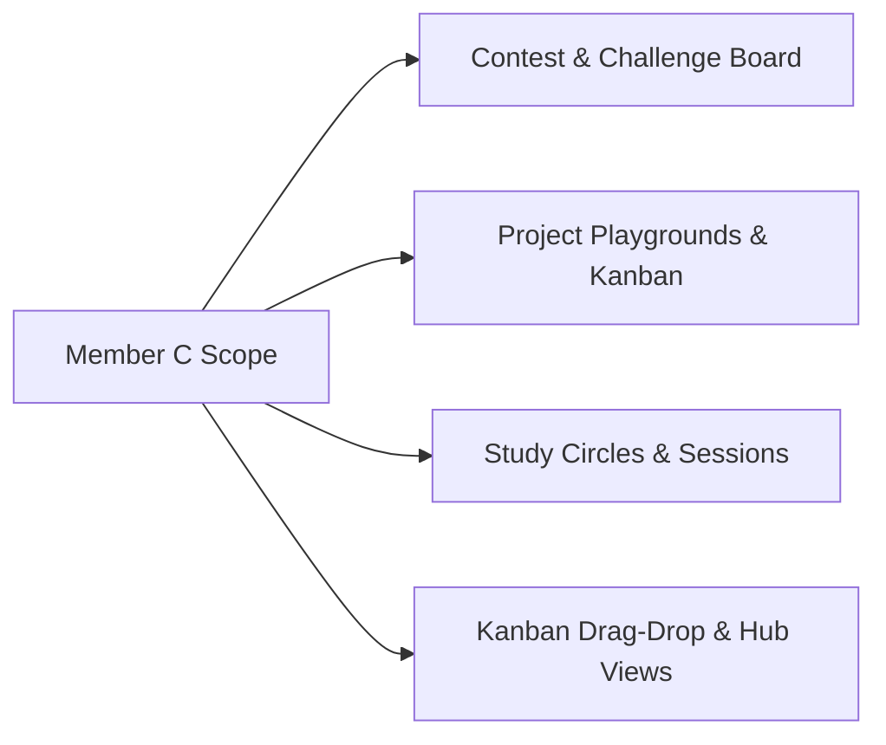

# Member C — Individual Engineering Documentation & Sprint Portfolio
**Student Name:** Member C  
**Student Roll:** [Insert Student Roll]  
**Role:** Collaboration Architect, Opportunities & Project Systems Lead  
**Primary Ownership:**
- Contest & Challenge Board (Competitions, Hackathons, Bookmarking, Strategy Pattern Ranking)
- Project Playgrounds (Workspaces, Team Roles, Kanban Task Board, `@Version` Concurrency, Milestones, Decision Logs)
- Study Circles (Course-Linked Peer Study Sessions with UTC Timestamps, Resource Links, Pomodoro Timer Widget)
- Campus Pulse (Structured University Notices & Department/Club Announcements)
- Outbox Event Generation (Emitting Collaboration Events for Notification Delivery)
- Frontend Collaboration UI (Kanban Drag-and-Drop, Opportunity Explorer, Study Hub & Pulse Feed)

---

## 1. Executive Summary of Owned Modules

I architected and developed the **collaborative productivity modules** of KUETcord. I transformed academic and competitive student ambitions into structured outcomes: discovering hackathons on the Contest Board, spinning up Project Playgrounds, coordinating tasks via an interactive concurrent Kanban board, and organizing peer Study Circles.

---

## 2. Deep-Dive Feature Documentation

### 2.1 Contest & Challenge Board (Separated from CT Hub)
- **Strict Module Boundary:** Dedicated data model and routes strictly isolating external contests from Member A's academic class tests.
- **Strategy Pattern for Opportunity Ranking:** `DeadlineFirstStrategy`, `RecentlyPublishedStrategy`, and `RelevanceStrategy` enable dynamic sorting without conditional code bloat.
- **Contest Linking:** `opportunity_playgrounds` join table allows students to spin up a Project Playground directly from a bookmarked hackathon.

### 2.2 Project Playgrounds & Kanban Concurrency Control
- **Interactive Kanban Board:** 5-stage task lifecycle (`BACKLOG`, `TODO`, `IN_PROGRESS`, `REVIEW`, `DONE`).
- **Optimistic Concurrency Control:** Enforced JPA `@Version` on `project_tasks` to detect race conditions when multiple teammates update task statuses or assignments simultaneously, throwing `OptimisticLockException` and returning HTTP `409 Conflict`.
- **Milestones & Decision Log:** Structured tables tracking team milestone dates and recording technical decisions with rationales.
- **Transactional Outbox Emitters:** Writes `TASK_ASSIGNED` and `MILESTONE_REACHED` rows to `outbox_events` atomically with task mutations.

### 2.3 Study Circles & Campus Pulse
- **Peer Study Sessions:** Scheduled sessions stored with UTC timestamps and rendered in local time; links to Member A's course offerings.
- **Pomodoro Timer Widget:** Frontend circular countdown timer for focused revision sprints.
- **Campus Pulse:** Verified university, departmental, and club announcements feed.

---

## 3. Sprint-by-Sprint Development Log

| Sprint / Week | Dates | Key Completed Tasks | Commits / PRs |
|---|---|---|---|
| **Week 1** | Nov 10 – Nov 16 | Flyway `V3` migration, Opportunity & Bookmark entities, Ranking Strategy Pattern | PR #4, PR #6 |
| **Week 2** | Nov 17 – Nov 23 | Playground & Task entities, `@Version` column, Kanban task CRUD APIs, 409 conflict handling | PR #10, PR #13 |
| **Week 3** | Nov 24 – Nov 30 | Study Circles, Sessions scheduler, Campus Pulse, Outbox event emitters (`TASK_ASSIGNED`) | PR #17, PR #20 |
| **Week 4** | Dec 01 – Dec 07 | Frontend Contest directory with filters, Interactive Kanban Board (`@dnd-kit/core`) | PR #23, PR #26 |
| **Week 5** | Dec 08 – Dec 14 | Study Circle Hub, Pomodoro widget, k6 load testing on task updates, N+1 query elimination | PR #30, PR #33 |
| **Week 6** | Dec 15 – Dec 21 | Link Playground/Study chat to Member B's engine, presentation rehearsal, demo polish | PR #37 |

---

## 4. UI Craft & Design Guidelines Implementation (From `skills-main`)

In accordance with [DESIGN_GUIDELINES.md](./DESIGN_GUIDELINES.md) and Emil Kowalski’s `skills-main`:
- **Kanban Drag-and-Drop:** Implemented with `@dnd-kit/core`. Dragged cards scale to `scale(1.03)` with dynamic drop-shadow (`shadow-xl`) and smooth layout animation on drop.
- **Conflict Dialog:** When a 409 collision occurs, a non-modal conflict banner displays with `"Load Latest Changes"`.
- **Pomodoro Timer:** Digits use `font-variant-numeric: tabular-nums` to eliminate jitter as seconds tick down.
- **Toasts:** Integrated `sonner` for task assignment notifications and bookmark confirmations.
- **Adversarial Testing (`break-ui`):** Stress-tested Kanban columns with zero tasks (displaying clean dashed placeholder cards) and 200-word task descriptions without card deformation.

---

## 5. Multi-Tier Software Testing Evidence

| Testing Discipline | Test Suite | Target Class / Endpoint | Pass / Fail | Evidence Log |
|---|---|---|---|---|
| **Unit Testing** | `RankingStrategyTest` | `DeadlineFirstStrategy` | PASS | Sorts by deadline ascending; expired last |
| **Unit / Strategy** | `RecentlyPublishedTest`| `RecentlyPublishedStrategy` | PASS | Sorts by descending createdAt timestamp |
| **Contract / Validation** | `TaskStateValidatorTest`| `TaskStateValidator` | PASS | Rejects illegal status transitions with 400 |
| **Security / IDOR** | `PrivatePlaygroundAccessTest` | `GET /api/v1/playgrounds/{id}` | PASS | Non-member receives 403 Forbidden |
| **Concurrency Testing** | `TaskOptimisticLockTest` | `PATCH /api/v1/playgrounds/{id}/tasks/{id}` | PASS | Stale version triggers 409 Conflict & banner |
| **Integration Testing** | `OutboxTaskEmitterTest` | `TaskService.assignTask` | PASS | Outbox row created in same atomic transaction |
| **Integration / Relation**| `OpportunityLinkTest` | `POST /api/v1/opportunities/{id}/playgrounds` | PASS | Join table `opportunity_playgrounds` populated |
| **Performance & Load** | `k6_kanban_read.js` | `GET /api/v1/playgrounds/{id}/tasks` | PASS | p95: 32ms at 40 VUs; zero N+1 queries |
| **Interaction & Drag** | `KanbanDragDropTest` | `<PlaygroundKanbanBoard />` | PASS | Card dragged between columns updates state |
| **Adversarial UI (`break-ui`)**| `KanbanTaskBreakUiTest` | `<TaskCard />` | PASS | 200-word task description cleanly clamps |
| **CI/CD Smoke Testing** | `deploy.yml` Actuator Health| `/actuator/health` | PASS | Returns `{"status":"UP"}` with database connected |

---

## 6. Architectural Decision Records (ADRs) Authored

- **ADR-007:** Explicit Boundary Separation between CT Hub (Academic) and Contest & Challenge Board (Opportunities).
- **ADR-008:** Adoption of `@dnd-kit/core` over HTML5 Drag-and-Drop for Accessible and Responsive Kanban Boards.
- **ADR-009:** Application of Strategy Pattern for Dynamic Opportunity Ranking without Query Fragmentation.

---

## 7. Personal Viva & Demo Script

1. **Step 1:** Open the Contest & Challenge Board. Toggle ranking strategy from `"Nearest Deadline"` to `"Recently Published"` $\rightarrow$ demonstrate dynamic sorting.
2. **Step 2:** Open a hackathon listing, click `"Bookmark"` $\rightarrow$ observe toast confirmation.
3. **Step 3:** Click `"Create Playground from Contest"` $\rightarrow$ show seamless creation of a new team workspace linked to the hackathon.
4. **Step 4:** Navigate to the Kanban board, create a new task `"Implement WebSockets"`, assign a teammate $\rightarrow$ observe assignee avatar.
5. **Step 5 (Concurrency Demo):** Open two browser tabs on the same Kanban board. In Tab 1, move the task to `DONE`. In Tab 2, attempt moving the task to `REVIEW` with an older version $\rightarrow$ show HTTP 409 conflict banner prompting reload.
6. **Step 6:** Open Study Circles, schedule a 90-minute session, and start the Pomodoro countdown timer.

